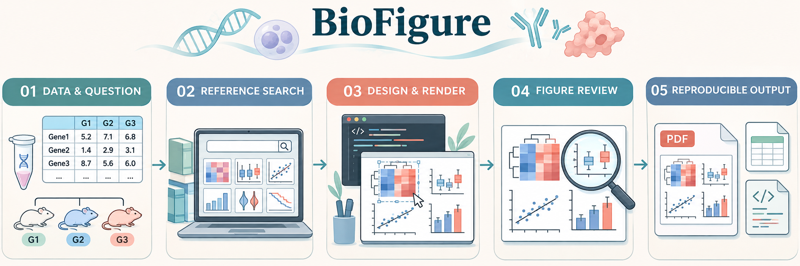
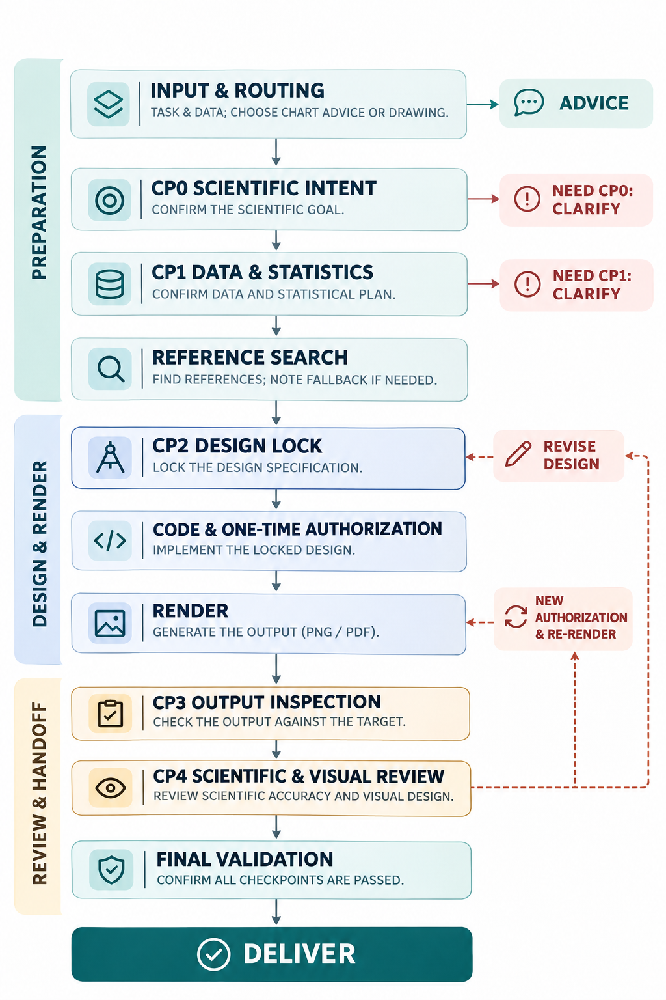
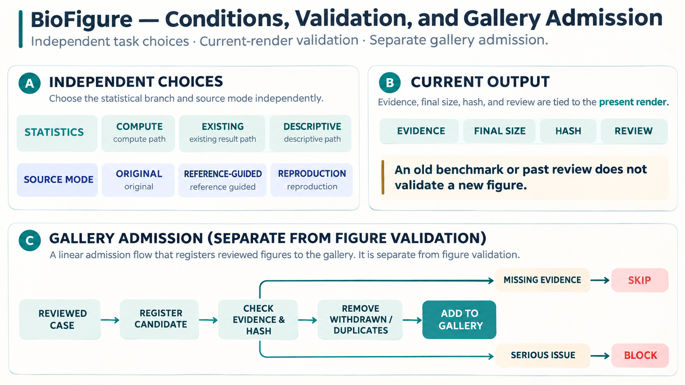
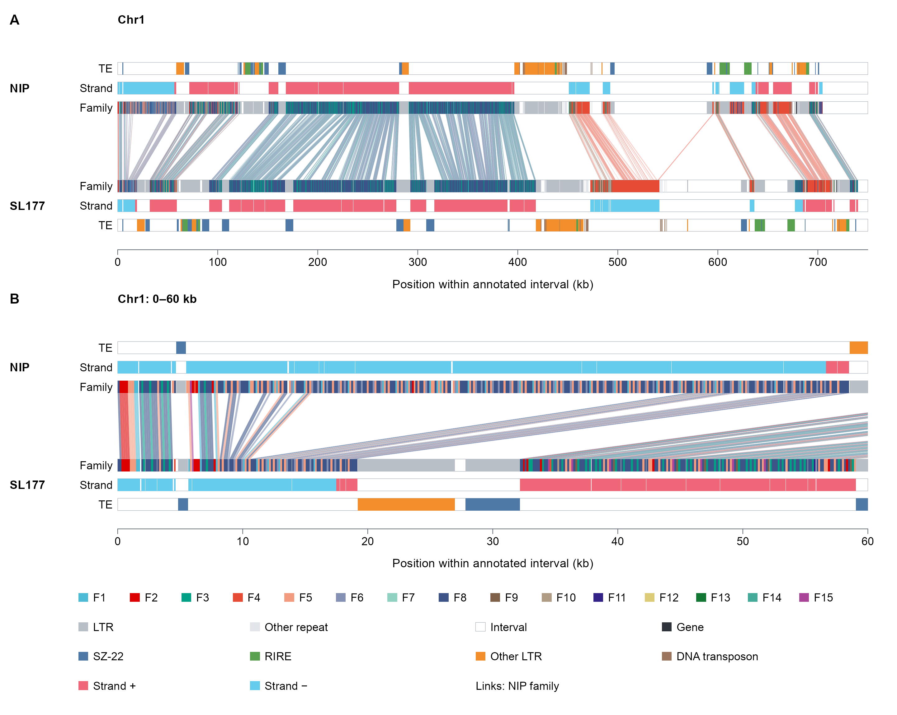
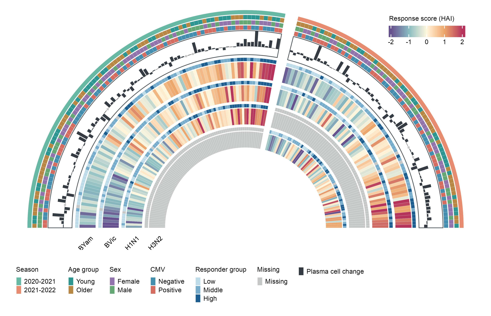
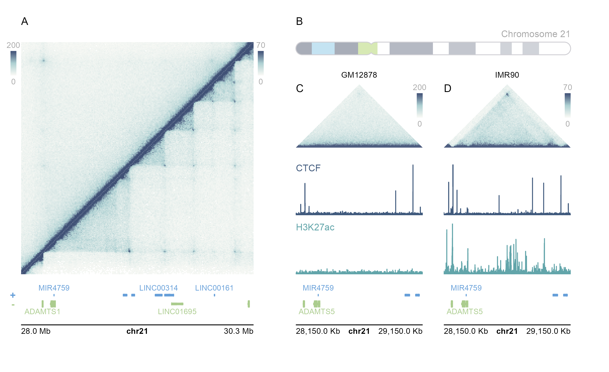

<div align="center">

**English · [中文](README.zh-CN.md)**

# 🎨 BioFigure

**Reference-guided design and quality control for biological figures**

[](biofigure/SKILL.md)
[](biofigure/renderer-registry.yaml)
[](biofigure/renderer-registry.yaml)
[](LICENSE)

[Quick start](#quick-start) · [Personal drawing tools](#personal-drawing-tools-in-development) · [English handbook](docs/HANDBOOK.en.md) · [Design sources](docs/DESIGN-SOURCES.md) · [Online gallery](https://woyekun-cell.github.io/BioFigure/) · [Gallery](docs/GALLERY.md) · [Releases](https://github.com/Woyekun-cell/BioFigure/releases) · [Community](https://github.com/Woyekun-cell/BioFigure/discussions)

</div>

Give BioFigure a data table and the question your figure needs to answer. The Skill helps your coding assistant choose a plot, write the R or Python code, and inspect the exported figure at its final size. You get the plotting data and script alongside the figure so you can change the analysis or layout later.

You can start from your own data, adapt a published design, or reproduce a specific panel. For a reproduction, the assistant checks what the source image, code and data actually support. With a drawing task delegated, it can fix clipped labels or a crowded legend and render again. A missing detail that changes the analysis, such as whether the samples are paired, calls for clarification.

## How BioFigure works





Drawing starts with the research question, data and reference search. After the design is locked, the code and current inputs are bound to a one-time authorization before rendering. If CP3 or CP4 fails, revise, authorize and render again, then review the new output. Delivery follows verification of the checkpoints and evidence. CP4 covers scientific, visual, publication and anti-AI review.



Statistical paths and source modes are chosen independently. Gallery admission separately checks the case evidence, final size and hash, and excludes withdrawn or duplicate entries. A gallery entry does not replace validation of the current figure.

## Explore the gallery

[**Open the interactive BioFigure gallery →**](https://woyekun-cell.github.io/BioFigure/)

Search by plot type or plotting package, inspect a figure at its original size, or put two figures side by side. Each entry links to the code, data and source notes available for that figure.

### Multitrack synteny with a detailed view

Genomic annotation tracks and links bring aligned regions and local detail into one view.



### Semi-circular multitrack heatmap

Sample features, changes and scores share a compact, layered layout.



### Hi-C contact map and multi-omics tracks

A contact matrix, genomic coordinates, signal tracks and gene annotations share a common coordinate system.



[Explore more figures online](https://woyekun-cell.github.io/BioFigure/) · [Browse the curated index](docs/GALLERY.md)

## Quick start

**Environment already configured:** run a box plot with bundled synthetic data from the repository root. The output retains PNG, PDF, statistics, and execution records. Use a fresh directory whenever inputs change.

```bash
Rscript biofigure/scripts/install_public_dependencies.R --check --profile portable
python3 biofigure/scripts/run_public_example.py boxplot --output-dir work/biofigure-first-boxplot
```

Continue after the dependency check reports `READY`. A successful render reports `RENDERED_PENDING_VISUAL_REVIEW`; open the current PNG/PDF to check fonts, final size, labels, and legends. Runtime depends on the local environment and dependencies. First-time users should follow [Installation and use](#installation-and-use).

Other executable examples are `heatmap`, `dense-heatmap`, `bubble`, `volcano`, `synteny`, and `phylogeny`. For real data, tell the coding assistant the experimental units, groups, comparison direction, and intended output:

```text
$biofigure Read expression.csv and metadata.csv and draw a grouped expression heatmap.
Preserve metadata sample order, annotate treatment and time, and review labels and legends.
```

For Python, the [authorized rendering entry point](biofigure/references/python-rendering.md) is `biofigure/scripts/figure_style.py`. It takes a Matplotlib Figure, including one obtained from seaborn or Scanpy, consumes a single-use authorization, and exports PNG/PDF/SVG with a render receipt. Only this Python entry point issues an official render receipt. Both R and Python require a preparation record, CP2 validation and review of the exported figure.

The Python renderer currently excludes rectangular heatmaps that require cell-geometry checks and MathText/TeX. Install the optional Python dependencies when you need them. For seaborn or Scanpy, install the package separately and record its version.

```bash
python3 -m pip install -r biofigure/requirements-python.txt
```

## Personal drawing tools in development

The repository includes a personal gallery website for local deployment. Stars, gallery edits, rendered revisions and preferences stay in the current user's local profile. The public website displays shared examples.

From the repository root, run the commands below and open the printed local URL. You need the Python dependencies and the drawing environment required by the selected figure. In the website, choose a signed-in local CLI or configure an API Key, endpoint and model.

```bash
python3 -m pip install -r biofigure/requirements.txt
python3 biofigure/bin/biofigure gallery-web
```

The default URL is `http://127.0.0.1:18807/BioFigure/`. Select references, ask a question, then execute an approved plan to receive a PNG, PDF, editable scripts and a checks file. Continue editing from that result. With multiple references, choose the figure to modify. Missing source code or data prompts for the required materials. Use `gallery-web --offline` for cached materials, or `--site` for an existing local example directory.

Connection settings support Codex, Claude Code, Gemini CLI, OpenCode, CodeBuddy CLI, and OpenAI-compatible, Anthropic or Gemini APIs. Local CLIs can use their configured default models; API connections use the model you enter. Keys stay in a local profile file with mode `0600`; the browser only receives a saved-key indicator. WorkBuddy desktop installation is checked separately from a working CodeBuddy CLI. API rendering requires macOS `sandbox-exec` or Linux `bwrap` to run scripts; a missing runtime is reported.

Each profile keeps its own local example snapshot. Later starts use that snapshot. Use `--refresh-examples` to update it explicitly. Set `BIOFIGURE_PERSONAL_DB` to keep separate catalogues, preferences and output folders for different deployments. The server listens on loopback only. See the [personal gallery guide](biofigure/references/personal-gallery.md).

### Draw from your own references

Pick as many references as you like and describe the part you want to borrow. For example, “Use the panels from the first figure and overlay the individual points the way the second one does.” With no references selected, the assistant searches by research question and opens the figures and scripts it needs. You can import your own images, star a reference and tag what you like about it. Finished plots stay in the project directory unless you ask to save one to your personal gallery.

For each plot family, BioFigure remembers how prominently you like the raw points to show, whether you use a grid, and where you put the legend. It looks at the last five distinct tasks with evidence for that setting. Three explicit requests for the same choice, or four tasks supporting it, make it the default for the next figure in that family, without a confirmation prompt. Revisions to one figure count once. Templates, journal rules and inherited defaults are excluded. You can set fonts, dimensions and group colors for a particular project. If the data call for a different design, the assistant explains why.

### Reuse a technique on a new dataset

Hosts that support background tasks can ask a feedback agent to review new references and corrections. It reads the figure and any available plotting code, identifies the fields each layer needs, then tries the technique on fresh data. A workflow that holds up on independent tasks can be reviewed for inclusion as a reusable Skill.

In a simulated time course, the agent borrowed layers from a longitudinal plot and a distribution plot. The new dataset had 86 observations from 18 individuals. Connecting only consecutive visits for the same individual produced 64 line segments, with breaks at missed visits. When the same 86 values were assigned to independent samples at each visit, the plot had zero individual segments. Group means and interquartile ranges stayed the same.

### Use the same gallery across agents

The repository includes a small CLI. On one machine, different hosts can share a SQLite index of personal references and preferences. Codex has been tested for Skill discovery, and OpenCode has called the CLI through its shell. Claude Code setup is documented and awaits a live test. You can use the CLI to look up a preference, combine references or preview a time course. Adding it to your PATH is optional.

The browser editor lets you adjust the canvas and margins, and change colors or text in SVGs with editable elements. The semicircular heatmap has a dedicated editor where you can load your own data, adjust tracks, and save a project to revisit later.

## Gallery by plot type

On November 19, 2026, the [online gallery](https://woyekun-cell.github.io/BioFigure/) listed 367 distinct figures in 20 categories. A figure can appear under several filters.

| Category | Figures | Category | Figures |
|---|---:|---|---:|
| Heatmaps & matrices | 58 | Sets & intersections | 9 |
| Scatter & embeddings | 50 | Trajectories & time | 32 |
| Distributions & box plots | 44 | Correlation & regression | 17 |
| Bars & dot plots | 40 | Clinical & forest | 16 |
| Differential & enrichment | 24 | Composition & hierarchy | 34 |
| Networks & chords | 23 | Phylogenetic trees | 14 |
| Sankey & flows | 7 | Multi-panel | 94 |
| Genomes & tracks | 52 | Mechanisms & structures | 2 |
| Maps | 29 | Anatomy & organs | 1 |
| Circular & radar | 37 | Curves & response profiles | 3 |

[Browse the online gallery](https://woyekun-cell.github.io/BioFigure/) · [View the curated repository index](docs/GALLERY.md)

## Research areas and plot types

| Research area | Plotting tasks |
|---|---|
| Transcriptomics and proteomics | Expression and differential heatmaps, volcano plots, grouped expression, enrichment, correlation matrices |
| Metabolomics and multi-omics | PCA, abundance distributions, cross-omics associations, annotated heatmaps, networks |
| Single-cell and spatial omics | Embeddings, marker dot plots, cell composition, spatial expression, faceted comparisons |
| Epigenomics and chromatin | ATAC/ChIP profiles, signal heatmaps, regions and genomic tracks |
| Genomics and comparative genomics | Chromosome and interval distributions, synteny, circular links, phylogenies with aligned annotations |
| Microbiology and ecology | Community composition, ordination, phylogenies, abundance and environmental associations |
| Clinical and experimental biology | Survival curves, forest plots, patient swimmers, time courses, group comparisons, model evaluation |
| Integrated figures | Multi-panel figures, imaging plates, evidence annotations |

Start with your analysis results, choose a figure around the question and data structure, then prepare the relevant packages and plotting parameters.

## Methods and quality checks

R is the default. BioFigure uses ggplot2 for general statistics, ComplexHeatmap for annotated matrices, circlize for circular tracks, ggtree for phylogenies, gggenomes for genomic tracks and synteny, and patchwork or cowplot for panel assembly. Python is available when requested, when a project already uses a Python-native workflow, or when R lacks a suitable tool.

Before plotting, the assistant checks the experimental units, groups, pairing, comparison direction, coordinates and data transformations. Any P value or adjusted P value shown in the figure should trace back to a results table. Existing analysis tables can be used directly.

After rendering, it checks fonts, labels, legends, panel alignment and group colors at the intended size, looking for overlap and clipping. Each revision gets a fresh review. The deliverables include plotting code, data and relevant environment details. Case records retain layout decisions and known problems.

## Installation and use

Place the complete `biofigure` folder in the project's `.agents/skills/` directory or your personal `~/.agents/skills/` directory. Keep scripts, configuration, examples and licenses together. Ordinary original figures do not require the parent repository or the author's private source archive.

```bash
python3 -m venv .venv
source .venv/bin/activate
python3 -m pip install -r biofigure/requirements.txt
Rscript biofigure/scripts/install_public_dependencies.R --check --profile portable
python3 biofigure/scripts/audit_portable_install.py --dry-fresh-install --output work/portable-install-audit.json
```

`--check` is read-only. To install the free R dependencies, explicitly select a separate library. Missing CRAN packages are installed as needed; ComplexHeatmap uses BiocManager, without upgrading existing packages:

```bash
Rscript biofigure/scripts/install_public_dependencies.R --install --library work/R-library --profile portable
```

<details>
<summary>Dependency versions, fonts and platforms</summary>

This exact-version requirement applies to the `portable` / `all-public` profiles in `install_public_dependencies.R`, rather than every R renderer. Other R tasks still require checks for their selected packages, fonts, and devices.

The default `portable` profile covers the seven new synthetic examples and OncoPrint. Its dependencies are ggplot2, ragg, systemfonts, jsonlite, yaml, digest, ComplexHeatmap, circlize, ape, ggrepel, scales and stringi. R and top-level package versions must match the [version lock](biofigure/static/core/public-runtime-versions.tsv): R 4.6.1 and Bioconductor 3.23. Mismatches return `NEEDS_R_VERSION` or `NEEDS_PACKAGE_VERSIONS`. Explicit installation obtains the selected versions from official CRAN/Bioconductor sources without upgrading unrelated existing packages. External packages retain their licenses; see the [Bioconductor installation instructions](https://www.bioconductor.org/install/). Fonts are not bundled. Current demonstrations require Arial and return `NEEDS_FONT` when it is missing. `--font Helvetica` checks that exact alternative family; changing a figure font still requires updating its specification and reviewing the new output. Execution has been tested on macOS; Linux and Windows runtime, font and device acceptance remain unverified. A fresh Python environment still uses existing R packages and system Arial; this is not a fresh operating-system installation test. PDF export additionally requires free Ghostscript for font embedding; it resolves an explicit `R_GSCMD` path or `gs`, `gswin64c` and `gswin32c`. This script never installs system software. On macOS use `brew install ghostscript`, or obtain it from [Ghostscript](https://www.ghostscript.com/releases/gsdnld.html). PNG-only checks use `Rscript biofigure/scripts/install_public_dependencies.R --check --formats png` and do not require Ghostscript.

</details>

Run a built-in plotting example:

```bash
python3 biofigure/scripts/run_public_example.py boxplot --output-dir work/boxplot-new
python3 biofigure/scripts/run_public_example.py heatmap --output-dir work/heatmap-new --formats png
```

PNG and PDF are the defaults; `--formats png` exports PNG only. Use a new or empty output directory. Set `R_LIBS_USER` to a separately installed R library when needed. Other cases are dense-heatmap, bubble, volcano, synteny and phylogeny. Each keeps its synthetic-data label, inputs, code, statistical or coordinate semantics, and scope boundaries.

For real data, state the research question, experimental unit, groups, comparison direction and pairing, for example:

```text
$biofigure Read expression.csv and metadata.csv and draw a grouped expression heatmap.
Preserve metadata sample order, annotate treatment and time, and review labels and legends.

$biofigure Draw a volcano plot from differential.csv using log2FC and -log10(padj).
The comparison is treatment versus control. Label specified genes; export PNG and PDF.
```

See the [English handbook](docs/HANDBOOK.en.md) for fuller design and export guidance.

## Validation and scope

Scientific and visual gates remain required: confirm experimental and statistical units, inspect data, lock the design, and review the actual output. Re-rendered figures require fresh review. Automated checks assess rules, files, and execution evidence; they neither replace inspection nor establish a general aesthetic score.

| Validation scope | Supported conclusion |
|---|---|
| Fixed cases | Applies only to the bound inputs, code, environment, and output; consult each case's status |
| New data | Recheck design, input, statistics, preparation, CP2, authorization, and the current figure; prior PASS does not transfer |
| Other platforms | Different operating systems, R/package versions, fonts, and devices require fresh execution and inspection; see the [platform record](docs/PLATFORM-VALIDATION.md) |
| Full V2 benchmark | Incomplete; method coverage, gallery inclusion, and public packaging tests do not establish full qualification |

## Cases and validation records

<details>
<summary>Public cases, sources, dependencies and validation records</summary>


For all 13 cases, explicitly select `all-public`. It installs the specialist packages and verifies the fixed HiCExperiment/HiContacts source archives by commit and SHA256, then records hashes of the installed package files. A matching package name/version alone is not source-pin evidence.

```bash
Rscript biofigure/scripts/install_public_dependencies.R --install --library work/R-library --profile all-public
Rscript biofigure/scripts/install_public_dependencies.R --check --library work/R-library --profile all-public
```

Use the same library when rendering: in a macOS shell, `export R_LIBS_USER="$PWD/work/R-library"`; in Windows PowerShell, `$env:R_LIBS_USER=(Resolve-Path "work/R-library").Path`. Both systems use the same exact-font PDF/Ghostscript interface, with no Quartz-only public runtime. PDF requires Ghostscript 10; retained cases also need Poppler `pdftoppm` for PDF inspection. On macOS, use `brew install ghostscript poppler`; see the [platform-validation guide](docs/PLATFORM-VALIDATION.md) for Windows tooling. Fonts must already be installed lawfully and are not bundled. Cross-platform acceptance depends on actual CI runs and inspection of the exported figures; setup success alone is not output acceptance.

Version 3.8.0 separates the searchable learning catalog from public executable cases. The 454 learning records retain sources, methods, historical defects and qualification boundaries. Unshipped source material is reported as `source-materials-unavailable`: it is not advertised as executable and does not block an ordinary original figure. Explicit source adoption or reproduction still requires the relevant source image, code, inputs and fresh CP2 binding.

The [public case manifest](biofigure/public-cases.json) lists 13 executable entries: seven entirely first-party synthetic examples, plus two Cannabis cases, Planarian, OHCA, Sankey and OncoPrint. OncoPrint preserves all 144 synthetic samples and 12 genes in three consecutive 48-column native blocks, with measured 2.1×2.1 mm square cells; its current fixed-input macOS execution and exported outputs were reviewed afresh. It binds code, input, provenance, licenses and SHA256. OHCA requires a SHA-pinned processed RDS; Cannabis requires pinned BUSCOplot source or a verified source cache. Network and external R dependencies are declared. Complete entrypoints do not certify arbitrary new data, another platform, full original-paper figures, or current visual acceptance.

The `portable` profile does not install specialist dependencies for retained cases; explicitly select `all-public` for them. The Cannabis cases also need packages including cowplot, magick and svglite; their entrypoints acquire and verify [pinned BUSCOplot source](https://github.com/knausb/BUSCOplot/tree/d4f793988ce89279cf44294ceb8017756e181b0b), or accept a verified source cache. Planarian additionally needs data.table and svglite; Sankey additionally needs ggalluvial, cowplot and svglite. Each case's script or execution configuration is the complete dependency authority. OHCA requires an existing R library containing [pinned HiContacts source](https://github.com/js2264/HiContacts/tree/dfb588e11e0a76e3f68ba0ed2fca7633848c8d0d), [pinned HiCExperiment source](https://github.com/js2264/HiCExperiment/tree/0f56f30b12466fd79f3500ebd0e4d7c8aa64a59a), InteractionSet, GenomeInfoDb, S4Vectors, rhdf5, Rhdf5lib, ggrastr, svglite and common plotting packages. Its [execution configuration](biofigure/examples/genomics-gallery-20261011/ohca-microc/data/metadata/execution-config.json) records package and input locks. [Bioconductor installation guidance](https://www.bioconductor.org/install/) can help prepare dependencies; the public entrypoint does not install them. Current Bioconductor releases are not the pinned commits and are not a compatibility guarantee for this adapter.

The two DPM cases remain reference-only, with first-party adapters and the [original paper](https://www.nature.com/articles/s41467-024-49986-4). Their separate GitHub input repository provides no explicit redistribution license. This release removes the derived CSV, PNG and PDF files rather than treating the article's CC-BY license as permission for that repository. Earlier Git history may still contain those files; the [withdrawal manifest](docs/gallery/rights-exclusions-3.8.0.json) records exact paths and hashes.

The portable audit checks the complete distribution, declared runtime materials, hashes, path containment, license declarations, and a Skill-only copy. It does not execute R or award scientific, source-fidelity or visual PASS. Actual figures still require applicable analysis, CP2, single-use authorization, output checks, and final-size PNG/PDF review. The full V2 scientific benchmark remains incomplete; historical PASS does not transfer to new data or environments.

```bash
python3 biofigure/scripts/audit_portable_install.py --distribution-root . --output work/release-audit.json
python3 tools/build_gallery.py --check
```

The Skill supplies methods and checks. It does not change model parameters or guarantee equivalent results across models or reasoning settings.

</details>

## Versions and history

- [Releases: download named versions](https://github.com/Woyekun-cell/BioFigure/releases)
- [Current 3.8.0 code and public cases](https://github.com/Woyekun-cell/BioFigure/tree/main)
- [v3.7.1 historical update](https://github.com/Woyekun-cell/BioFigure/tree/v3.7.1) · [Pre-refresh snapshot](https://github.com/Woyekun-cell/BioFigure/tree/snapshot-20261011-pre-gallery-refresh)
- [v3.5.1 release notes](docs/RELEASE-NOTES-3.5.1.md) · [v3.5.0 release notes](docs/RELEASE-NOTES-3.5.0.md)
- [Complete commit history](https://github.com/Woyekun-cell/BioFigure/commits/main/): inspect each change and its contemporary files.

`main` contains current code. Version tags remain attached to their release commits so earlier versions can be downloaded and compared.

## Sources and feedback

Find the ideas and methods behind the figures in [design sources](docs/DESIGN-SOURCES.md) and [NOTICE](NOTICE.md). Gallery cases link to code, data and sources—follow the workflow, then adapt it to your own data.

Use [Discussions](https://github.com/Woyekun-cell/BioFigure/discussions) for figure ideas, references, and design feedback. Report reproducible problems through [Issues](https://github.com/Woyekun-cell/BioFigure/issues/new/choose), including data structure, code, package versions, and output. See the [contribution guide](CONTRIBUTING.md).


