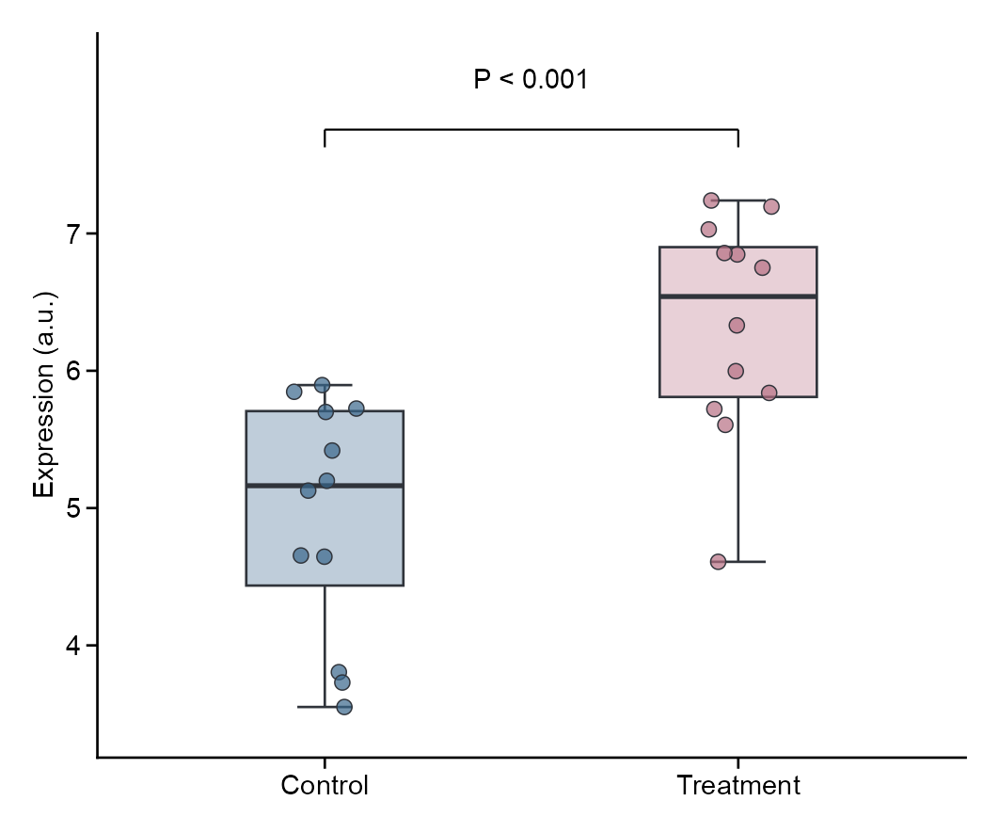
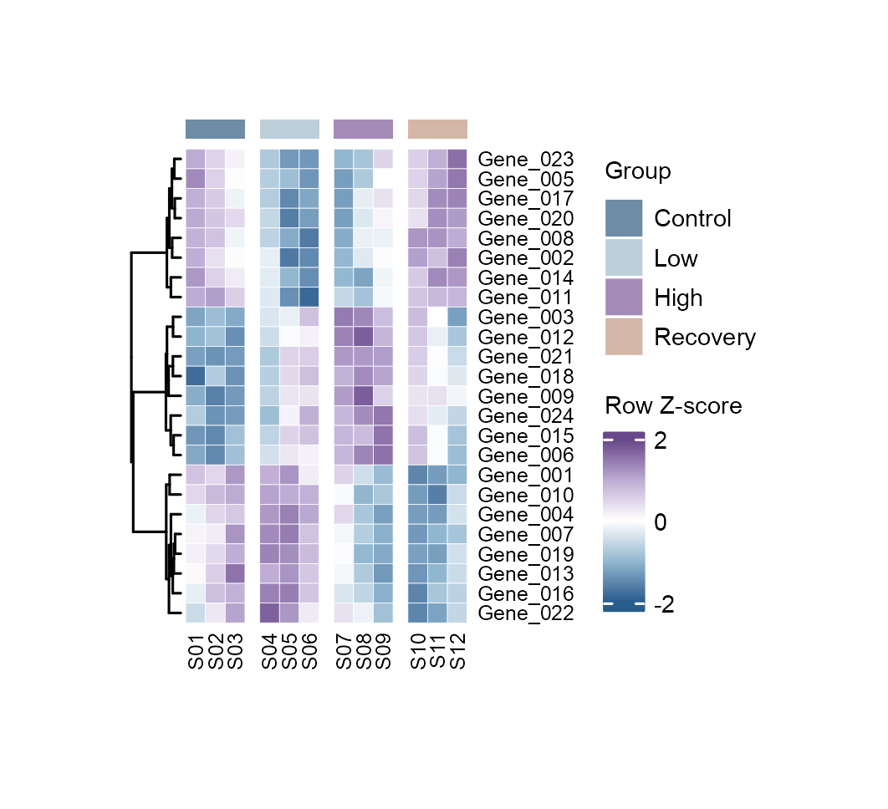
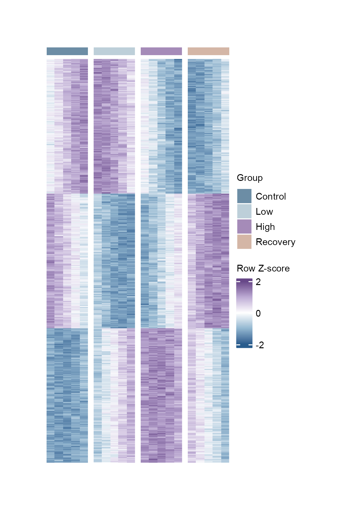
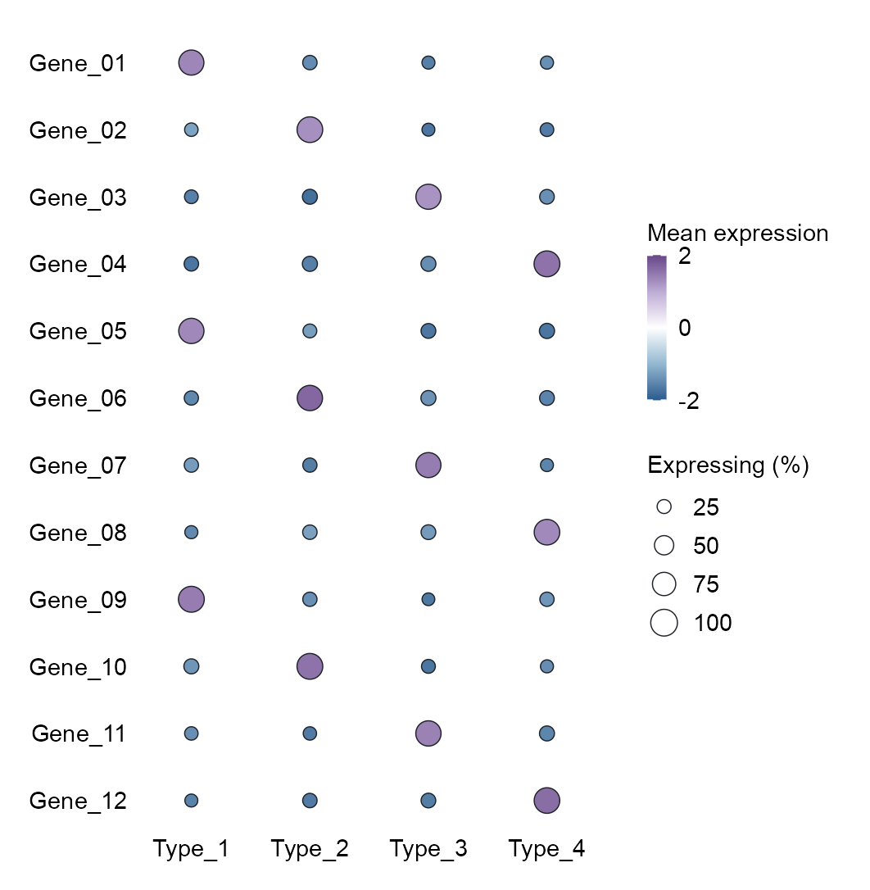
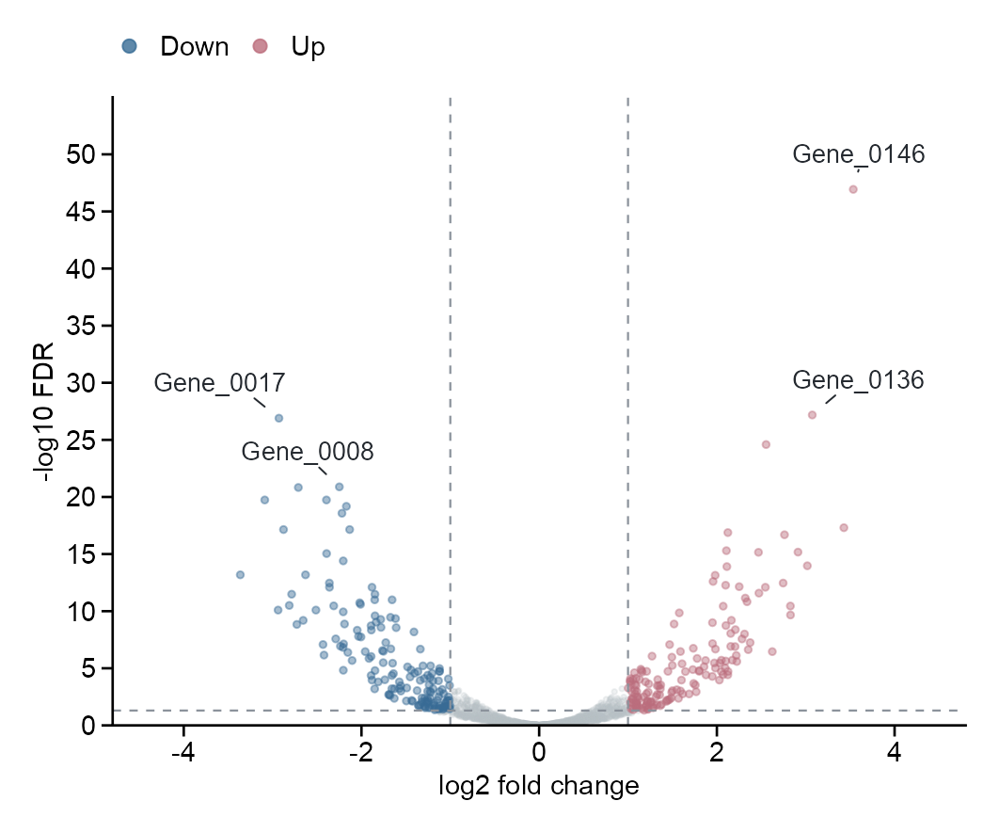
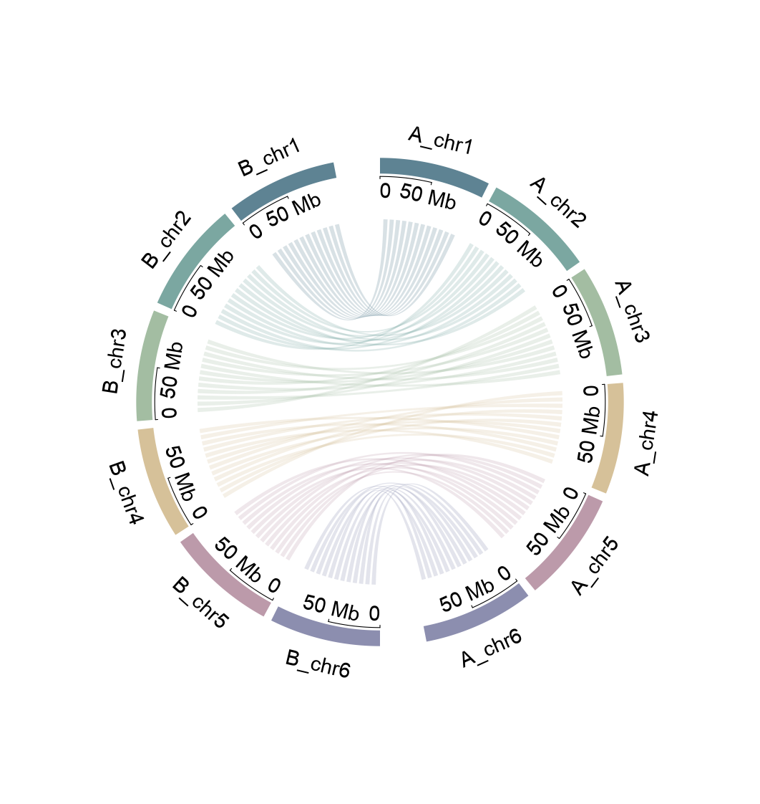
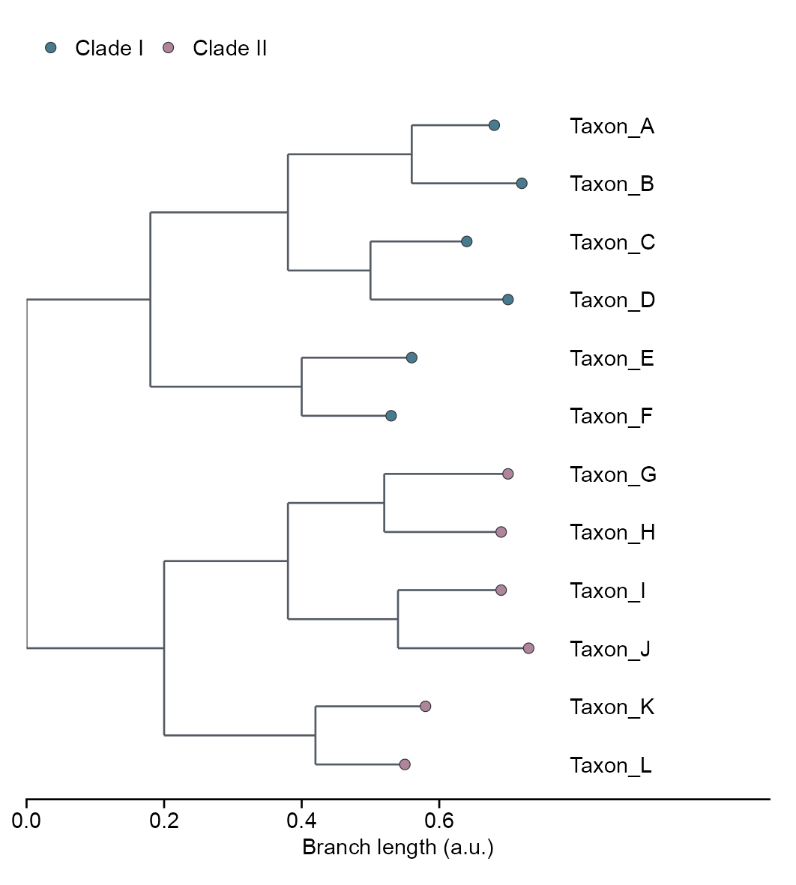

<div align="center">

**[中文](README.md) · English**

# BioFigure

**Reference-guided design and quality control for biological figures**

[](biofigure/SKILL.md)
[](biofigure/renderer-registry.yaml)
[](biofigure/renderer-registry.yaml)
[](LICENSE)

[English handbook](docs/HANDBOOK.en.md) · [Design sources](docs/DESIGN-SOURCES.md) · [Gallery](docs/GALLERY.md) · [Releases](https://github.com/Woyekun-cell/BioFigure/releases) · [Community](https://github.com/Woyekun-cell/BioFigure/discussions)

</div>

BioFigure supports figure design across multi-omics and biomedical research, from checking data structures and selecting plot types to writing R/Python code, arranging panels, and reviewing rendered output. It is a Skill for coding assistants that connects research questions to suitable plotting methods while retaining editable code and plot data.

R is the default backend. Dedicated packages handle annotated matrices, circular tracks, phylogenies, genomic coordinates, and panel assembly. Native AnnData and Scanpy workflows can remain in Python. The workflow preserves scientific meaning while giving labels, colors, legends, and panels a clear layout.

## Research areas and plot types

| Research area | Plotting tasks |
|---|---|
| Transcriptomics and proteomics | Expression and differential heatmaps, volcano plots, grouped expression, enrichment, correlation matrices |
| Metabolomics and multi-omics | PCA, abundance distributions, cross-omics associations, annotated heatmaps, networks |
| Single-cell and spatial omics | Embeddings, marker dot plots, cell composition, spatial expression, faceted comparisons |
| Epigenomics and chromatin | ATAC/ChIP profiles, signal heatmaps, regions and genomic tracks |
| Genomics and comparative genomics | Chromosome and interval distributions, synteny, circular links, phylogenies with aligned annotations |
| Microbiology and ecology | Community composition, ordination, phylogenies, abundance and environmental associations |
| Clinical and experimental biology | Survival curves, forest plots, patient swimmers, time courses, group comparisons, model evaluation |
| Integrated figures | Multi-panel figures, imaging plates, evidence annotations |

These are areas covered by the method library and routing rules. Individual tasks depend on available data, dependencies, and method validation status. Existing analysis results can be plotted directly; unavailable upstream analyses are not treated as completed.

## Gallery by plot type

The gallery selects **77 figures in 14 categories**. Each visual subtype appears once; color-only, dataset-only and historical variants are omitted.

Each figure states whether it uses simulated, public or package-example data. Inclusion does not certify reproduction of original research findings or complete acceptance testing.

| Category | Figures |
|---|---:|
| [Heatmaps](docs/gallery/heatmaps.md) | 6 |
| [Distributions](docs/gallery/distributions.md) | 5 |
| [Correlations and scatter plots](docs/gallery/correlations.md) | 6 |
| [Composition and flows](docs/gallery/composition.md) | 7 |
| [Bars and lollipops](docs/gallery/bars.md) | 6 |
| [Radar plots](docs/gallery/radar.md) | 2 |
| [Differential expression](docs/gallery/differential.md) | 6 |
| [Embeddings and spatial plots](docs/gallery/embeddings.md) | 6 |
| [Clinical plots](docs/gallery/clinical.md) | 7 |
| [Genomes and phylogeny](docs/gallery/genomes.md) | 11 |
| [Networks and maps](docs/gallery/networks.md) | 5 |
| [Time courses and profiles](docs/gallery/profiles.md) | 5 |
| [Set intersections](docs/gallery/intersections.md) | 2 |
| [Mechanisms and panels](docs/gallery/multipanel.md) | 3 |

See the [complete gallery index](docs/GALLERY.md) and [per-figure inventory](docs/gallery/catalog.csv). Composite figures appear in one primary category.

## Portable examples

Seven first-party synthetic examples bundle the current PNG/PDF, input, metadata and provenance. Simulation and interpretation limits are recorded outside the figures. These examples do not certify new inputs or another platform.

[Shared rendering code](biofigure/examples/portable/render.R) · [Input generator](biofigure/examples/portable/generate_inputs.py)

### Grouped box plot



[PDF](biofigure/examples/portable/boxplot/figures/boxplot.pdf) · [Data](biofigure/examples/portable/boxplot/data.csv) · [Metadata](biofigure/examples/portable/boxplot/metadata.json) · [Provenance](biofigure/examples/portable/boxplot/provenance.json) · [Code](biofigure/examples/portable/render.R)

### Square-cell heatmap



[PDF](biofigure/examples/portable/heatmap/figures/heatmap.pdf) · [Data](biofigure/examples/portable/heatmap/data.csv) · [Metadata](biofigure/examples/portable/heatmap/metadata.json) · [Provenance](biofigure/examples/portable/heatmap/provenance.json) · [Code](biofigure/examples/portable/render.R)

### Dense matrix overview



[PDF](biofigure/examples/portable/dense-heatmap/figures/dense-heatmap.pdf) · [Data](biofigure/examples/portable/dense-heatmap/data.csv) · [Metadata](biofigure/examples/portable/dense-heatmap/metadata.json) · [Provenance](biofigure/examples/portable/dense-heatmap/provenance.json) · [Code](biofigure/examples/portable/render.R)

### Bubble plot



[PDF](biofigure/examples/portable/bubble/figures/bubble.pdf) · [Data](biofigure/examples/portable/bubble/data.csv) · [Metadata](biofigure/examples/portable/bubble/metadata.json) · [Provenance](biofigure/examples/portable/bubble/provenance.json) · [Code](biofigure/examples/portable/render.R)

### Volcano plot



[PDF](biofigure/examples/portable/volcano/figures/volcano.pdf) · [Data](biofigure/examples/portable/volcano/data.csv) · [Metadata](biofigure/examples/portable/volcano/metadata.json) · [Provenance](biofigure/examples/portable/volcano/provenance.json) · [Code](biofigure/examples/portable/render.R)

### Synteny plot



[PDF](biofigure/examples/portable/synteny/figures/synteny.pdf) · [Data](biofigure/examples/portable/synteny/data.csv) · [Metadata](biofigure/examples/portable/synteny/metadata.json) · [Provenance](biofigure/examples/portable/synteny/provenance.json) · [Code](biofigure/examples/portable/render.R)

### Phylogenetic tree



[PDF](biofigure/examples/portable/phylogeny/figures/phylogeny.pdf) · [Data](biofigure/examples/portable/phylogeny/data.csv) · [Metadata](biofigure/examples/portable/phylogeny/metadata.json) · [Provenance](biofigure/examples/portable/phylogeny/provenance.json) · [Code](biofigure/examples/portable/render.R)

## Methods and quality checks

**Choose packages by task.** Use ggplot2 for general statistics, ComplexHeatmap for annotated matrices, circlize for circular coordinates, ggtree for phylogenies, gggenomes for genomic tracks and synteny, and patchwork or cowplot for panel assembly. Select the package and key functions before coding.

**Check scientific meaning first.** Confirm experimental units, groups, pairing, comparison direction, transformations, and coordinates. Resolve material ambiguities instead of guessing statistical tests or inventing measurements.

**Review the rendered figure.** Check fonts and final dimensions, reserve space for labels and legends, and inspect overlap, clipping, color semantics, and required annotations. Recheck revised outputs; successful execution alone does not establish visual quality.

**Keep work reproducible.** Deliver plotting code, data, and essential environment information. Method records retain package usage, layout decisions, and known problems to support new datasets.

## Installation and use

Place the complete `biofigure` folder in the project's `.agents/skills/` directory or your personal `~/.agents/skills/` directory. Keep scripts, configuration, examples and licenses together. Ordinary original figures do not require the parent repository or the author's private source archive.

```bash
python3 -m pip install -r biofigure/requirements.txt
Rscript biofigure/scripts/install_public_dependencies.R --check --profile portable
python3 biofigure/scripts/audit_portable_install.py --dry-fresh-install --output work/portable-install-audit.json
```

`--check` is read-only. To install the free R dependencies, explicitly select a separate library. Missing CRAN packages are installed as needed; ComplexHeatmap uses BiocManager, without upgrading existing packages:

```bash
Rscript biofigure/scripts/install_public_dependencies.R --install --library work/R-library --profile portable
```

The default `portable` profile covers the seven new synthetic examples and OncoPrint. Its dependencies are ggplot2, ragg, systemfonts, jsonlite, yaml, digest, ComplexHeatmap, circlize, ape, ggrepel, scales and stringi. R and top-level package versions must match the [version lock](biofigure/static/core/public-runtime-versions.tsv): R 4.6.1 and Bioconductor 3.23. Mismatches return `NEEDS_R_VERSION` or `NEEDS_PACKAGE_VERSIONS`. Explicit installation obtains the selected versions from official CRAN/Bioconductor sources without upgrading unrelated existing packages. External packages retain their licenses; see the [Bioconductor installation instructions](https://www.bioconductor.org/install/). Fonts are not bundled. Current demonstrations require Arial and return `NEEDS_FONT` when it is missing. `--font Helvetica` checks that exact alternative family; changing a figure font still requires updating its specification and reviewing the new output. Execution has been tested on macOS; Linux and Windows runtime, font and device acceptance remain unverified. A fresh Python environment still uses existing R packages and system Arial; this is not a fresh operating-system installation test. PDF export additionally requires the free Ghostscript `gs` executable for font embedding. This script never installs system software. On macOS use `brew install ghostscript`, or obtain it from [Ghostscript](https://www.ghostscript.com/releases/gsdnld.html). PNG-only checks use `Rscript biofigure/scripts/install_public_dependencies.R --check --formats png` and do not require Ghostscript.

Run a first-party synthetic example:

```bash
python3 biofigure/scripts/run_public_example.py boxplot --output-dir work/boxplot-new
python3 biofigure/scripts/run_public_example.py heatmap --output-dir work/heatmap-new --formats png
```

PNG and PDF are the defaults; `--formats png` exports PNG only. Use a new or empty output directory. Set `R_LIBS_USER` to a separately installed R library when needed. Other cases are dense-heatmap, bubble, volcano, synteny and phylogeny. Each keeps its synthetic-data label, inputs, code, statistical or coordinate semantics, and scope boundaries.

For real data, state the research question, experimental unit, groups, comparison direction and pairing, for example:

```text
$biofigure Read expression.csv and metadata.csv and draw a grouped expression heatmap.
Preserve metadata sample order, annotate treatment and time, and review labels and legends.

$biofigure Draw a volcano plot from differential.csv using log2FC and -log10(padj).
The comparison is treatment versus control. Label specified genes; export PNG and PDF.
```

See the [English handbook](docs/HANDBOOK.en.md) for fuller design and export guidance.

## Validation and scope


For all 13 cases, explicitly select `all-public`. It installs the specialist packages and verifies the fixed HiCExperiment/HiContacts source archives by commit and SHA256, then records hashes of the installed package files. A matching package name/version alone is not source-pin evidence.

```bash
Rscript biofigure/scripts/install_public_dependencies.R --install --library work/R-library --profile all-public
Rscript biofigure/scripts/install_public_dependencies.R --check --library work/R-library --profile all-public
```

Use the same library when rendering: in a macOS shell, `export R_LIBS_USER="$PWD/work/R-library"`; in Windows PowerShell, `$env:R_LIBS_USER=(Resolve-Path "work/R-library").Path`. Both systems use the same exact-font PDF/Ghostscript interface, with no Quartz-only public runtime. PDF requires Ghostscript 10; retained cases also need Poppler `pdftoppm` for PDF inspection. On macOS, use `brew install ghostscript poppler`; see the [platform-validation guide](docs/PLATFORM-VALIDATION.md) for Windows tooling. Fonts must already be installed lawfully and are not bundled. Cross-platform acceptance depends on actual CI runs and inspection of the exported figures; setup success alone is not output acceptance.

Version 3.8.0 separates the searchable learning catalog from public executable cases. The 454 learning records retain sources, methods, historical defects and qualification boundaries. Unshipped source material is reported as `source-materials-unavailable`: it is not advertised as executable and does not block an ordinary original figure. Explicit source adoption or reproduction still requires the relevant source image, code, inputs and fresh CP2 binding.

The [public case manifest](biofigure/public-cases.json) lists 13 executable entries: seven entirely first-party synthetic examples, plus two Cannabis cases, Planarian, OHCA, Sankey and OncoPrint. OncoPrint preserves all 144 synthetic samples and 12 genes in three consecutive 48-column native blocks, with measured 2.1×2.1 mm square cells; its current fixed-input macOS execution and exported outputs were reviewed afresh. It binds code, input, provenance, licenses and SHA256. OHCA requires a SHA-pinned processed RDS; Cannabis requires pinned BUSCOplot source or a verified source cache. Network and external R dependencies are declared. Complete entrypoints do not certify arbitrary new data, another platform, full original-paper figures, or current visual acceptance.

The `portable` profile does not install specialist dependencies for retained cases; explicitly select `all-public` for them. The Cannabis cases also need packages including cowplot, magick and svglite; their entrypoints acquire and verify [pinned BUSCOplot source](https://github.com/knausb/BUSCOplot/tree/d4f793988ce89279cf44294ceb8017756e181b0b), or accept a verified source cache. Planarian additionally needs data.table and svglite; Sankey additionally needs ggalluvial, cowplot and svglite. Each case's script or execution configuration is the complete dependency authority. OHCA requires an existing R library containing [pinned HiContacts source](https://github.com/js2264/HiContacts/tree/dfb588e11e0a76e3f68ba0ed2fca7633848c8d0d), [pinned HiCExperiment source](https://github.com/js2264/HiCExperiment/tree/0f56f30b12466fd79f3500ebd0e4d7c8aa64a59a), InteractionSet, GenomeInfoDb, S4Vectors, rhdf5, Rhdf5lib, ggrastr, svglite and common plotting packages. Its [execution configuration](biofigure/examples/genomics-gallery-20261011/ohca-microc/data/metadata/execution-config.json) records package and input locks. [Bioconductor installation guidance](https://www.bioconductor.org/install/) can help prepare dependencies; the public entrypoint does not install them. Current Bioconductor releases are not the pinned commits and are not a compatibility guarantee for this adapter.

The two DPM cases remain reference-only, with first-party adapters and the [original paper](https://www.nature.com/articles/s41467-024-49986-4). Their separate GitHub input repository provides no explicit redistribution license. This release removes the derived CSV, PNG and PDF files rather than treating the article's CC-BY license as permission for that repository. Earlier Git history may still contain those files; the [withdrawal manifest](docs/gallery/rights-exclusions-3.8.0.json) records exact paths and hashes.

The portable audit checks the complete distribution, declared runtime materials, hashes, path containment, license declarations, and a Skill-only copy. It does not execute R or award scientific, source-fidelity or visual PASS. Actual figures still require applicable analysis, CP2, single-use authorization, output checks, and final-size PNG/PDF review. The full V2 scientific benchmark remains incomplete; historical PASS does not transfer to new data or environments.

```bash
python3 biofigure/scripts/audit_portable_install.py --distribution-root . --output work/release-audit.json
python3 tools/build_gallery.py --check
```

The Skill supplies methods and checks. It does not change model parameters or guarantee equivalent results across models or reasoning settings.

## Versions and history

- [Releases: download named versions](https://github.com/Woyekun-cell/BioFigure/releases)
- [v3.8.0 portable installation and public cases](https://github.com/Woyekun-cell/BioFigure/tree/v3.8.0)
- [v3.7.1 historical update](https://github.com/Woyekun-cell/BioFigure/tree/v3.7.1) · [Pre-refresh snapshot](https://github.com/Woyekun-cell/BioFigure/tree/snapshot-20261011-pre-gallery-refresh)
- [v3.5.1 release notes](docs/RELEASE-NOTES-3.5.1.md) · [v3.5.0 release notes](docs/RELEASE-NOTES-3.5.0.md)
- [Complete commit history](https://github.com/Woyekun-cell/BioFigure/commits/main/): inspect each change and its contemporary files.

`main` contains current code. Version tags remain attached to their release commits so earlier versions can be downloaded and compared.

## Sources and feedback

See [design sources](docs/DESIGN-SOURCES.md) and [NOTICE](NOTICE.md) for provenance. The gallery contains independently generated figures with per-figure data-origin labels; third-party reference images, webpages, and scraped code are not included.

Use [Discussions](https://github.com/Woyekun-cell/BioFigure/discussions) for figure ideas, references, and design feedback. Report reproducible problems through [Issues](https://github.com/Woyekun-cell/BioFigure/issues/new/choose), including data structure, code, package versions, and output. See the [contribution guide](CONTRIBUTING.md).
