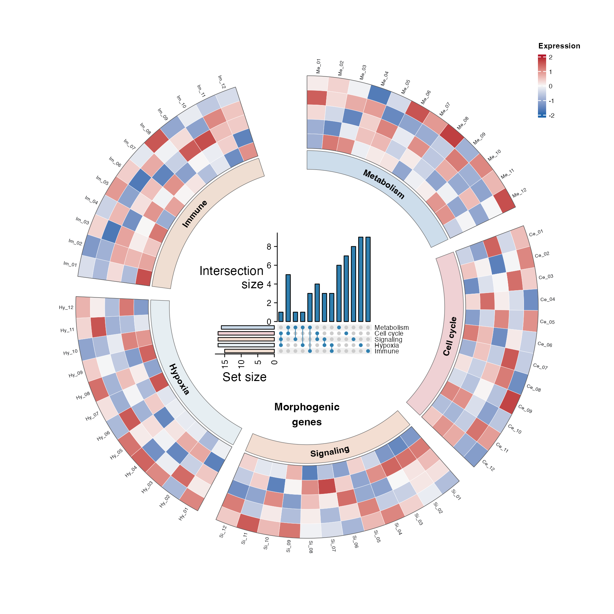
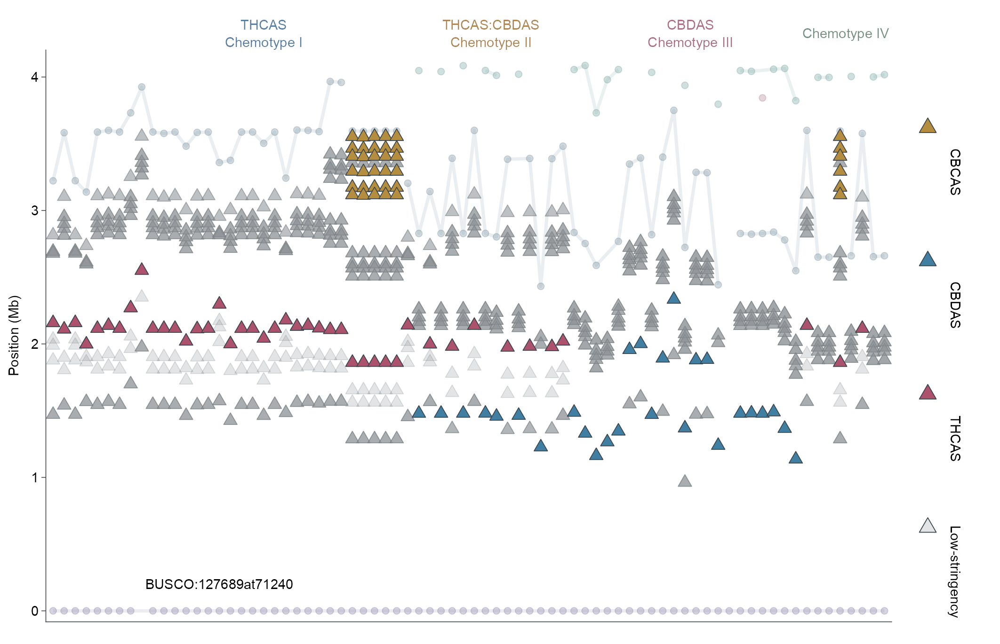
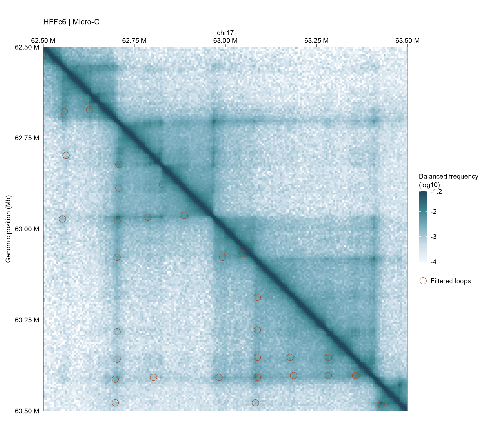
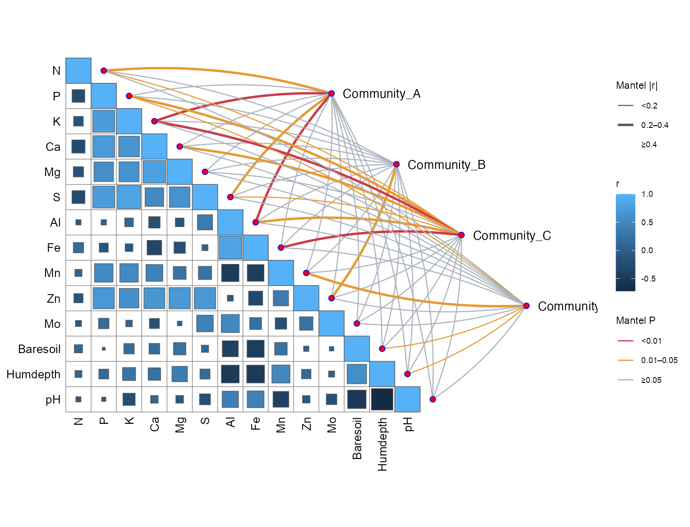

<div align="center">

**中文 · [English](README.en.md)**

# 🎨 BioFigure

**参考引导的生物科研图设计与质控 Skill**

[](biofigure/SKILL.md)
[](biofigure/renderer-registry.yaml)
[](biofigure/renderer-registry.yaml)
[](LICENSE)

[快速开始](#快速开始) · [中文手册](docs/HANDBOOK.zh-CN.md) · [设计来源](docs/DESIGN-SOURCES.md) · [精选图廊](docs/GALLERY.md) · [版本下载](https://github.com/Woyekun-cell/BioFigure/releases) · [社区](https://github.com/Woyekun-cell/BioFigure/discussions)

</div>

让科研绘图更顺手，也更好看。BioFigure 是给编码助手用的生物科研绘图 Skill，围绕生物与多组学数据，把选图、配色、排版、出图和成图检查串起来，留下能继续修改的 R/Python 代码与绘图数据。项目还在持续更新，绘图方法、案例和质控流程也在不断完善。

R 是默认后端，提供准备、CP2、一次性绘图授权和成图审查流程；矩阵、环形轨道、系统树和基因组图按任务选择专用包。AnnData、Scanpy 等可沿用 Python 代码工作流；**当前 Python 无官方绘图授权入口，不能声明 CP3 PASS**。两条路径都需核对科学含义与最终输出。

## 快速开始

**环境已配好：**在仓库根目录运行一个自带模拟数据的箱线图。输出保留 PNG、PDF、统计表与执行记录；每次改输入请用新目录。

```bash
Rscript biofigure/scripts/install_public_dependencies.R --check --profile portable
python3 biofigure/scripts/run_public_example.py boxplot --output-dir work/biofigure-first-boxplot
```

依赖检查显示 `READY` 后再运行；渲染成功状态为 `RENDERED_PENDING_VISUAL_REVIEW`，仍需打开当前 PNG/PDF 检查字体、终尺寸、文字与图例。耗时取决于本机环境与依赖，不承诺固定完成时间。首次使用见下方[安装与使用](#安装与使用)。

可运行示例还有 `heatmap`、`dense-heatmap`、`bubble`、`volcano`、`synteny`、`phylogeny`。真实数据任务可直接向编码助手描述实验单位、分组、比较方向和输出用途：

```text
$biofigure 读取 expression.csv 和 metadata.csv，画分组表达热图。
样本顺序按元数据，标注处理与时间，先检查数据，再绘图并检查文字与图例。
```

## 精选作品

挑几张我在做的复杂图放在这里：多层注释、基因组比较，以及把多种统计信息接起来的组合图。每张都附了案例与代码入口，方便继续看细节。

### 环形热图 × UpSet

把多层注释、表达模式和集合交集放到一起，展示复杂信息如何在一张图里有条理地展开。



[案例详情](docs/gallery/heatmaps.md#bf-0082) · [绘图代码](biofigure/examples/archive-gallery/scidraw-001-065/scripts/render_cases_10_14.R) · [参考来源](https://mp.weixin.qq.com/s/LuFxqYKavB5VvL3K_fDGVA)

### BUSCO 锚定的基因区域比较

基于原作者公开处理数据重绘，把跨基因组的区域结构与合酶位点放到同一视野。



[案例详情](docs/gallery/genomes.md#bf-0217) · [绘图代码](biofigure/examples/genomics-gallery-20261011/cannabis-cassette/scripts) · [来源说明](biofigure/examples/genomics-gallery-20261011/cannabis-cassette/provenance.json) · [参考来源](https://www.nature.com/articles/s41586-025-09065-0)

### Micro-C 接触矩阵与环标记

OHCA 书籍案例重绘，将公开数据的接触矩阵与环标记组合展示。



[案例详情](docs/gallery/genomes.md#bf-0221) · [绘图代码](biofigure/examples/genomics-gallery-20261011/ohca-microc/scripts) · [来源说明](biofigure/examples/genomics-gallery-20261011/ohca-microc/provenance.json) · [参考来源](https://js2264.github.io/OHCA/devel/pages/topological-features.html)

### 相关矩阵与 Mantel 网络

使用 vegan 示例数据，将环境变量相关矩阵与 Mantel 检验网络连接起来。



[案例详情](docs/gallery/networks.md#bf-0055) · [绘图代码](biofigure/examples/scidraw-gallery/scripts/generate_batch20.R) · [示例数据](https://github.com/vegandevs/vegan/blob/master/man/varechem.Rd)

[7 个含输入与 PNG/PDF 的便携绘图案例](biofigure/examples/portable)

## 分类图廊

现有成图中精选 **14 类、77 张**。同一细分图型只展示一张代表图，去除重复配色、数据集及历史版本；点击分类查看。

从图形结构和科研用途出发挑选案例，附上代码、数据与参考来源，方便继续修改和复用。

| 图型分类 | 图数 |
|---|---:|
| [热图与矩阵注释](docs/gallery/heatmaps.md) | 6 |
| [分布、箱线与小提琴](docs/gallery/distributions.md) | 5 |
| [相关、散点与气泡矩阵](docs/gallery/correlations.md) | 6 |
| [组成、桑基与三元图](docs/gallery/composition.md) | 7 |
| [柱形、棒棒糖与花瓣图](docs/gallery/bars.md) | 6 |
| [雷达与多指标比较](docs/gallery/radar.md) | 2 |
| [差异表达、富集与曼哈顿图](docs/gallery/differential.md) | 6 |
| [降维、单细胞与空间](docs/gallery/embeddings.md) | 6 |
| [生存、森林与患者轨迹](docs/gallery/clinical.md) | 7 |
| [基因组、染色体与系统树](docs/gallery/genomes.md) | 11 |
| [网络与地图](docs/gallery/networks.md) | 5 |
| [时序、曲线与信号](docs/gallery/profiles.md) | 5 |
| [集合交叠与 UpSet](docs/gallery/intersections.md) | 2 |
| [机制、图像与多面板](docs/gallery/multipanel.md) | 3 |

[完整分类目录](docs/GALLERY.md) · [逐图清单与文件哈希](docs/gallery/catalog.csv)。复合图只归入一个主要类别，同类变体不重复展示。

## 适用领域与图型

| 研究领域 | 绘图任务 |
|---|---|
| 转录组、蛋白组 | 表达与差异热图、火山图、分组表达、富集结果、相关矩阵 |
| 代谢组与多组学整合 | PCA、丰度分布、跨组学关联、注释热图、关联网络 |
| 单细胞与空间组学 | 降维嵌入、标记基因气泡图、细胞组成、空间表达及分面比较 |
| 表观组与染色质 | ATAC/ChIP 信号曲线、信号热图、区域与基因组轨道 |
| 基因组与比较基因组 | 染色体与区间分布、共线性、环形连线、系统树及对齐注释 |
| 微生物与生态研究 | 群落组成、排序分析、系统树、丰度与环境关联 |
| 临床与实验生物学 | 生存曲线、森林图、患者泳道、时序响应、分组比较与模型评估 |
| 综合展示 | 多面板组合、图像实验板和证据注释 |

从已有分析结果出发，按数据结构和研究问题选择图型，再准备相应的包与绘图参数。

## 绘图方法与质量检查

**按图型选择包。** 通用统计图采用 ggplot2，复杂矩阵注释采用 ComplexHeatmap，环形坐标采用 circlize，系统树采用 ggtree，基因组轨道与共线性采用 gggenomes，多面板采用 patchwork 或 cowplot。具体包和关键函数在编码前确定，避免用不合适的基础图层替代专用布局。

**先核对科学含义。** 检查实验单位、分组、配对关系、比较方向、数据变换及坐标。请求含糊时补齐关键信息，不能凭图名猜测统计方法，也不能补造测量值。

**按实际成图检查。** 统一字体和最终尺寸，为标签和图例留出空间，核对文字遮挡、裁切、颜色语义和必要注释。修图后重新检查当前输出；代码运行成功不等于版式通过。

**保留可复现材料。** 交付绘图代码、所用数据及必要环境信息。案例记录保存包用法、布局方法和已知问题，便于更换数据后重新编码和调整。

## 安装与使用

将完整的 `biofigure` 文件夹放入项目的 `.agents/skills/` 或个人 `~/.agents/skills/`。脚本、配置、案例、许可证须一起保留；普通原创绘图不依赖父仓库或作者电脑上的私有图库。安装后先检查依赖：

```bash
python3 -m venv .venv
source .venv/bin/activate
python3 -m pip install -r biofigure/requirements.txt
Rscript biofigure/scripts/install_public_dependencies.R --check --profile portable
python3 biofigure/scripts/audit_portable_install.py --dry-fresh-install --output work/portable-install-audit.json
```

`--check` 只读。需要安装免费 R 包时，显式选择独立 library；CRAN 包按缺失项安装，ComplexHeatmap 通过 BiocManager 安装，不升级已有包：

```bash
Rscript biofigure/scripts/install_public_dependencies.R --install --library work/R-library --profile portable
```

<details>
<summary>依赖版本、字体与平台说明</summary>

该精确版本要求适用于 `install_public_dependencies.R` 的 `portable` / `all-public` 公开依赖配置，不代表所有 R 绘图入口都有同一版本硬锁。其他 R 任务仍按所选包、字体与设备单独核验。

`portable` 检查器覆盖新增 7 例与 OncoPrint 的依赖，依赖为 ggplot2、ragg、systemfonts、jsonlite、yaml、digest、ComplexHeatmap、circlize、ape、ggrepel、scales、stringi。R 与顶层包版本按[固定版本清单](biofigure/static/core/public-runtime-versions.tsv)精确检查：R 4.6.1、Bioconductor 3.23；不匹配会明确返回 `NEEDS_R_VERSION` 或 `NEEDS_PACKAGE_VERSIONS`。安装器只从官方 CRAN／Bioconductor 安装指定版本，不自动升级其他既有包。R 包遵守各自许可证，参考 [Bioconductor 安装说明](https://www.bioconductor.org/install/)。字体不随包分发；当前示例指定 Arial，缺失时返回 `NEEDS_FONT`，不静默换字体。可用 `--font Helvetica` 单独检查 Helvetica；更改出图字体仍须更新当前规格并重新核验。已实跑环境为 macOS；Linux、Windows 尚未完成运行和字体/设备验收。Python 新环境测试仍使用既有 R 包和系统 Arial，不等同在全新操作系统上安装验证。 PDF 导出还需免费 Ghostscript 嵌入字体，支持 `R_GSCMD` 显式路径以及 `gs`、`gswin64c`、`gswin32c`；本脚本不自动安装系统软件。macOS 可用 `brew install ghostscript`，或从 [Ghostscript 官方](https://www.ghostscript.com/releases/gsdnld.html)获取。仅 PNG 可运行 `Rscript biofigure/scripts/install_public_dependencies.R --check --formats png`，无需 Ghostscript。

</details>

运行内置绘图示例：

```bash
python3 biofigure/scripts/run_public_example.py boxplot --output-dir work/boxplot-new
python3 biofigure/scripts/run_public_example.py heatmap --output-dir work/heatmap-new --formats png
```

默认输出 PNG、PDF；`--formats png` 仅导出 PNG。输出目录须为新目录或空目录。使用独立 R library 时设置 `R_LIBS_USER` 指向该目录。其余入口为 dense-heatmap、bubble、volcano、synteny、phylogeny；每例明确模拟身份、输入、代码、统计/坐标语义及适用边界。

提供真实数据时同时说明研究问题、实验单位、分组、比较方向与配对关系，例如：

```text
$biofigure 读取 expression.csv 和 metadata.csv，画分组表达热图。
样本顺序按元数据，标注处理与时间，先检查数据，再绘图并检查文字与图例。

$biofigure 用 differential.csv 画火山图，横轴 log2FC，纵轴 -log10(padj)。
比较方向为处理组相对对照组，标注指定基因，输出 PNG 和 PDF。
```

更完整的设计与导出说明见[中文手册](docs/HANDBOOK.zh-CN.md)。


完整 13 案的专用包使用 `all-public`；该选项还按固定提交与压缩包 SHA256 安装 HiCExperiment、HiContacts，并记录安装树哈希，不把同名同版本误认成已验证源码。

```bash
Rscript biofigure/scripts/install_public_dependencies.R --install --library work/R-library --profile all-public
Rscript biofigure/scripts/install_public_dependencies.R --check --library work/R-library --profile all-public
```

执行阶段须让 R 找到同一库：macOS shell 可用 `export R_LIBS_USER="$PWD/work/R-library"`；Windows PowerShell 可用 `$env:R_LIBS_USER=(Resolve-Path "work/R-library").Path`。Windows 和 macOS 共用精确字体 PDF／Ghostscript 接口，无 Quartz 专属运行路径。PDF 需要 Ghostscript 10；旧例的 PDF 检视还需 Poppler `pdftoppm`。macOS 可用 `brew install ghostscript poppler`；Windows 工具步骤见[双系统验证说明](docs/PLATFORM-VALIDATION.md)。字体仅从合法已安装系统字体解析，不随包分发。跨系统测试结果以真实 CI 记录和导出图审阅为准；配置成功不算两端成图验收。

## 验证与适用边界

科学与视觉门禁始终保留：确认实验与统计单位，先检查数据，再锁设计；实际渲染后检查当前文件，复绘后重审。自动检查验证规则、文件与执行证据，不能替代看图，也不产生通用审美分数。

| 验证范围 | 可支持的结论 |
|---|---|
| 固定案例 | 只适用于记录绑定的输入、代码、环境及输出；逐例状态见材料清单 |
| 新数据 | 重新检查实验设计、输入、统计、准备回执、CP2、授权与当前成图；旧 PASS 不转移 |
| 跨平台 | 其他操作系统、R/包版本、字体和设备需重新运行并审图；见[平台记录](docs/PLATFORM-VALIDATION.md) |
| 全量 V2 | 尚未完成；方法库覆盖、图库收录和公开包测试均不升级为全量资格 |

## 案例与验证记录

<details>
<summary>查看公开案例、来源、依赖与验证记录</summary>

3.8.0 将可检索学习档案与公开执行入口分开。454 条学习记录保留来源、方法、历史缺陷和资格边界；未分发的来源材料显示 `source-materials-unavailable`，不冒称可执行，也不阻断普通原创图。明确采用某个来源或要求复现时，仍须具备相应原图、代码、输入和新的 CP2 绑定。

[公开案例清单](biofigure/public-cases.json)列出 13 个可执行入口：7 个全一方模拟例，加 Cannabis 两案、Planarian、OHCA、桑基图和 OncoPrint 六个既有公开适配例。OncoPrint 保留全部144个模拟样本与12个基因，按原始连续48列分为3块，实际方格均为2.1×2.1mm；当前固定输入与macOS实跑已重新核验。清单绑定代码、输入、来源、许可证和 SHA256。OHCA 需取得固定 SHA256 的作者处理 RDS；Cannabis 需固定版本 BUSCOplot 或核验过的来源缓存，所需网络与外部 R 包均明确列出。执行入口完整不代表任意新数据、跨平台、原论文整幅图或视觉验收已通过。

旧 5 例不由上述新例依赖检查器安装。Cannabis 两案另需 cowplot、magick、svglite 等包；入口取得并校验 [BUSCOplot 固定提交](https://github.com/knausb/BUSCOplot/tree/d4f793988ce89279cf44294ceb8017756e181b0b)，也可传入已核验来源缓存。Planarian 另需 data.table、svglite；桑基图另需 ggalluvial、cowplot、svglite，完整依赖以各例脚本/执行配置为准。OHCA 要求既有 R library，含 [HiContacts 固定来源](https://github.com/js2264/HiContacts/tree/dfb588e11e0a76e3f68ba0ed2fca7633848c8d0d)、[HiCExperiment 固定来源](https://github.com/js2264/HiCExperiment/tree/0f56f30b12466fd79f3500ebd0e4d7c8aa64a59a)、InteractionSet、GenomeInfoDb、S4Vectors、rhdf5、Rhdf5lib、ggrastr、svglite 及常规绘图包；包与输入锁定见[执行配置](biofigure/examples/genomics-gallery-20261011/ohca-microc/data/metadata/execution-config.json)。可参考 [Bioconductor](https://www.bioconductor.org/install/)准备依赖，公共入口不自动安装；当期 Bioconductor 版本不等于上述固定提交，也不构成当前适配例的兼容保证。

DPM 气泡图与网络两案仅保留参考档案、第一方适配代码及[原论文链接](https://www.nature.com/articles/s41467-024-49986-4)。其独立 GitHub 输入未有明确再分发许可；本版撤下相关 CSV、PNG、PDF，未把论文学术 CC-BY 许可套用到该仓库。历史版本无法由本次撤回；[撤下清单](docs/gallery/rights-exclusions-3.8.0.json)记录具体路径与哈希。

独立安装审计检查完整发行目录、公开运行材料、哈希、文件均位于 Skill 根内的检查、许可声明及仅复制 Skill 后的依赖完整性；它不运行 R，也不授予科研、来源或视觉 PASS。实际绘图仍须先完成适用统计、CP2、一次性授权、当前输出检查及终尺寸 PNG/PDF 审阅。全量 V2 科学 benchmark 尚未完成，历史 PASS 不迁移到新数据或环境。

```bash
python3 biofigure/scripts/audit_portable_install.py --distribution-root . --output work/release-audit.json
python3 tools/build_gallery.py --check
```

Skill 提供方法与检查流程，不改变模型参数，也不保证不同模型或推理档位得到相同结果。

</details>

## 版本与历史

- [Releases：下载已命名版本](https://github.com/Woyekun-cell/BioFigure/releases)
- [v3.8.0：独立安装与公开案例](https://github.com/Woyekun-cell/BioFigure/tree/v3.8.0)
- [v3.7.1：历史更新](https://github.com/Woyekun-cell/BioFigure/tree/v3.7.1) · [更新前快照](https://github.com/Woyekun-cell/BioFigure/tree/snapshot-20261011-pre-gallery-refresh)
- [v3.5.1 更新记录](docs/RELEASE-NOTES-3.5.1.md) · [v3.5.0 更新记录](docs/RELEASE-NOTES-3.5.0.md)
- [完整提交历史](https://github.com/Woyekun-cell/BioFigure/commits/main/)：查看每次修改和当时的文件。

`main` 是当前代码；版本标签固定在对应提交上，便于下载和对照旧版本。

## 来源与反馈

绘图思路与方法参考整理在[设计来源](docs/DESIGN-SOURCES.md)和[来源声明](NOTICE.md)中。图廊里的案例附有代码、数据和来源链接，欢迎顺着看，也欢迎带着自己的数据继续改。

绘图需求、参考案例和审美建议欢迎发到 [Discussions](https://github.com/Woyekun-cell/BioFigure/discussions)。可复现的问题请提交 [Issue](https://github.com/Woyekun-cell/BioFigure/issues/new/choose)，附数据结构、代码、包版本和成图；贡献方式见[贡献指南](CONTRIBUTING.md)。

