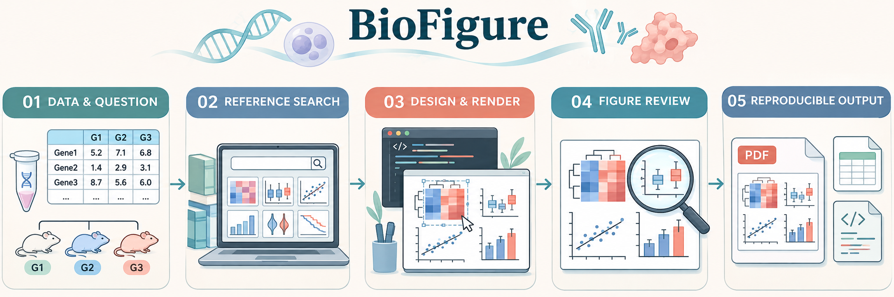
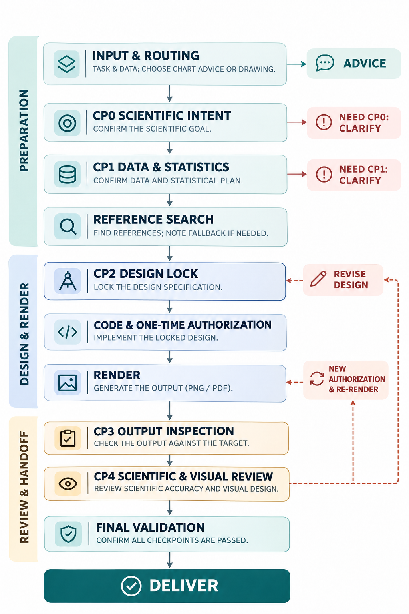
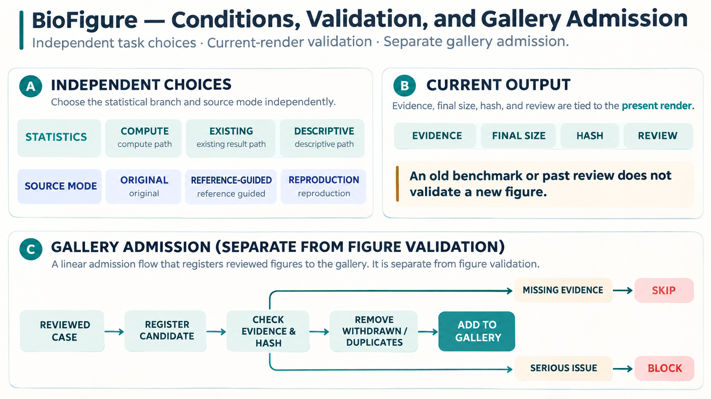
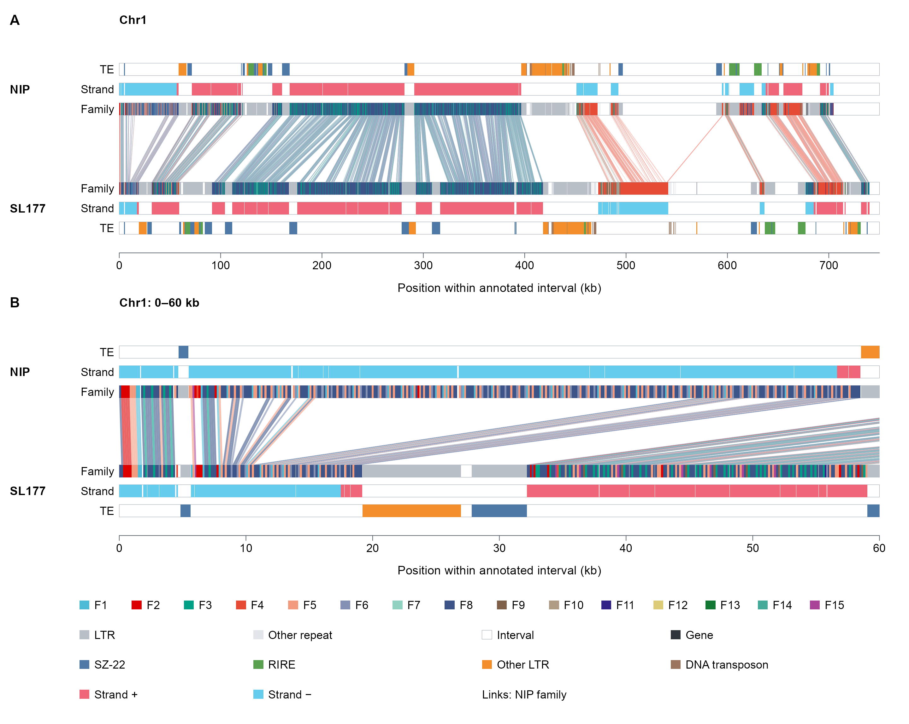
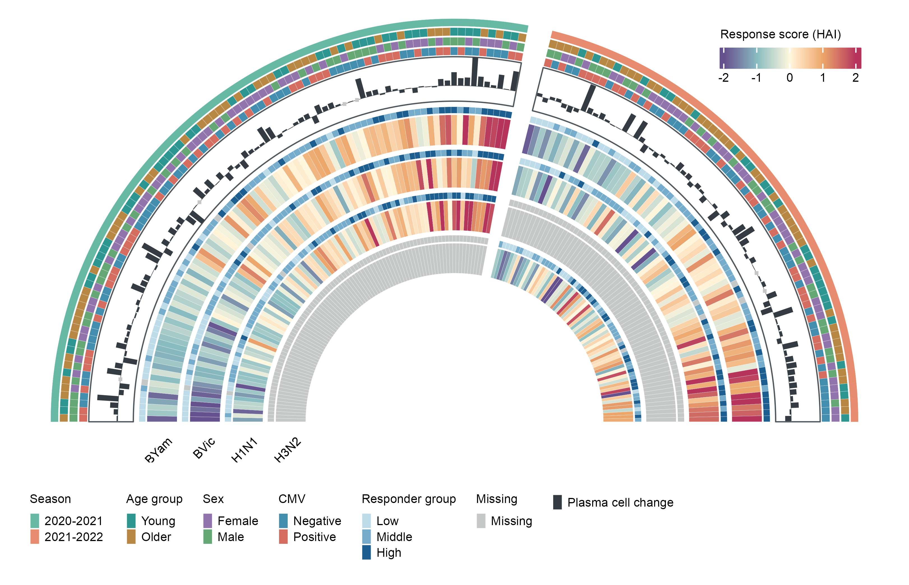
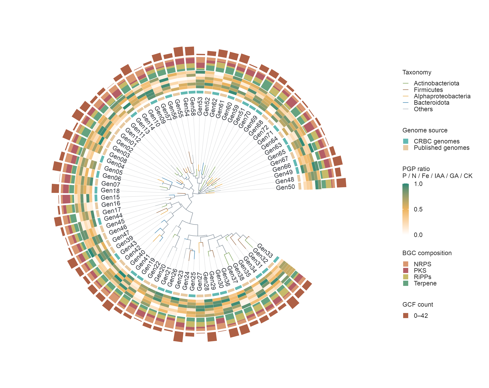
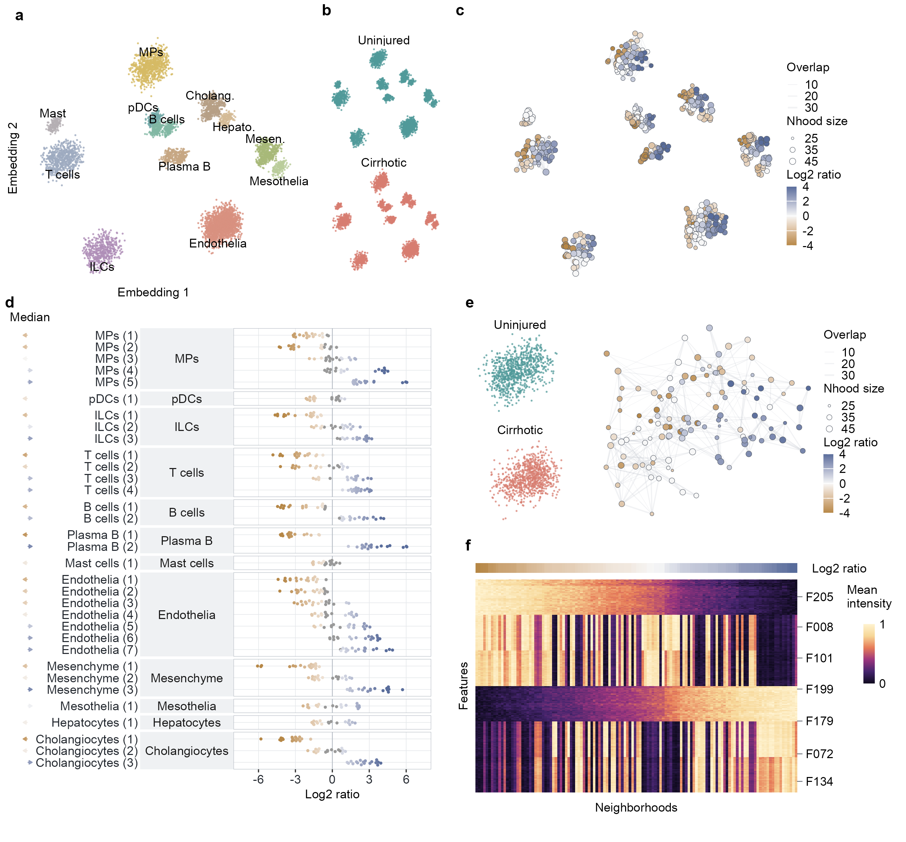
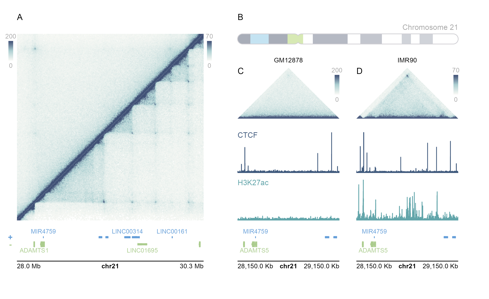
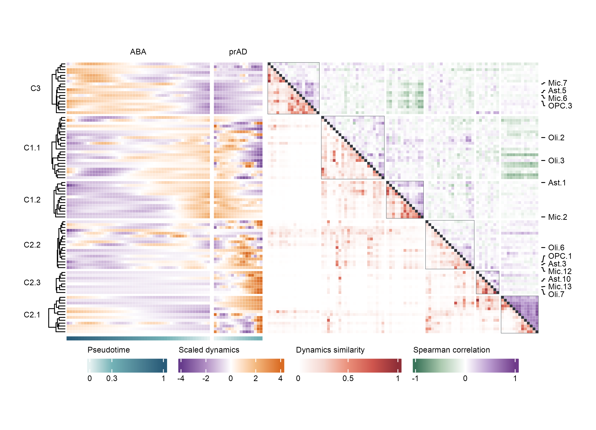

<div align="center">

**[English](README.md) · 中文**

# 🎨 BioFigure

**参考引导的生物科研图设计与质控 Skill**

[](biofigure/SKILL.md)
[](biofigure/renderer-registry.yaml)
[](biofigure/renderer-registry.yaml)
[](LICENSE)

[快速开始](#快速开始) · [开发版个人助手](#开发版里的个人绘图助手) · [中文手册](docs/HANDBOOK.zh-CN.md) · [设计来源](docs/DESIGN-SOURCES.md) · [在线图廊](https://woyekun-cell.github.io/BioFigure/) · [精选图廊](docs/GALLERY.md) · [版本下载](https://github.com/Woyekun-cell/BioFigure/releases) · [社区](https://github.com/Woyekun-cell/BioFigure/discussions)

</div>

给 BioFigure 一份数据，告诉它这张图要回答什么问题。它会帮你的编码助手选图，写出能修改的 R 或 Python 代码，再按最终尺寸查看导出的图。交付时附绘图数据和脚本，换一批样本或调整版面时可以接着用。

你可以用自己的数据从头画，借用参考图的布局，也可以指定论文中的某个面板复现。复现时会核对原图、代码和源数据。遇到标签被裁、图例拥挤等问题，助手可以自行修改并重画。如果样本是否配对会影响分析，而数据表里又看不出来，助手会请你补充。

## 工作流程





绘图从科学问题、数据和参考检索开始，锁定设计后编写代码，绑定当前输入与脚本进行一次性授权，再渲染并检查当前成图。CP3 或 CP4 未通过时，修改后重新授权、渲染和检查；所有检查及证据核验通过后交付。



统计分支与来源模式分别选择。图廊入库独立核对案例证据、终尺寸和哈希，并排除撤回及重复案例；缺少证据时不入库。图廊入库不能代替当前绘图的验证。

[浏览在线图廊](https://woyekun-cell.github.io/BioFigure/)，按图型查看案例。

## 精选作品

在线图谱支持按图型或绘图包检索、查看原尺寸图，也可以把两张图并排比较。打开图卡可查看该例公开的代码、绘图数据和来源。

### 多轨共线性与局部放大

沿基因组坐标对齐注释轨道，用连线呈现区域对应关系，再放大局部细节。



### 半环多轨热图

把样本特征、变化量和多组评分放在同一半环中，层次清楚，适合同时比较多类信息。



### 系统树与多层注释

以系统树为中心，对齐分类、连续数值和功能组成等多层轨道。图中使用模拟数据。



### 细胞状态、邻域网络与表达热图

将细胞分布、邻域关系、分组比较和表达模式组合成一张多面板图。图中使用模拟数据。



### Hi-C 接触矩阵与多组学轨道

将接触矩阵、染色体位置、信号轨道与基因注释放在同一坐标体系中。



### 轨迹热图与三角关联矩阵

左侧展示细胞状态随拟时序的变化，右侧并排呈现动态相似度与相关性。



[浏览图画廊文件](gallery/) · [分类图廊](docs/GALLERY.md)

## 快速开始

安装 BioFigure 后，直接告诉编码助手数据位置、图型和需要保留的信息。例如：

```text
$biofigure 读取 expression.csv 和 metadata.csv，画分组表达热图。
样本顺序按元数据，标注处理与时间，检查文字、图例并输出 PDF。
```

也可使用内置模拟数据试运行基因组共线性示例：

```bash
Rscript biofigure/scripts/install_public_dependencies.R --check --profile portable
python3 biofigure/scripts/run_public_example.py synteny --output-dir work/biofigure-first-synteny
```

依赖检查显示 `READY` 后运行；生成图稿后打开 PNG 或 PDF，检查文字、图例和最终尺寸。[安装与使用](#安装与使用)中还有环境配置和更多示例。

## 开发版里的个人绘图助手

个人图库网站随仓库源码提供，在本机部署后使用。Star、图库编辑、重绘结果和个人偏好保存在当前用户的本机档案，公开官网用于浏览公共示例。

在仓库根目录运行以下命令，再打开终端显示的本机网址。需要 Python 依赖、已登录的 Codex CLI，以及所选图型使用的绘图环境。

```bash
python3 -m pip install -r biofigure/requirements.txt
python3 biofigure/bin/biofigure gallery-web
```

默认地址为 `http://127.0.0.1:18807/BioFigure/`。选择参考图后提问，选定方案并执行，可得到 PNG、PDF、可编辑脚本和检查文件，再基于结果继续修改。多图时指定要修改的主图。缺少原始脚本或数据时会提示补齐。运行 `gallery-web --offline` 可浏览已缓存材料，`--site` 可指定已有的本地示例目录。

不同部署通过 `BIOFIGURE_PERSONAL_DB` 配置各自的档案。运行时只监听本机回环地址。使用方法见[个人图库](biofigure/references/personal-gallery.md)。

### 用喜欢的图做参考

可以临时选任意数量的参考图，写一句「沿用第一张的分面，把第二张那样的原始点叠上去」。没有选图时，助手会先按研究问题检索，只展开用得上的图和代码。想留作常用参考，可以把自己的图片导入个人图库，点星，再标上「喜欢这个留白」。平时画好的图留在项目目录，说「收藏这张」才收入个人图库。

BioFigure 会分别记住你画每类图时习惯怎样显示原始点和网格、把图例放在哪里。每项偏好都只看最近五个有相关记录的不同任务。同一设置被明确要求三次，或在四个任务中有记录，就静默用于下次同类图。对一张图改五遍只算一个任务，模板、期刊要求和沿用旧偏好的结果都不计入。项目可以另设字体、画布尺寸和分组配色。如果数据更适合另一种画法，助手会说明理由。

### 让一张图的画法用到下一组数据

支持后台任务的宿主可以让反馈 Agent 整理新增参考和修图记录。它查看原图及能取得的绘图代码，记下各图层需要哪些字段，再换一份数据试画。经过独立任务验证的流程可以整理成候选 Skill，审核后启用。

在一个模拟时序实验里，助手从纵向轨迹图和分布图借用了两种画法。18 个个体有 86 条观测，只连接同一个体相邻的访视，遇到缺访就断开，共得到 64 段线。保留这 86 个数值，改成各时间点独立取样后，个体连线降为 0，各组的均值和四分位区间仍然相同。

### 换一个 Agent，继续用同一份图库

源码随附轻量 CLI，同一台机器上的宿主可以共用 SQLite 里的图库索引与偏好。Codex 已能发现这个 Skill，OpenCode 已通过 shell 调用过 CLI。Claude Code 有接入说明，仍待实机验证。命令行可查询偏好、组合参考或运行时序预览，按需加入 PATH 即可。

浏览器工作台可以调画布和留白，有可编辑元素的 SVG 还可改色、改字。半环多轨热图有专用编辑器，可以换自己的数据、调整轨道，保存项目后接着画。

## 在线图廊分类

截至 2026 年 11 月 19 日，[在线图廊](https://woyekun-cell.github.io/BioFigure/)收录 367 个图例，分为 20 类。同一图例可归入多个分类。

| 图型分类 | 图数 | 图型分类 | 图数 |
|---|---:|---|---:|
| 热图与矩阵 | 58 | 集合与交叠 | 9 |
| 散点与降维 | 50 | 轨迹与时序 | 32 |
| 分布与箱线 | 44 | 相关与回归 | 17 |
| 柱形与点图 | 40 | 临床与森林 | 16 |
| 差异与富集 | 24 | 组成与层级 | 34 |
| 网络与弦图 | 23 | 系统树 | 14 |
| 桑基与流向 | 7 | 多面板组合 | 94 |
| 基因组与轨道 | 52 | 机制与结构 | 2 |
| 地图 | 29 | 器官与解剖 | 1 |
| 环形与雷达 | 37 | 曲线与响应谱 | 3 |

[浏览在线图廊](https://woyekun-cell.github.io/BioFigure/) · [查看仓库精选目录](docs/GALLERY.md)

## 适用领域与图型

| 研究领域 | 绘图任务 |
|---|---|
| 转录组、蛋白组 | 表达与差异热图、火山图、分组表达、富集结果、相关矩阵 |
| 代谢组与多组学整合 | PCA、丰度分布、跨组学关联、注释热图、关联网络 |
| 单细胞与空间组学 | 降维嵌入、标记基因气泡图、细胞组成、空间表达及分面比较 |
| 表观组与染色质 | ATAC/ChIP 信号曲线、信号热图、区域与基因组轨道 |
| 基因组与比较基因组 | 染色体与区间分布、共线性、环形连线、系统树及对齐注释 |
| 微生物与生态研究 | 群落组成、排序分析、系统树、丰度与环境关联 |
| 临床与实验生物学 | 生存曲线、森林图、患者泳道、时序响应、分组比较与模型评估 |
| 综合展示 | 多面板组合、图像实验板和证据注释 |

从已有分析结果出发，按数据结构和研究问题选择图型，再准备相应的包与绘图参数。

## 绘图方法与质量检查

通常用 R。统计图用 ggplot2，注释热图用 ComplexHeatmap，环形轨道用 circlize，系统树用 ggtree，基因组轨道和共线性用 gggenomes，组图用 patchwork 或 cowplot。你指定 Python、已有 Python 流程要沿用，或 R 缺少合适工具时，可以切到 Python。

先核对实验单位、分组、配对、比较方向、坐标和数据变换。图上标出的 P 值或校正值要能追溯到统计表。已有分析结果可直接用于绘图。

导出后按最终尺寸查看字体、标注、图例和面板对齐，检查遮挡、裁切和分组配色。修图后重查本次输出。随图保留代码、绘图数据和必要的环境信息，案例记录另存布局做法及已知问题。

## 安装与使用

将完整的 `biofigure` 文件夹放入项目的 `.agents/skills/` 或个人 `~/.agents/skills/`。脚本、配置、案例、许可证须一起保留；普通原创绘图不依赖父仓库或作者电脑上的私有图库。安装后先检查依赖：

```bash
python3 -m venv .venv
source .venv/bin/activate
python3 -m pip install -r biofigure/requirements.txt
Rscript biofigure/scripts/install_public_dependencies.R --check --profile portable
python3 biofigure/scripts/audit_portable_install.py --dry-fresh-install --output work/portable-install-audit.json
```

`--check` 只读。需要安装免费 R 包时，显式选择独立 library；CRAN 包按缺失项安装，ComplexHeatmap 通过 BiocManager 安装，不升级已有包：

```bash
Rscript biofigure/scripts/install_public_dependencies.R --install --library work/R-library --profile portable
```

<details>
<summary>依赖版本、字体与平台说明</summary>

该精确版本要求适用于 `install_public_dependencies.R` 的 `portable` / `all-public` 公开依赖配置，不代表所有 R 绘图入口都有同一版本硬锁。其他 R 任务仍按所选包、字体与设备单独核验。

`portable` 检查器覆盖新增 7 例与 OncoPrint 的依赖，依赖为 ggplot2、ragg、systemfonts、jsonlite、yaml、digest、ComplexHeatmap、circlize、ape、ggrepel、scales、stringi。R 与顶层包版本按[固定版本清单](biofigure/static/core/public-runtime-versions.tsv)精确检查：R 4.6.1、Bioconductor 3.23；不匹配会明确返回 `NEEDS_R_VERSION` 或 `NEEDS_PACKAGE_VERSIONS`。安装器只从官方 CRAN／Bioconductor 安装指定版本，不自动升级其他既有包。R 包遵守各自许可证，参考 [Bioconductor 安装说明](https://www.bioconductor.org/install/)。字体不随包分发；当前示例指定 Arial，缺失时返回 `NEEDS_FONT`，不静默换字体。可用 `--font Helvetica` 单独检查 Helvetica；更改出图字体仍须更新当前规格并重新核验。已实跑环境为 macOS；Linux、Windows 尚未完成运行和字体/设备验收。Python 新环境测试仍使用既有 R 包和系统 Arial，不等同在全新操作系统上安装验证。 PDF 导出还需免费 Ghostscript 嵌入字体，支持 `R_GSCMD` 显式路径以及 `gs`、`gswin64c`、`gswin32c`；本脚本不自动安装系统软件。macOS 可用 `brew install ghostscript`，或从 [Ghostscript 官方](https://www.ghostscript.com/releases/gsdnld.html)获取。仅 PNG 可运行 `Rscript biofigure/scripts/install_public_dependencies.R --check --formats png`，无需 Ghostscript。

</details>

运行内置绘图示例：

```bash
python3 biofigure/scripts/run_public_example.py synteny --output-dir work/synteny-new
python3 biofigure/scripts/run_public_example.py heatmap --output-dir work/heatmap-new --formats png
```

默认输出 PNG、PDF；`--formats png` 仅导出 PNG。输出目录须为新目录或空目录。使用独立 R library 时设置 `R_LIBS_USER` 指向该目录。其余入口为 dense-heatmap、bubble、volcano、synteny、phylogeny；每例明确模拟身份、输入、代码、统计/坐标语义及适用边界。

提供真实数据时同时说明研究问题、实验单位、分组、比较方向与配对关系，例如：

```text
$biofigure 读取 expression.csv 和 metadata.csv，画分组表达热图。
样本顺序按元数据，标注处理与时间，先检查数据，再绘图并检查文字与图例。

$biofigure 用 differential.csv 画火山图，横轴 log2FC，纵轴 -log10(padj)。
比较方向为处理组相对对照组，标注指定基因，输出 PNG 和 PDF。
```

更完整的设计与导出说明见[中文手册](docs/HANDBOOK.zh-CN.md)。


完整 13 案的专用包使用 `all-public`；该选项还按固定提交与压缩包 SHA256 安装 HiCExperiment、HiContacts，并记录安装树哈希，不把同名同版本误认成已验证源码。

```bash
Rscript biofigure/scripts/install_public_dependencies.R --install --library work/R-library --profile all-public
Rscript biofigure/scripts/install_public_dependencies.R --check --library work/R-library --profile all-public
```

执行阶段须让 R 找到同一库：macOS shell 可用 `export R_LIBS_USER="$PWD/work/R-library"`；Windows PowerShell 可用 `$env:R_LIBS_USER=(Resolve-Path "work/R-library").Path`。Windows 和 macOS 共用精确字体 PDF／Ghostscript 接口，无 Quartz 专属运行路径。PDF 需要 Ghostscript 10；旧例的 PDF 检视还需 Poppler `pdftoppm`。macOS 可用 `brew install ghostscript poppler`；Windows 工具步骤见[双系统验证说明](docs/PLATFORM-VALIDATION.md)。字体仅从合法已安装系统字体解析，不随包分发。跨系统测试结果以真实 CI 记录和导出图审阅为准；配置成功不算两端成图验收。

## 验证与适用边界

科学与视觉门禁始终保留：确认实验与统计单位，先检查数据，再锁设计；实际渲染后检查当前文件，复绘后重审。自动检查验证规则、文件与执行证据，不能替代看图，也不产生通用审美分数。

| 验证范围 | 可支持的结论 |
|---|---|
| 固定案例 | 只适用于记录绑定的输入、代码、环境及输出；逐例状态见材料清单 |
| 新数据 | 重新检查实验设计、输入、统计、准备回执、CP2、授权与当前成图；旧 PASS 不转移 |
| 跨平台 | 其他操作系统、R/包版本、字体和设备需重新运行并审图；见[平台记录](docs/PLATFORM-VALIDATION.md) |
| 全量 V2 | 尚未完成；方法库覆盖、图库收录和公开包测试均不升级为全量资格 |

## 案例与验证记录

<details>
<summary>查看公开案例、来源、依赖与验证记录</summary>

3.8.0 将可检索学习档案与公开执行入口分开。454 条学习记录保留来源、方法、历史缺陷和资格边界；未分发的来源材料显示 `source-materials-unavailable`，不冒称可执行，也不阻断普通原创图。明确采用某个来源或要求复现时，仍须具备相应原图、代码、输入和新的 CP2 绑定。

[公开案例清单](biofigure/public-cases.json)列出 13 个可执行入口：7 个全一方模拟例，加 Cannabis 两案、Planarian、OHCA、桑基图和 OncoPrint 六个既有公开适配例。OncoPrint 保留全部144个模拟样本与12个基因，按原始连续48列分为3块，实际方格均为2.1×2.1mm；当前固定输入与macOS实跑已重新核验。清单绑定代码、输入、来源、许可证和 SHA256。OHCA 需取得固定 SHA256 的作者处理 RDS；Cannabis 需固定版本 BUSCOplot 或核验过的来源缓存，所需网络与外部 R 包均明确列出。执行入口完整不代表任意新数据、跨平台、原论文整幅图或视觉验收已通过。

旧 5 例不由上述新例依赖检查器安装。Cannabis 两案另需 cowplot、magick、svglite 等包；入口取得并校验 [BUSCOplot 固定提交](https://github.com/knausb/BUSCOplot/tree/d4f793988ce89279cf44294ceb8017756e181b0b)，也可传入已核验来源缓存。Planarian 另需 data.table、svglite；桑基图另需 ggalluvial、cowplot、svglite，完整依赖以各例脚本/执行配置为准。OHCA 要求既有 R library，含 [HiContacts 固定来源](https://github.com/js2264/HiContacts/tree/dfb588e11e0a76e3f68ba0ed2fca7633848c8d0d)、[HiCExperiment 固定来源](https://github.com/js2264/HiCExperiment/tree/0f56f30b12466fd79f3500ebd0e4d7c8aa64a59a)、InteractionSet、GenomeInfoDb、S4Vectors、rhdf5、Rhdf5lib、ggrastr、svglite 及常规绘图包；包与输入锁定见[执行配置](biofigure/examples/genomics-gallery-20261011/ohca-microc/data/metadata/execution-config.json)。可参考 [Bioconductor](https://www.bioconductor.org/install/)准备依赖，公共入口不自动安装；当期 Bioconductor 版本不等于上述固定提交，也不构成当前适配例的兼容保证。

DPM 气泡图与网络两案仅保留参考档案、第一方适配代码及[原论文链接](https://www.nature.com/articles/s41467-024-49986-4)。其独立 GitHub 输入未有明确再分发许可；本版撤下相关 CSV、PNG、PDF，未把论文学术 CC-BY 许可套用到该仓库。历史版本无法由本次撤回；[撤下清单](docs/gallery/rights-exclusions-3.8.0.json)记录具体路径与哈希。

独立安装审计检查完整发行目录、公开运行材料、哈希、文件均位于 Skill 根内的检查、许可声明及仅复制 Skill 后的依赖完整性；它不运行 R，也不授予科研、来源或视觉 PASS。实际绘图仍须先完成适用统计、CP2、一次性授权、当前输出检查及终尺寸 PNG/PDF 审阅。全量 V2 科学 benchmark 尚未完成，历史 PASS 不迁移到新数据或环境。

```bash
python3 biofigure/scripts/audit_portable_install.py --distribution-root . --output work/release-audit.json
python3 tools/build_gallery.py --check
```

Skill 提供方法与检查流程，不改变模型参数，也不保证不同模型或推理档位得到相同结果。

</details>

## 版本与历史

- [Releases：下载已命名版本](https://github.com/Woyekun-cell/BioFigure/releases)
- [当前 3.8.0 代码与公开案例](https://github.com/Woyekun-cell/BioFigure/tree/main)
- [v3.7.1：历史更新](https://github.com/Woyekun-cell/BioFigure/tree/v3.7.1) · [更新前快照](https://github.com/Woyekun-cell/BioFigure/tree/snapshot-20261011-pre-gallery-refresh)
- [v3.5.1 更新记录](docs/RELEASE-NOTES-3.5.1.md) · [v3.5.0 更新记录](docs/RELEASE-NOTES-3.5.0.md)
- [完整提交历史](https://github.com/Woyekun-cell/BioFigure/commits/main/)：查看每次修改和当时的文件。

`main` 是当前代码；版本标签固定在对应提交上，便于下载和对照旧版本。

## 来源与反馈

绘图思路与方法参考整理在[设计来源](docs/DESIGN-SOURCES.md)和[来源声明](NOTICE.md)中。图廊里的案例附有代码、数据和来源链接，欢迎顺着看，也欢迎带着自己的数据继续改。

绘图需求、参考案例和审美建议欢迎发到 [Discussions](https://github.com/Woyekun-cell/BioFigure/discussions)。可复现的问题请提交 [Issue](https://github.com/Woyekun-cell/BioFigure/issues/new/choose)，附数据结构、代码、包版本和成图；贡献方式见[贡献指南](CONTRIBUTING.md)。


