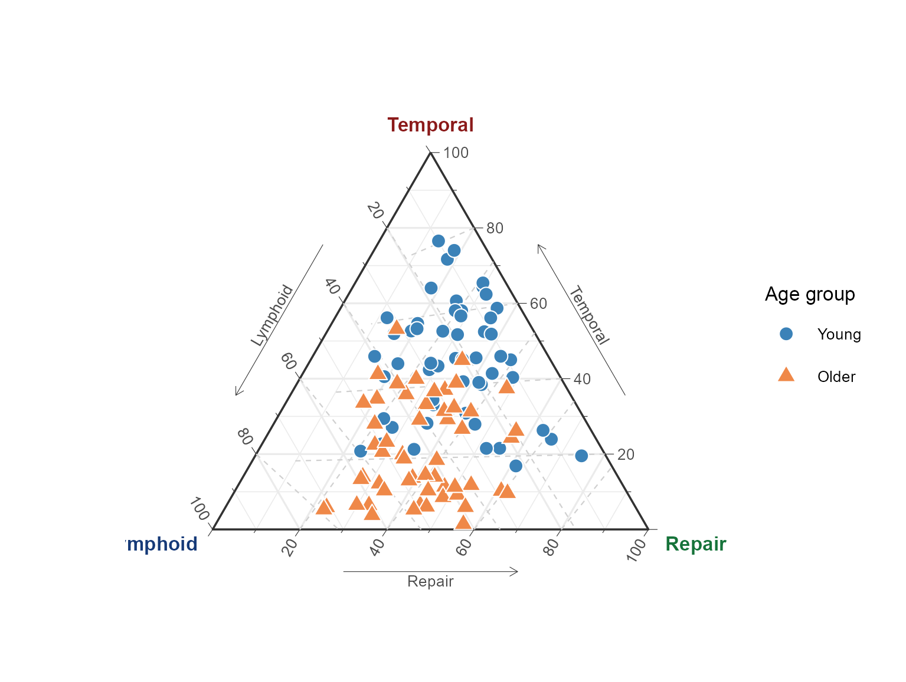
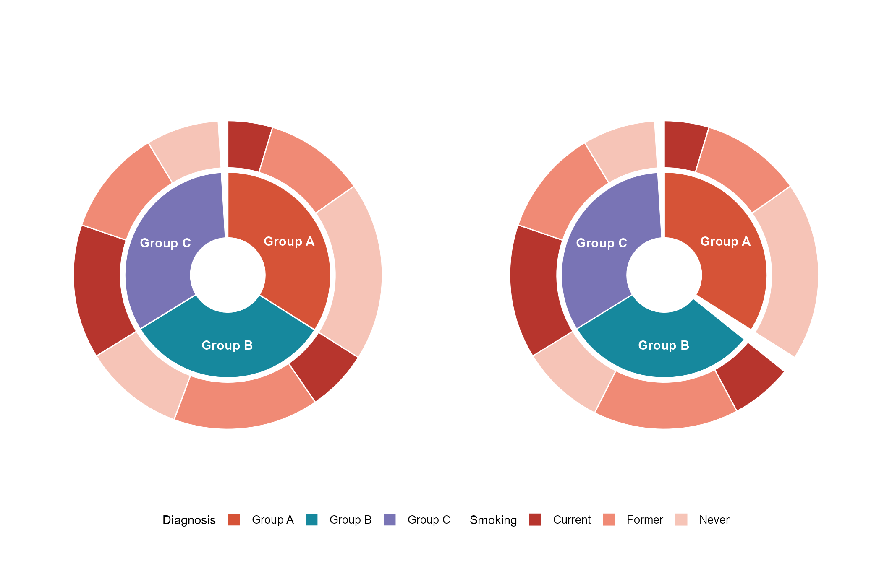
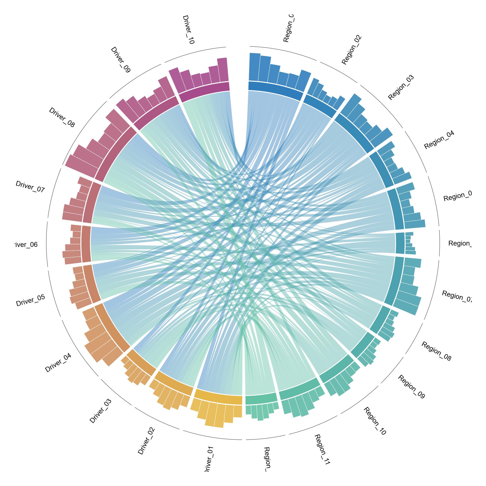
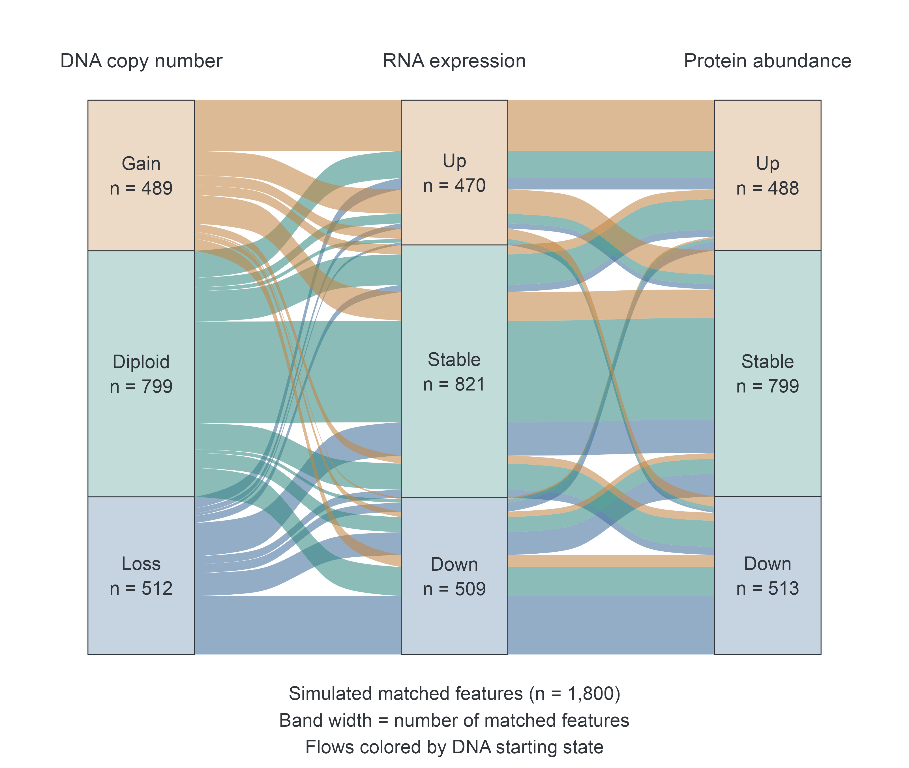
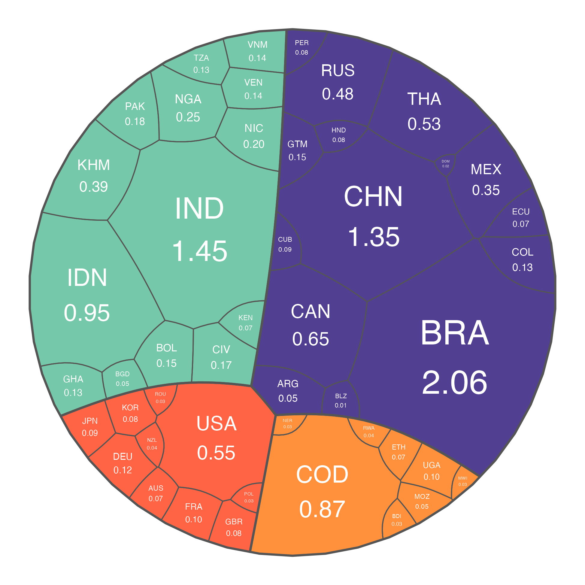
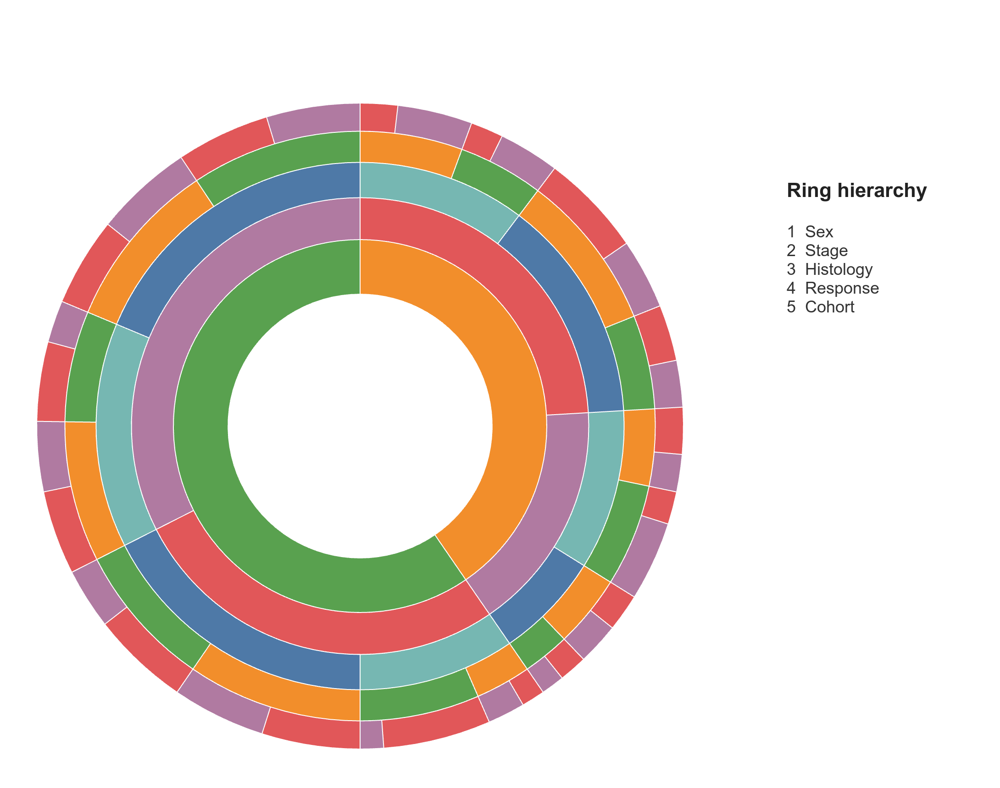
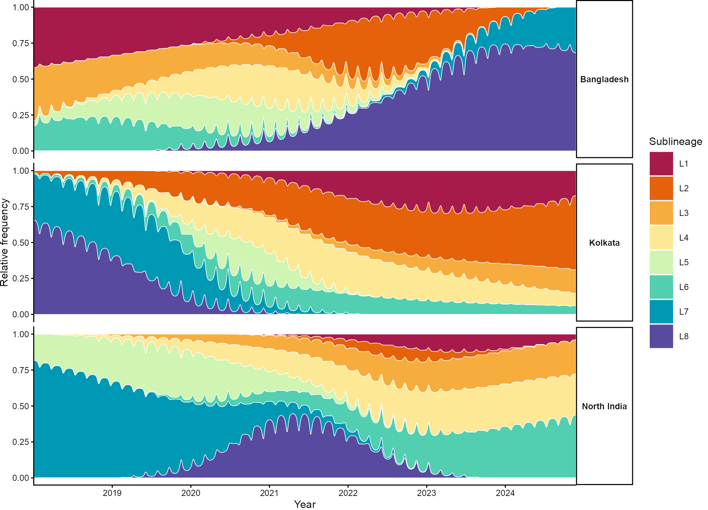

# 组成、桑基与三元图 / Composition and flows

[全部分类 / Categories](../GALLERY.md) · [首页 / Home](../../README.md) · [逐图清单 / Inventory](catalog.csv)

本类 **7 张代表图**，每个细分图型保留一例。

按图形结构与科研用途浏览，每个细分图型选一张代表图；点击图片下方的来源与代码，继续探索绘图过程。 Explore one example per visual subtype, with source and code links for a closer look at the workflow.

## BF-0022 · 三元分组图

三元组成绘图示例。

[原尺寸](../../docs/assets/reproduction-gallery/figure_073_issue065_ternary_groups.png) · [脚本](../../biofigure/examples/reproduction-gallery/generate_064_080_gallery.R) · [案例记录 / Details](catalog.csv)

## BF-0026 · 双层环图

嵌套环图绘图示例。

[原尺寸](../../docs/assets/reproduction-gallery/figure_083_issue072_nested_piedonut.png) · [脚本](../../biofigure/examples/reproduction-gallery/generate_064_080_gallery.R) · [案例记录 / Details](catalog.csv)

## BF-0034 · 弦图与外层注释轨道

弦图绘图示例。

[原尺寸](../../docs/assets/scidraw-gallery/05_chord_outer_track.png) · [脚本](../../biofigure/examples/scidraw-gallery/scripts/generate_six_scidraw.R) · [案例记录 / Details](catalog.csv)

## BF-0109 · DNA–RNA–Protein 状态桑基图

DNA、RNA 与蛋白状态的完整路径，在一张桑基图中串联呈现。

[原尺寸](../../docs/assets/archive-gallery/scidraw-001-065/36_gradient_sankey.png) · [PDF](../../biofigure/examples/genomics-gallery-20261011/sankey/results/figures/sankey_simulated_repaired.pdf) · [批次脚本](../../biofigure/examples/genomics-gallery-20261011/sankey/scripts) · [绘图数据](../../biofigure/examples/genomics-gallery-20261011/sankey/results/plot_data) · [来源说明 / Source notes](../../biofigure/examples/genomics-gallery-20261011/sankey/provenance.json) · [参考来源 / Reference](https://corybrunson.github.io/ggalluvial/articles/ggalluvial.html) · [案例记录 / Details](catalog.csv)

## BF-0189 · 加权 Voronoi 组成图

Voronoi组成绘图示例。

[原尺寸](../../docs/assets/archive-gallery/full-reproduction/figure_067_weighted_voronoi_code_driven.png) · [脚本](../../biofigure/examples/archive-gallery/full-reproduction/scripts/non_single_cell_055_069.R) · [案例记录 / Details](catalog.csv)

## BF-0199 · 多层旭日图

旭日图绘图示例。

[原尺寸](../../docs/assets/archive-gallery/full-reproduction/figure_082_issue071_sunburst.png) · [脚本](../../biofigure/examples/archive-gallery/full-reproduction/scripts/code_driven_071_087.R) · [案例记录 / Details](catalog.csv)

## BF-0203 · 分面流图

流图绘图示例。

[原尺寸](../../docs/assets/archive-gallery/full-reproduction/figure_089_issue079_streamgraph.png) · [脚本](../../biofigure/examples/archive-gallery/full-reproduction/scripts/code_driven_071_087.R) · [案例记录 / Details](catalog.csv)

[全部分类](../GALLERY.md) · [脚本存档说明](../../biofigure/examples/archive-gallery/README.md)
