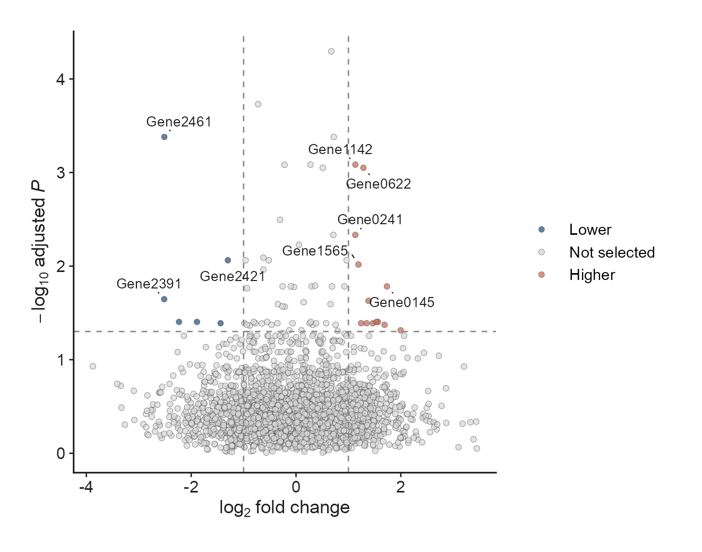
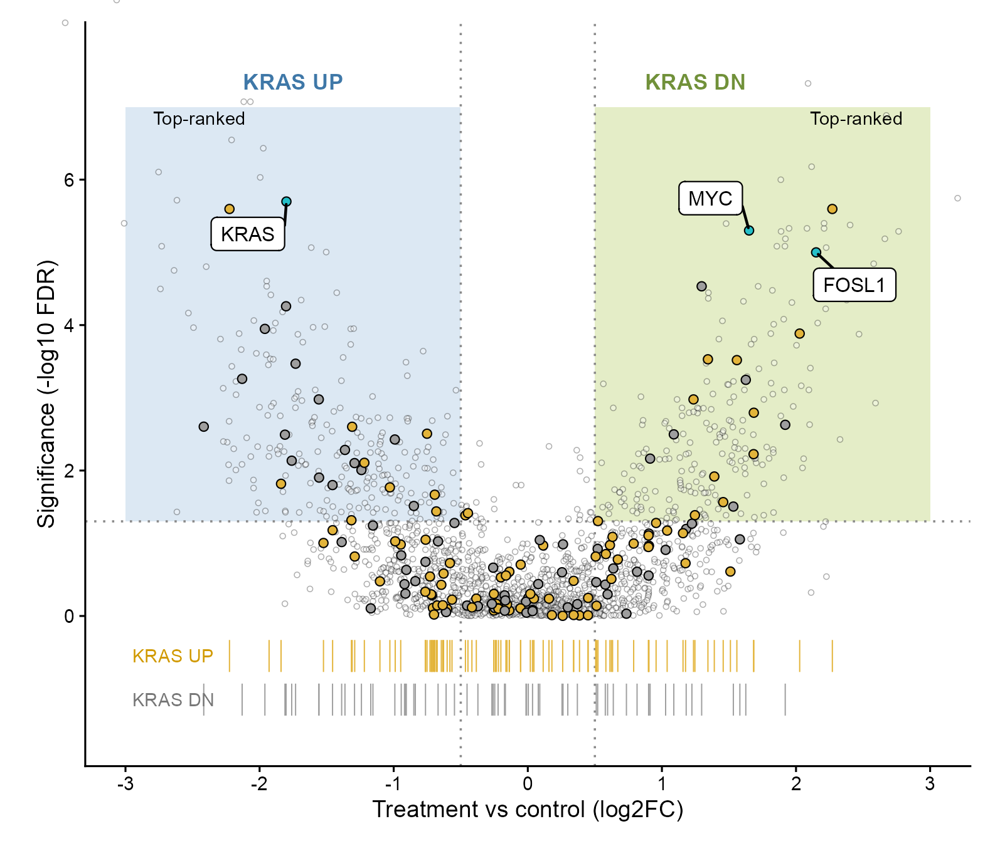
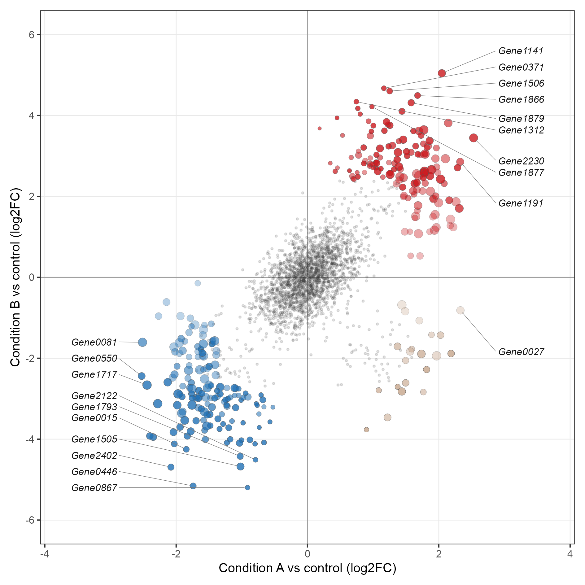
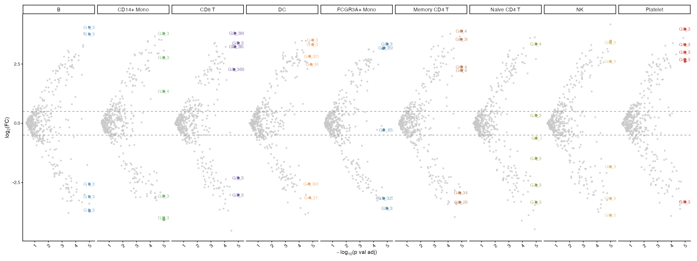
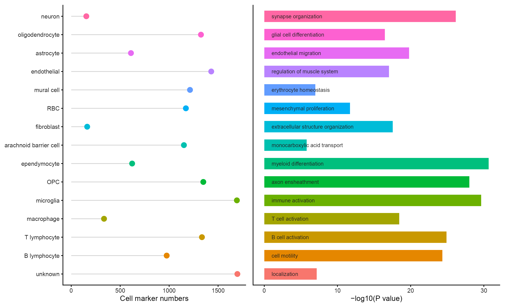
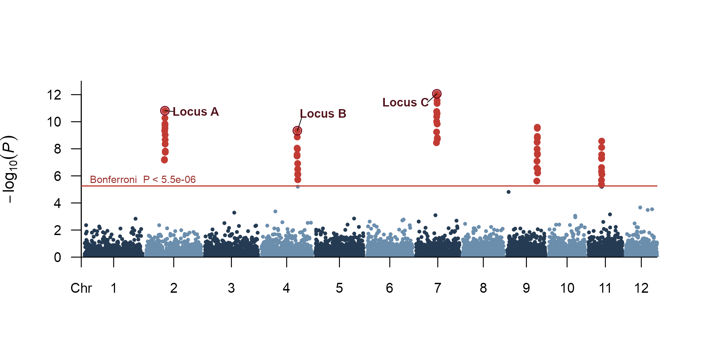

# 差异表达、富集与曼哈顿图 / Differential expression

[全部分类 / Categories](../GALLERY.md) · [首页 / Home](../../README.md) · [逐图清单 / Inventory](catalog.csv)

本类 **6 张代表图**，每个细分图型保留一例。

按图形结构与科研用途浏览，每个细分图型选一张代表图；点击图片下方的来源与代码，继续探索绘图过程。 Explore one example per visual subtype, with source and code links for a closer look at the workflow.

## BF-0018 · 火山图

基础火山绘图示例。

[原尺寸](../../docs/assets/gallery/template-volcano.png) · [脚本](../../biofigure/examples/gallery/generate_core_gallery.R) · [案例记录 / Details](catalog.csv)

## BF-0035 · 火山图与 GSEA 组合

火山与富集组合绘图示例。

[原尺寸](../../docs/assets/scidraw-gallery/06_volcano_gsea.png) · [脚本](../../biofigure/examples/scidraw-gallery/scripts/generate_six_scidraw.R) · [案例记录 / Details](catalog.csv)

## BF-0070 · 双条件 log2FC 比较

双条件效应比较绘图示例。

[原尺寸](../../docs/assets/archive-gallery/random-three/logfc.png) · [脚本](../../biofigure/examples/archive-gallery/random-three/scripts/draw_three.R) · [案例记录 / Details](catalog.csv)

## BF-0112 · 多细胞群火山图

多组火山绘图示例。

[原尺寸](../../docs/assets/archive-gallery/scidraw-001-065/39_multi_cell_volcano.png) · [脚本](../../biofigure/examples/archive-gallery/scidraw-001-065/scripts/render_cases_36_45.R) · [参考来源 / Reference](https://mp.weixin.qq.com/s/yeMUSZIac-nHXA-WY6P08Q) · [案例记录 / Details](catalog.csv)

## BF-0209 · 细胞比例棒棒糖与 GO 富集

棒棒糖与GO富集绘图示例。

[原尺寸](../../docs/assets/archive-gallery/full-reproduction/revision_v1_46_lollipop_go.png) · [脚本](../../biofigure/examples/archive-gallery/full-reproduction/scripts/batch41_50_reproduction.R) · [案例记录 / Details](catalog.csv)

## BF-0215 · 模拟 GWAS 曼哈顿图

GWAS曼哈顿绘图示例。

[原尺寸](../../docs/assets/archive-gallery/manhattan/manhattan_simulated.png) · [脚本](../../biofigure/examples/archive-gallery/manhattan/scripts/draw_manhattan.R) · [案例记录 / Details](catalog.csv)

[全部分类](../GALLERY.md) · [脚本存档说明](../../biofigure/examples/archive-gallery/README.md)
