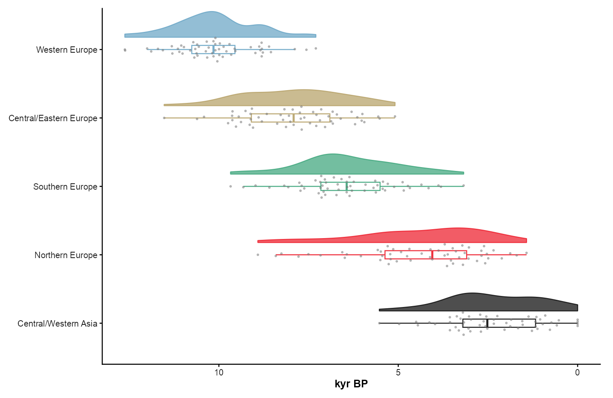
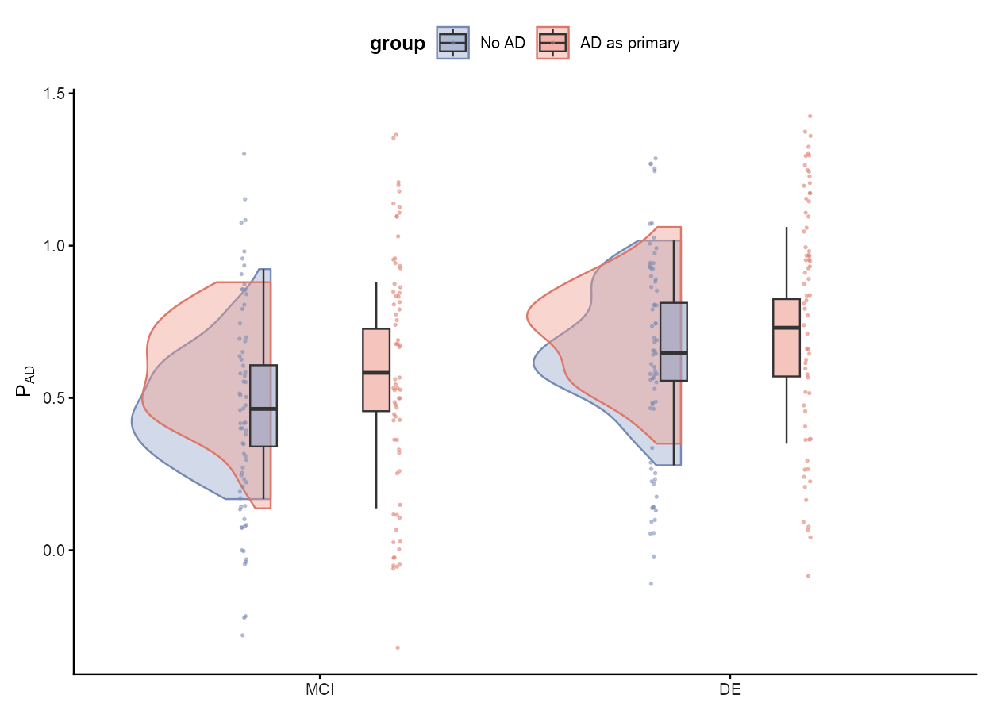
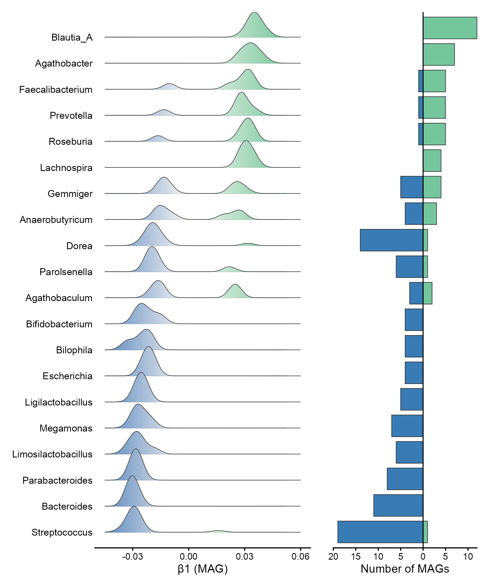
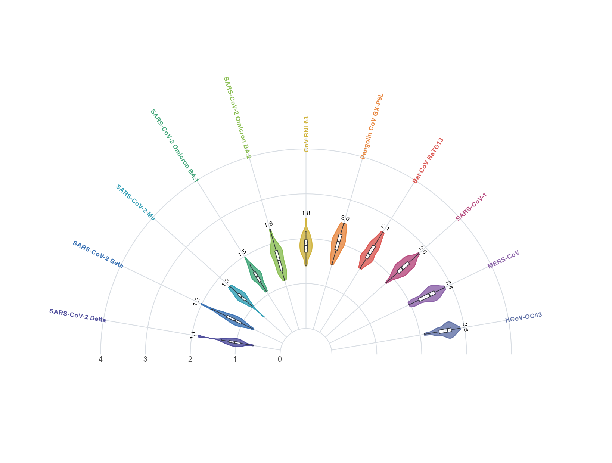
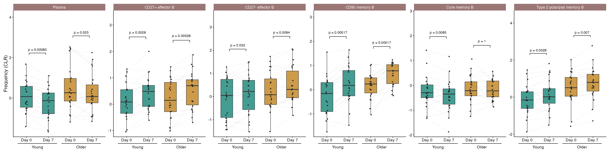

# 分布、箱线与小提琴 / Distributions

[全部分类 / Categories](../GALLERY.md) · [首页 / Home](../../README.md) · [逐图清单 / Inventory](catalog.csv)

本类 **5 张代表图**，每个细分图型保留一例。

按图形结构与科研用途浏览，每个细分图型选一张代表图；点击图片下方的来源与代码，继续探索绘图过程。 Explore one example per visual subtype, with source and code links for a closer look at the workflow.

## BF-0044 · 小提琴、箱线与蜂群点

小提琴与蜂群绘图示例。

[原尺寸](../../docs/assets/scidraw-gallery-batch2/07_violin_box_beeswarm.png) · [脚本](../../biofigure/examples/scidraw-gallery/scripts/generate_batch20.R) · [案例记录 / Details](catalog.csv)

## BF-0046 · 分组云雨图

云雨图绘图示例。

[原尺寸](../../docs/assets/scidraw-gallery-batch2/09_grouped_raincloud_gghalves.png) · [脚本](../../biofigure/examples/scidraw-gallery/scripts/generate_batch20.R) · [案例记录 / Details](catalog.csv)

## BF-0072 · 双向山脊分布

山脊分布绘图示例。

[原尺寸](../../docs/assets/archive-gallery/ridge-repaired-v2/scidraw_ridge_bipolar.png) · [脚本](../../biofigure/examples/archive-gallery/ridge-repaired-v2/scripts/render.R) · [案例记录 / Details](catalog.csv)

## BF-0084 · 半圆小提琴图

径向小提琴绘图示例。

[原尺寸](../../docs/assets/archive-gallery/scidraw-001-065/12_semicircle_violin.png) · [脚本](../../biofigure/examples/archive-gallery/scidraw-001-065/scripts/render_cases_10_14.R) · [参考来源 / Reference](https://mp.weixin.qq.com/s/cPBBUA1QLryNnMS554uCqw) · [案例记录 / Details](catalog.csv)

## BF-0106 · 分面配对箱线图

配对箱线绘图示例。

[原尺寸](../../docs/assets/archive-gallery/scidraw-001-065/33_faceted_paired_boxplot.png) · [脚本](../../biofigure/examples/archive-gallery/scidraw-001-065/scripts/render_cases_26_35.R) · [参考来源 / Reference](https://mp.weixin.qq.com/s/82Pmi41CjpUtQrm5Rvzezw) · [案例记录 / Details](catalog.csv)

[全部分类](../GALLERY.md) · [脚本存档说明](../../biofigure/examples/archive-gallery/README.md)
