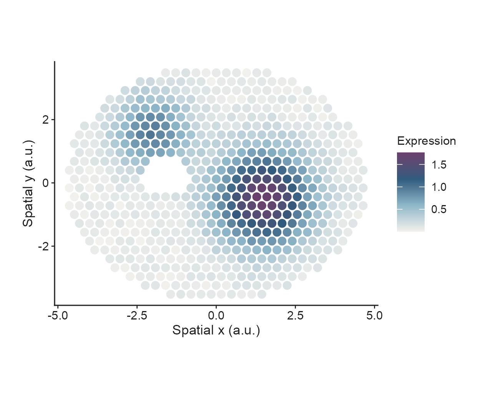
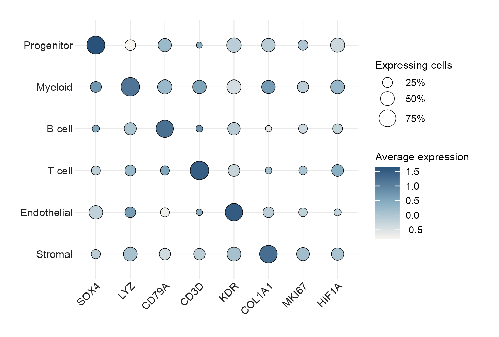
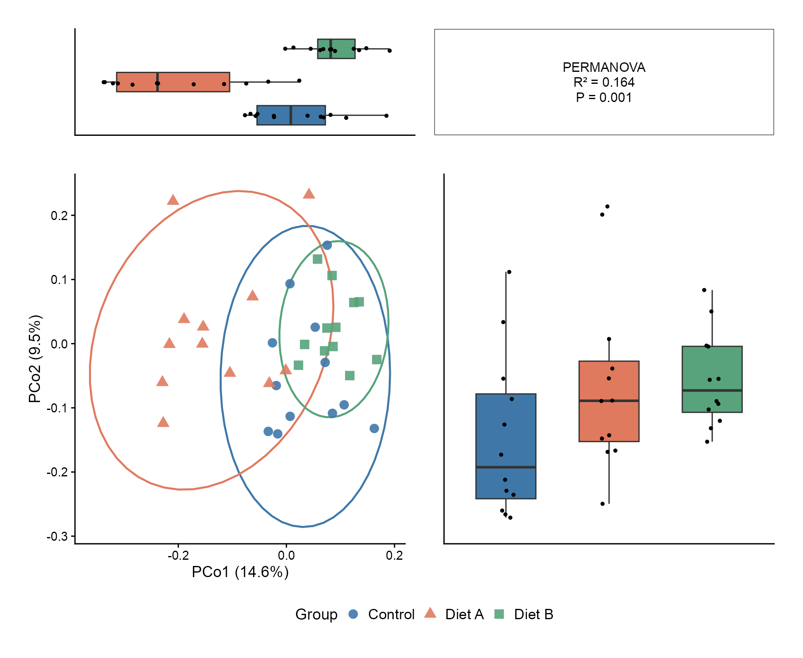
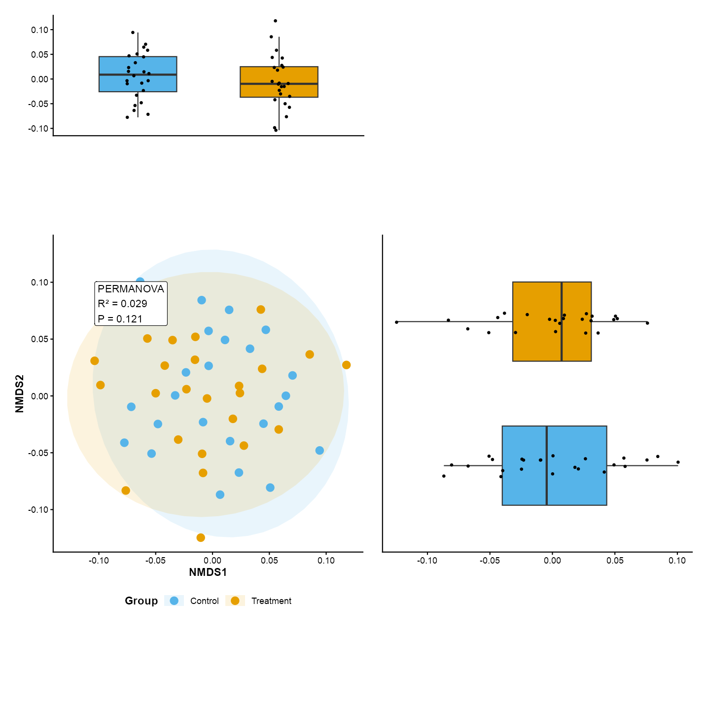
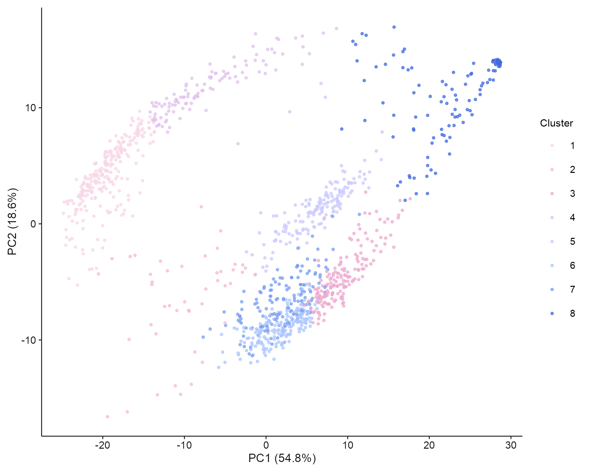
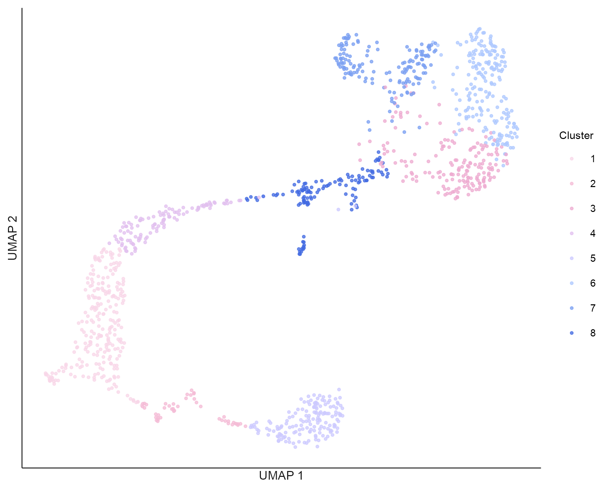

# 降维、单细胞与空间 / Embeddings and spatial plots

[全部分类 / Categories](../GALLERY.md) · [首页 / Home](../../README.md) · [逐图清单 / Inventory](catalog.csv)

本类 **6 张代表图**，每个细分图型保留一例。

按图形结构与科研用途浏览，每个细分图型选一张代表图；点击图片下方的来源与代码，继续探索绘图过程。 Explore one example per visual subtype, with source and code links for a closer look at the workflow.

## BF-0010 · 空间表达

空间表达绘图示例。

[原尺寸](../../docs/assets/gallery/domain-spatial-expression.png) · [脚本](../../biofigure/examples/gallery/generate_domain_gallery.R) · [案例记录 / Details](catalog.csv)

## BF-0017 · 单细胞标记基因气泡图

标记基因气泡绘图示例。

[原尺寸](../../docs/assets/gallery/template-single-cell-dotplot.png) · [脚本](../../biofigure/examples/gallery/generate_core_gallery.R) · [案例记录 / Details](catalog.csv)

## BF-0030 · PCoA 与边际分布

PCoA绘图示例。

[原尺寸](../../docs/assets/scidraw-gallery/01_pcoa_marginal.png) · [脚本](../../biofigure/examples/scidraw-gallery/scripts/generate_six_scidraw.R) · [案例记录 / Details](catalog.csv)

## BF-0073 · NMDS 与边缘箱线图

NMDS绘图示例。

[原尺寸](../../docs/assets/archive-gallery/scidraw-001-065/01_nmds_marginal_box.png) · [批次脚本](../../biofigure/examples/archive-gallery/scidraw-001-065/scripts) · [参考来源 / Reference](https://mp.weixin.qq.com/s/deuYTanHaDr6D8y3lKjW-Q) · [案例记录 / Details](catalog.csv)

## BF-0151 · PBMC：PCA

PCA：公开数据可视化示例。

[原尺寸](../../docs/assets/archive-gallery/public-omics/03_scrna_pca.png) · [脚本](../../biofigure/examples/archive-gallery/public-omics/scripts/analysis.R) · [案例记录 / Details](catalog.csv)

## BF-0152 · PBMC：UMAP

UMAP：公开数据可视化示例。

[原尺寸](../../docs/assets/archive-gallery/public-omics/04_scrna_umap.png) · [脚本](../../biofigure/examples/archive-gallery/public-omics/scripts/analysis.R) · [案例记录 / Details](catalog.csv)

[全部分类](../GALLERY.md) · [脚本存档说明](../../biofigure/examples/archive-gallery/README.md)
