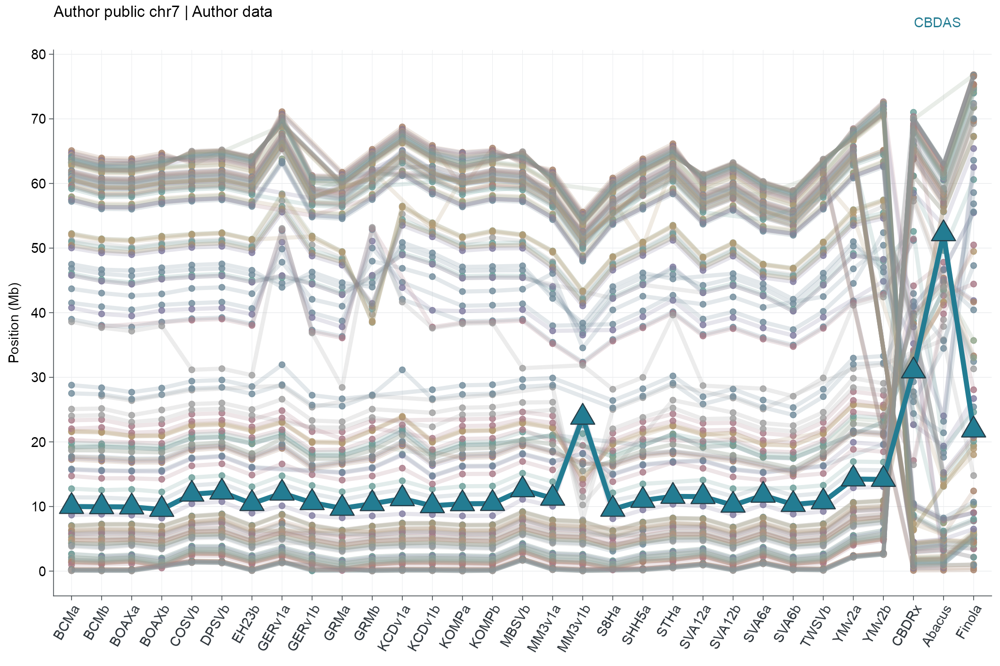
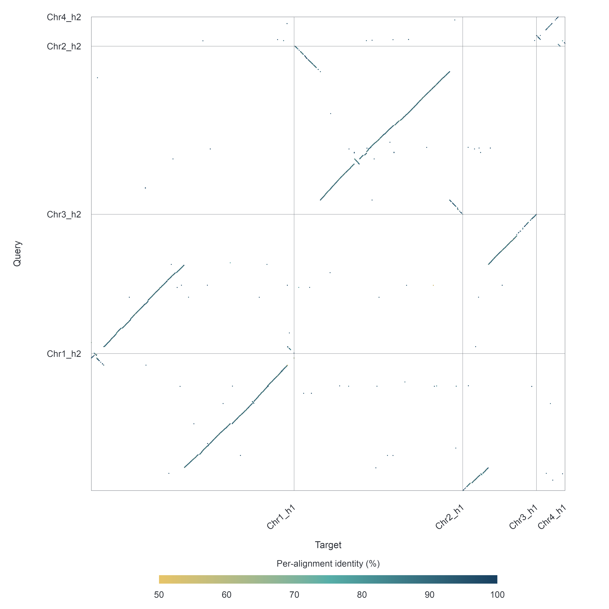

# 基因组、染色体与系统树 / Genomes and phylogeny

[全部分类 / Categories](../GALLERY.md) · [首页 / Home](../../README.md) · [逐图清单 / Inventory](catalog.csv)

本类 **11 张代表图**，每个细分图型保留一例。

按结构与用途选取代表图，去除同类配色、数据集及历史变体。数据来源逐图标注；收录不等于完整 CP 验收。 One representative per visual subtype; color-only, dataset-only and historical variants are omitted. Inclusion does not certify scientific fidelity.

## BF-0218 · 整条染色体 BUSCO 与 CBDAS 定位

图型：跨基因组BUSCO路径与基因位点。真实作者处理坐标；147个BUSCO、31个基因组、31个CBDAS位点。作者公开图重绘，正式补图编号未验证。

[原尺寸](../../docs/assets/genomics-gallery-20261011/cannabis-chr7.png) · [PDF](../../biofigure/examples/genomics-gallery-20261011/cannabis-chr7/results/figures/author-public-chr7-recolored.pdf) · [批次脚本](../../biofigure/examples/genomics-gallery-20261011/cannabis-chr7/scripts) · [绘图数据](../../biofigure/examples/genomics-gallery-20261011/cannabis-chr7/results/plot_data) · [来源与验证范围](../../biofigure/examples/genomics-gallery-20261011/cannabis-chr7/provenance.json) · [方法来源](https://www.nature.com/articles/s41586-025-09065-0) · [记录](catalog.csv)

## BF-0221 · Micro-C 联系矩阵与 loops

图型：染色质接触矩阵与环标记。真实作者book处理RDS；5kb、200bins、19667联系记录、31个可见环。原生HiContacts；仅对应book案例，正式论文面板未验证。

[原尺寸](../../docs/assets/genomics-gallery-20261011/ohca-microc.png) · [PDF](../../biofigure/examples/genomics-gallery-20261011/ohca-microc/results/figures/author-book-microc-loops-recolored.pdf) · [批次脚本](../../biofigure/examples/genomics-gallery-20261011/ohca-microc/scripts) · [绘图数据](../../biofigure/examples/genomics-gallery-20261011/ohca-microc/results/plot_data) · [来源与验证范围](../../biofigure/examples/genomics-gallery-20261011/ohca-microc/provenance.json) · [方法来源](https://www.nature.com/articles/s41467-024-44761-x) · [记录](catalog.csv)

## BF-0222 · 四染色体单倍型比对

图型：全基因组单倍型端点比对。真实作者已翻向、拼接的处理坐标；19637条比对、39274端点。保留作者4×4顺序和maxEnd边界，按单条比对identity换色；正式面板未验证。

[原尺寸](../../docs/assets/genomics-gallery-20261011/planarian-dotplot.png) · [PDF](../../biofigure/examples/genomics-gallery-20261011/planarian-dotplot/results/figures/planarian_haplotype_recolored.pdf) · [批次脚本](../../biofigure/examples/genomics-gallery-20261011/planarian-dotplot/scripts) · [绘图数据](../../biofigure/examples/genomics-gallery-20261011/planarian-dotplot/results/plot_data) · [来源与验证范围](../../biofigure/examples/genomics-gallery-20261011/planarian-dotplot/provenance.json) · [方法来源](https://www.nature.com/articles/s41467-026-74605-9) · [记录](catalog.csv)

页码：[1](genomes.md) · **2**

[全部分类](../GALLERY.md) · [脚本存档说明](../../biofigure/examples/archive-gallery/README.md)
