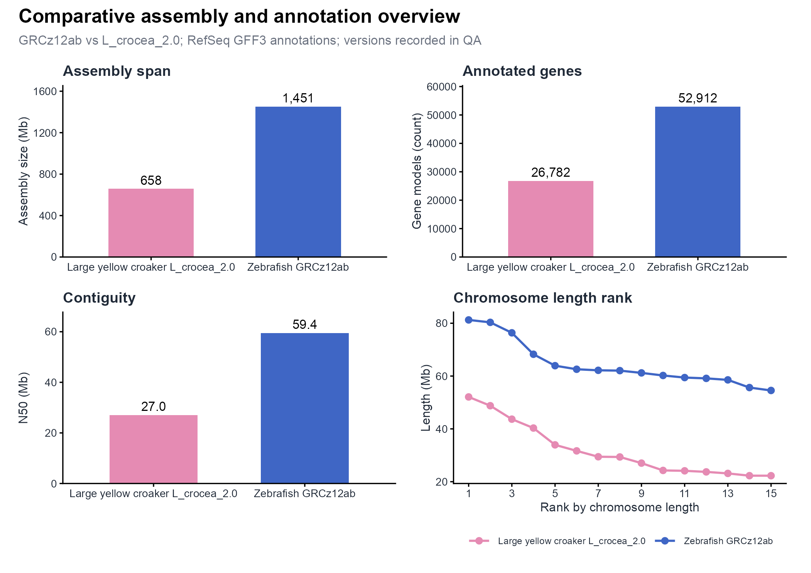
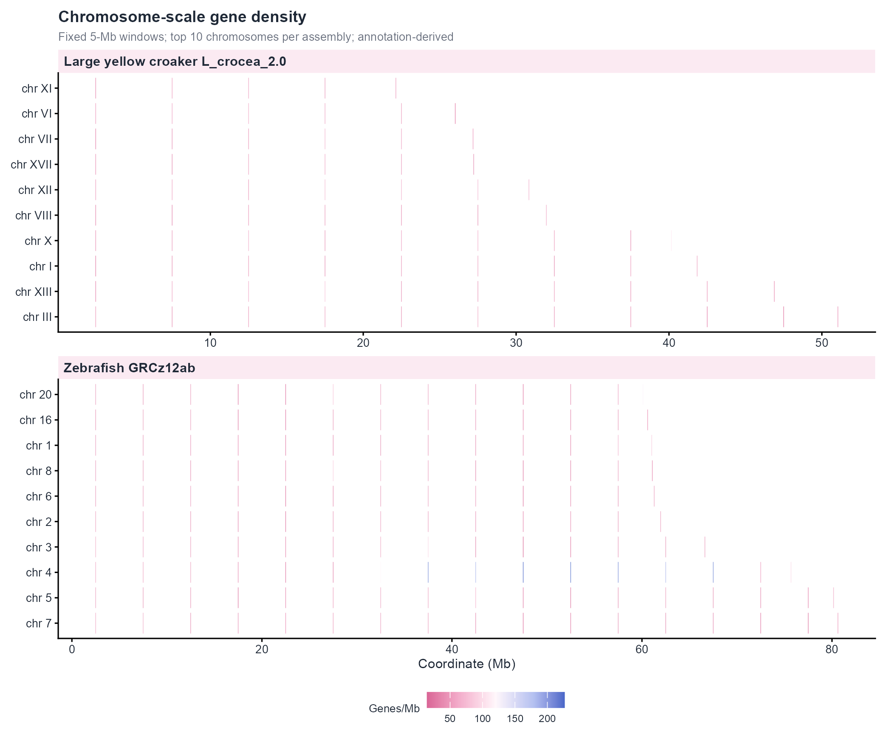
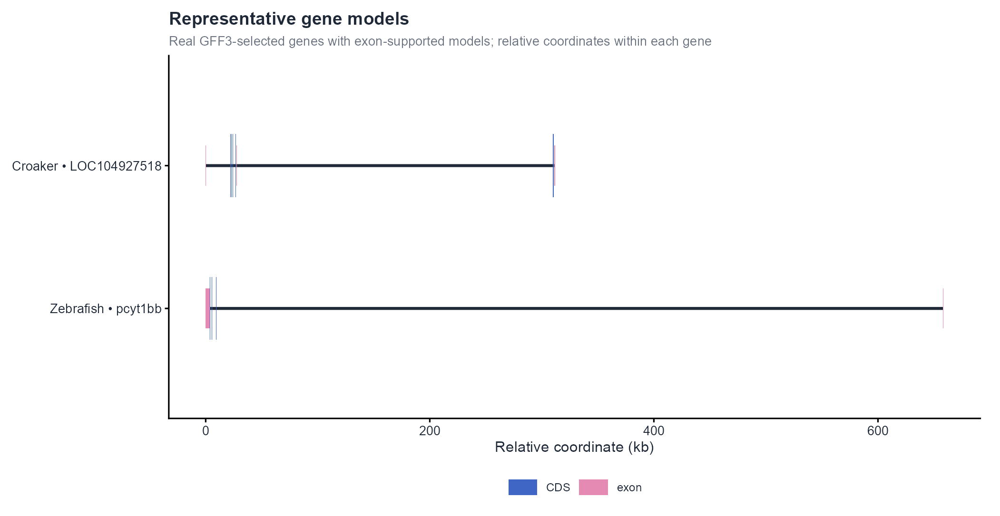

# 基因组、染色体与系统树 / Genomes and phylogeny

[全部分类 / Categories](../GALLERY.md) · [首页 / Home](../../README.md) · [逐图清单 / Inventory](catalog.csv)

本类 **11 张代表图**，每个细分图型保留一例。

按图形结构与科研用途浏览，每个细分图型选一张代表图；点击图片下方的来源与代码，继续探索绘图过程。 Explore one example per visual subtype, with source and code links for a closer look at the workflow.

## BF-0167 · 双物种组装与注释概览

组装注释概览：公开数据可视化示例。

[原尺寸](../../docs/assets/archive-gallery/comparative-genomics/01_assembly_annotation_overview.png) · [脚本](../../biofigure/examples/archive-gallery/comparative-genomics/scripts/analysis.R) · [案例记录 / Details](catalog.csv)

## BF-0168 · 染色体基因密度

基因密度：公开数据可视化示例。

[原尺寸](../../docs/assets/archive-gallery/comparative-genomics/02_chromosome_gene_density.png) · [脚本](../../biofigure/examples/archive-gallery/comparative-genomics/scripts/analysis.R) · [案例记录 / Details](catalog.csv)

## BF-0170 · 代表性基因结构示意

基因结构：公开数据可视化示例。

[原尺寸](../../docs/assets/archive-gallery/comparative-genomics/04_representative_gene_models.png) · [脚本](../../biofigure/examples/archive-gallery/comparative-genomics/scripts/analysis.R) · [案例记录 / Details](catalog.csv)

页码：[1](genomes.md) · **2**

[全部分类](../GALLERY.md) · [脚本存档说明](../../biofigure/examples/archive-gallery/README.md)
