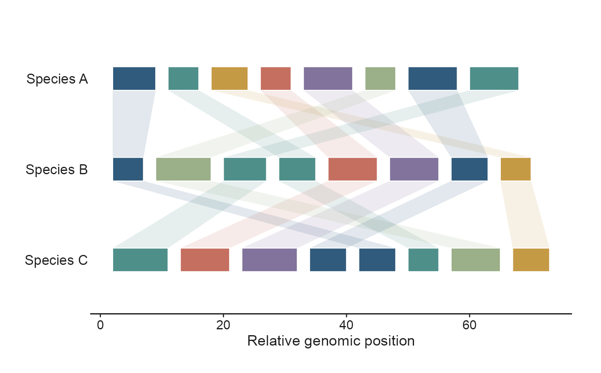
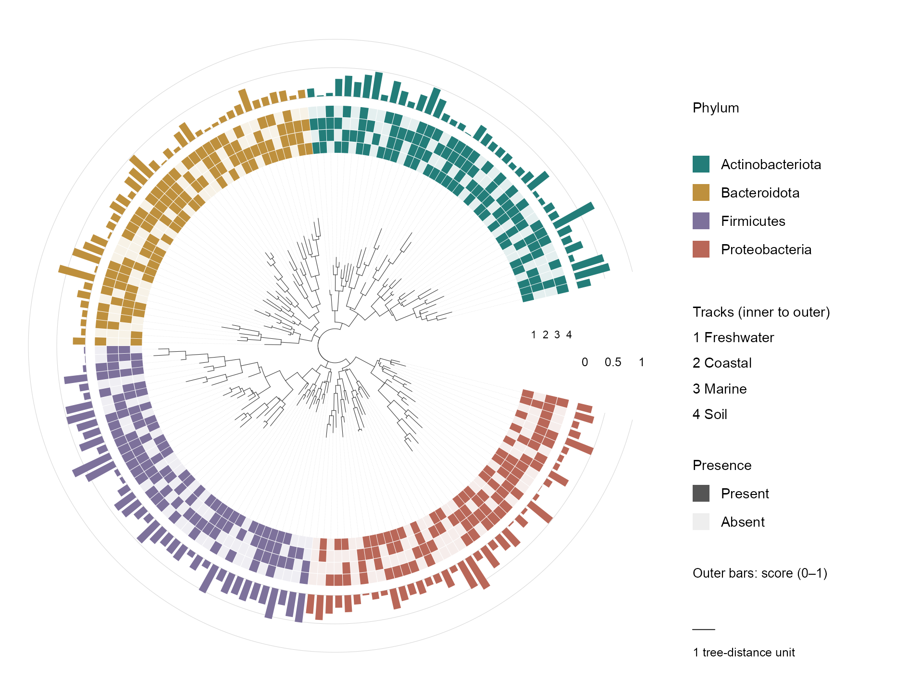
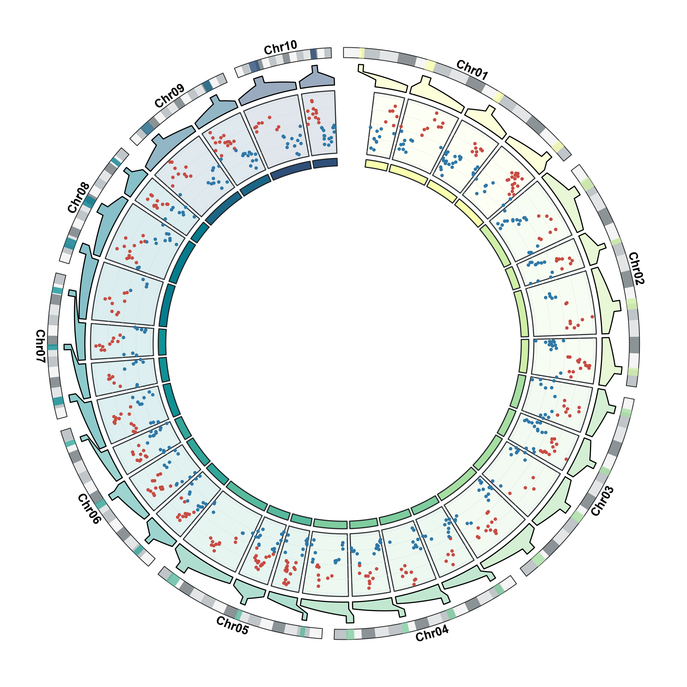
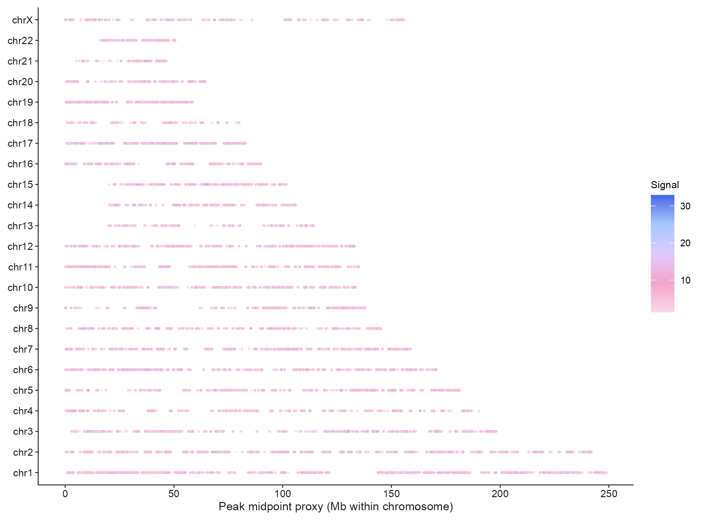

# 基因组、染色体与系统树 / Genomes and phylogeny

[全部分类 / Categories](../GALLERY.md) · [首页 / Home](../../README.md) · [逐图清单 / Inventory](catalog.csv)

本类 **11 张代表图**，每个细分图型保留一例。

按图形结构与科研用途浏览，每个细分图型选一张代表图；点击图片下方的来源与代码，继续探索绘图过程。 Explore one example per visual subtype, with source and code links for a closer look at the workflow.

## BF-0217 · BUSCO 锚定合酶区域对照

基于原作者公开处理数据重绘，展示 BUSCO 锚定的基因区域比较。

[原尺寸](../../docs/assets/genomics-gallery-20261011/cannabis-cassette.png) · [PDF](../../biofigure/examples/genomics-gallery-20261011/cannabis-cassette/results/figures/fig4d-author-recolored.pdf) · [批次脚本](../../biofigure/examples/genomics-gallery-20261011/cannabis-cassette/scripts) · [绘图数据](../../biofigure/examples/genomics-gallery-20261011/cannabis-cassette/results/plot_data) · [来源说明 / Source notes](../../biofigure/examples/genomics-gallery-20261011/cannabis-cassette/provenance.json) · [参考来源 / Reference](https://www.nature.com/articles/s41586-025-09065-0) · [案例记录 / Details](catalog.csv)

## BF-0218 · 整条染色体 BUSCO 与 CBDAS 定位

基于原作者公开处理坐标重绘，串联 BUSCO 路径与 CBDAS 位点。

[原尺寸](../../docs/assets/genomics-gallery-20261011/cannabis-chr7.png) · [PDF](../../biofigure/examples/genomics-gallery-20261011/cannabis-chr7/results/figures/author-public-chr7-recolored.pdf) · [批次脚本](../../biofigure/examples/genomics-gallery-20261011/cannabis-chr7/scripts) · [绘图数据](../../biofigure/examples/genomics-gallery-20261011/cannabis-chr7/results/plot_data) · [来源说明 / Source notes](../../biofigure/examples/genomics-gallery-20261011/cannabis-chr7/provenance.json) · [参考来源 / Reference](https://www.nature.com/articles/s41586-025-09065-0) · [案例记录 / Details](catalog.csv)

## BF-0221 · Micro-C 联系矩阵与 loops

OHCA 书籍案例重绘：Micro-C 接触矩阵与环标记。 A redraw of the OHCA book example: Micro-C contact matrix and loop annotations.

[原尺寸](../../docs/assets/genomics-gallery-20261011/ohca-microc.png) · [PDF](../../biofigure/examples/genomics-gallery-20261011/ohca-microc/results/figures/author-book-microc-loops-recolored.pdf) · [批次脚本](../../biofigure/examples/genomics-gallery-20261011/ohca-microc/scripts) · [绘图数据](../../biofigure/examples/genomics-gallery-20261011/ohca-microc/results/plot_data) · [来源说明 / Source notes](../../biofigure/examples/genomics-gallery-20261011/ohca-microc/provenance.json) · [参考来源 / Reference](https://js2264.github.io/OHCA/devel/pages/topological-features.html) · [案例记录 / Details](catalog.csv)

## BF-0222 · 四染色体单倍型比对

基于原作者公开处理坐标重绘，以四染色体单倍型点阵呈现序列比对关系。

[原尺寸](../../docs/assets/genomics-gallery-20261011/planarian-dotplot.png) · [PDF](../../biofigure/examples/genomics-gallery-20261011/planarian-dotplot/results/figures/planarian_haplotype_recolored.pdf) · [批次脚本](../../biofigure/examples/genomics-gallery-20261011/planarian-dotplot/scripts) · [绘图数据](../../biofigure/examples/genomics-gallery-20261011/planarian-dotplot/results/plot_data) · [来源说明 / Source notes](../../biofigure/examples/genomics-gallery-20261011/planarian-dotplot/provenance.json) · [参考来源 / Reference](https://www.nature.com/articles/s41467-026-74605-9) · [案例记录 / Details](catalog.csv)

## BF-0012 · 共线性示意

共线性绘图示例。

[原尺寸](../../docs/assets/gallery/domain-synteny.png) · [脚本](../../biofigure/examples/gallery/generate_domain_gallery.R) · [案例记录 / Details](catalog.csv)

## BF-0014 · 系统树与多轨注释

系统树与注释绘图示例。

[原尺寸](../../docs/assets/gallery/template-phylogeny-tracks.png) · [脚本](../../biofigure/examples/gallery/generate_advanced_gallery.R) · [案例记录 / Details](catalog.csv)

## BF-0019 · 嵌套染色体与区间分布

嵌套染色体绘图示例。

[原尺寸](../../docs/assets/genome-gallery/chromosome-distribution.png) · [脚本](../../biofigure/examples/genome-gallery/draw.R) · [案例记录 / Details](catalog.csv)

## BF-0156 · ATAC：染色体峰位置

染色体峰位置：公开数据可视化示例。

[原尺寸](../../docs/assets/archive-gallery/public-omics/08_atac_chromosome_peak_map.png) · [脚本](../../biofigure/examples/archive-gallery/public-omics/scripts/analysis.R) · [案例记录 / Details](catalog.csv)

页码：**1** · [2](genomes-2.md)

[全部分类](../GALLERY.md) · [脚本存档说明](../../biofigure/examples/archive-gallery/README.md)
