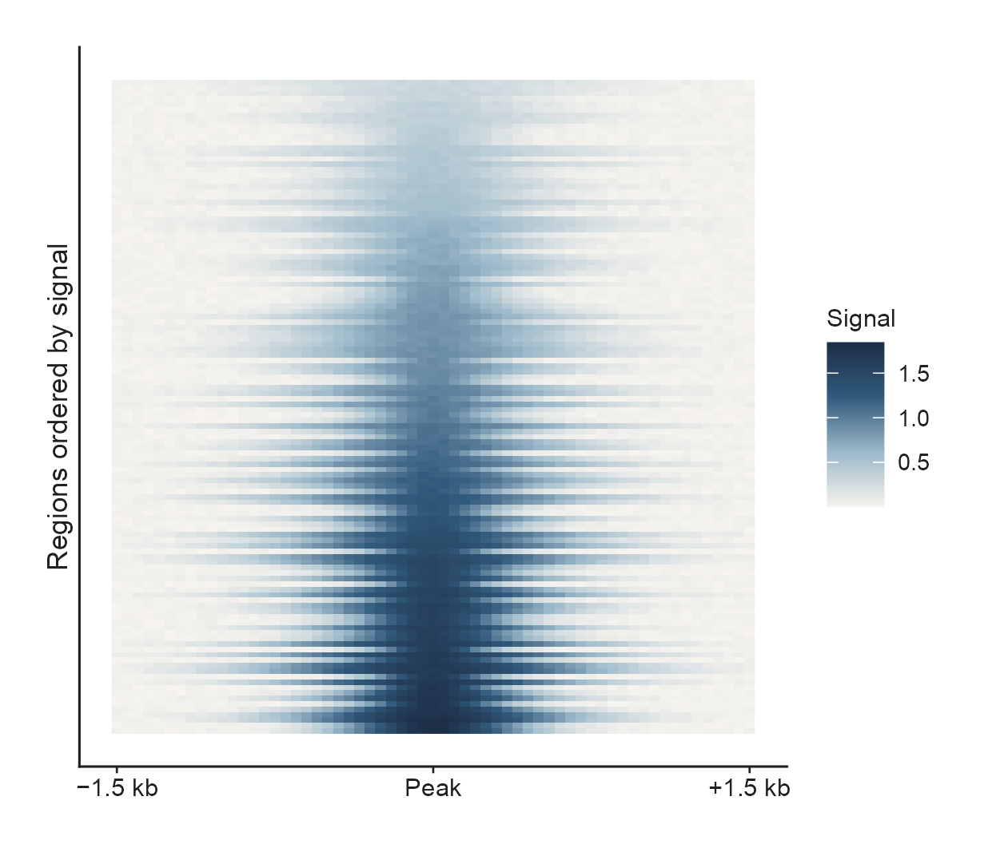
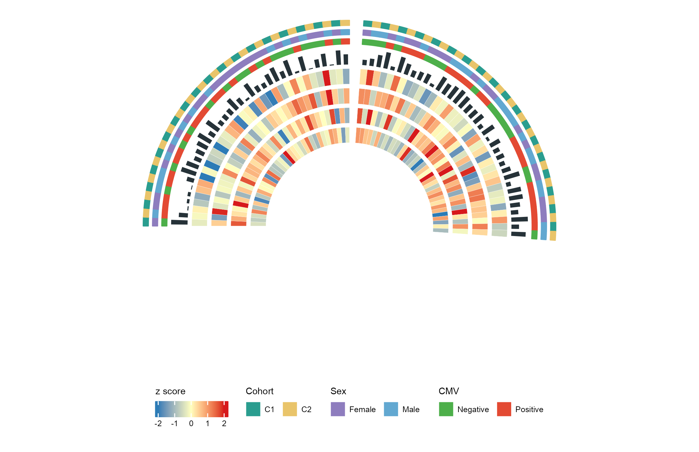
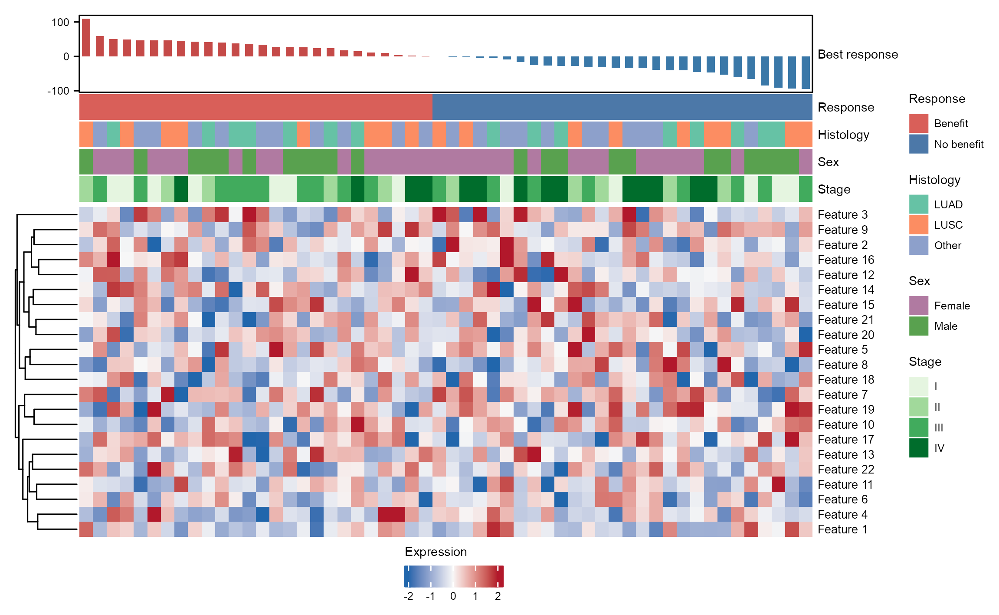
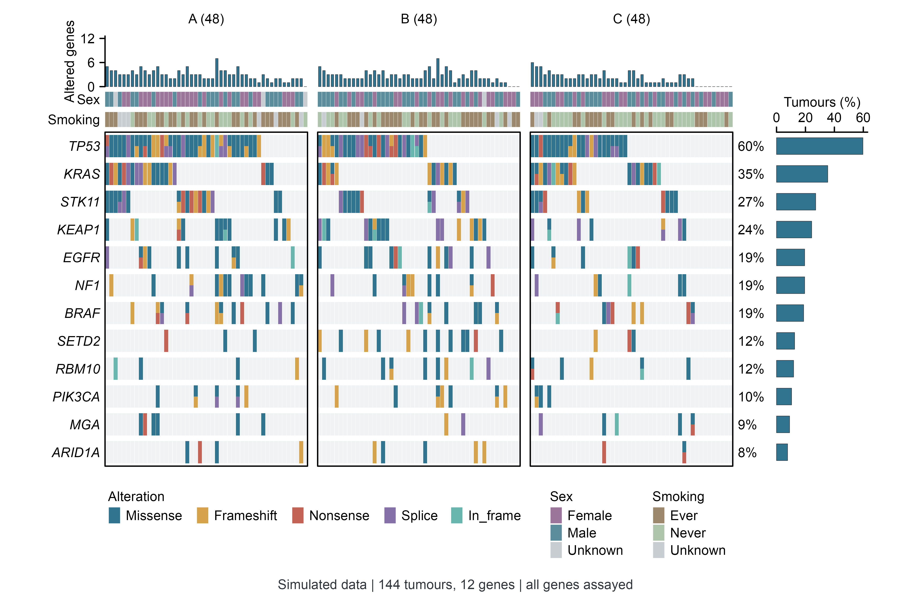
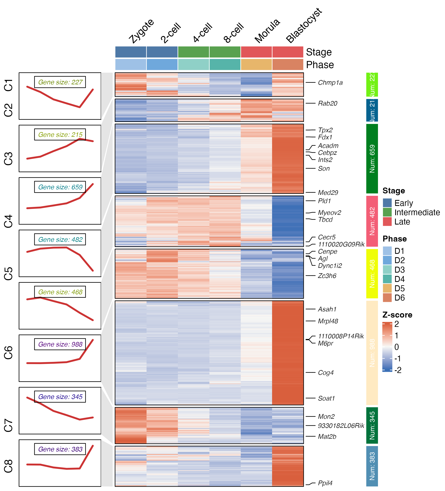

# 热图与矩阵注释 / Heatmaps

[全部分类 / Categories](../GALLERY.md) · [首页 / Home](../../README.md) · [逐图清单 / Inventory](catalog.csv)

本类 **6 张代表图**，每个细分图型保留一例。

按图形结构与科研用途浏览，每个细分图型选一张代表图；点击图片下方的来源与代码，继续探索绘图过程。 Explore one example per visual subtype, with source and code links for a closer look at the workflow.

## BF-0001 · 染色质信号热图

信号强度矩阵绘图示例。

[原尺寸](../../docs/assets/gallery/domain-chromatin-heatmap.png) · [脚本](../../biofigure/examples/gallery/generate_domain_gallery.R) · [案例记录 / Details](catalog.csv)

## BF-0023 · 半圆多轨热图

半圆多轨矩阵绘图示例。

[原尺寸](../../docs/assets/reproduction-gallery/figure_076_issue067_circlize_rainbow_heatmap.png) · [脚本](../../biofigure/examples/reproduction-gallery/generate_064_080_gallery.R) · [案例记录 / Details](catalog.csv)

## BF-0024 · 临床注释热图

临床注释矩阵绘图示例。

[原尺寸](../../docs/assets/reproduction-gallery/figure_077_issue068_clinical_heatmap.png) · [脚本](../../biofigure/examples/reproduction-gallery/generate_064_080_gallery.R) · [案例记录 / Details](catalog.csv)

## BF-0082 · 环形热图与 UpSet

环形热图与 UpSet 组合：在同一版面中连接多层注释、表达模式与集合交集。 Circular heatmap and UpSet: layered annotations, expression patterns and set intersections in one layout.

[原尺寸](../../docs/assets/archive-gallery/scidraw-001-065/10_circular_heatmap_upset.png) · [批次脚本](../../biofigure/examples/archive-gallery/scidraw-001-065/scripts) · [参考来源 / Reference](https://mp.weixin.qq.com/s/LuFxqYKavB5VvL3K_fDGVA) · [案例记录 / Details](catalog.csv)

## BF-0146 · OncoPrint 多事件突变景观

多事件突变景观示例：12 个基因、144 个样本，在三块对齐方格矩阵中呈现。

[原尺寸](../../docs/assets/archive-gallery/topjournal-001-010/08_oncoprint_landscape.png) · [PDF](../../biofigure/examples/genomics-gallery-20261011/oncoprint/results/figures/oncoprint-simulated.pdf) · [批次脚本](../../biofigure/examples/genomics-gallery-20261011/oncoprint/scripts) · [绘图数据](../../biofigure/examples/genomics-gallery-20261011/oncoprint/results/plot_data) · [来源说明 / Source notes](../../biofigure/examples/genomics-gallery-20261011/oncoprint/provenance.json) · [参考来源 / Reference](https://jokergoo.github.io/ComplexHeatmap-reference/book/oncoprint.html) · [案例记录 / Details](catalog.csv)

## BF-0178 · 聚类热图与行趋势

聚类矩阵与行趋势绘图示例。

[原尺寸](../../docs/assets/archive-gallery/topjournal-early/issue059_cluster_heatmap.png) · [脚本](../../biofigure/examples/archive-gallery/topjournal-early/scripts/issue059_cluster_heatmap_reproduction.R) · [案例记录 / Details](catalog.csv)

[全部分类](../GALLERY.md) · [脚本存档说明](../../biofigure/examples/archive-gallery/README.md)
