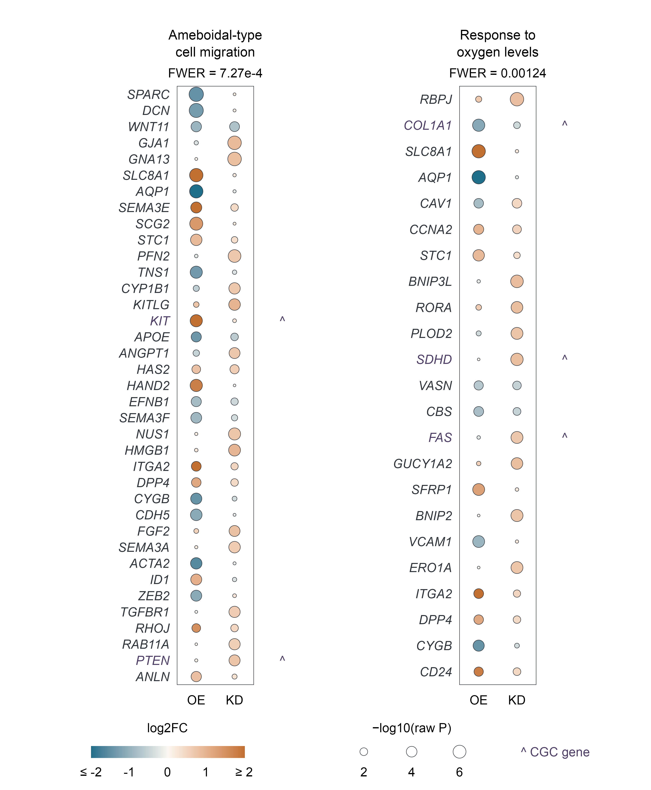

# 热图与矩阵注释 / Heatmaps

[全部分类 / Categories](../GALLERY.md) · [首页 / Home](../../README.md) · [逐图清单 / Inventory](catalog.csv)

本类 **7 张代表图**，每个细分图型保留一例。

按结构与用途选取代表图，去除同类配色、数据集及历史变体。数据来源逐图标注；收录不等于完整 CP 验收。 One representative per visual subtype; color-only, dataset-only and historical variants are omitted. Inclusion does not certify scientific fidelity.

## BF-0001 · 染色质信号热图

图型：信号强度矩阵。模拟数据／方法展示；非原论文数据复现。

[原尺寸](../../docs/assets/gallery/domain-chromatin-heatmap.png) · [脚本](../../biofigure/examples/gallery/generate_domain_gallery.R) · [记录](catalog.csv)

## BF-0023 · 半圆多轨热图

图型：半圆多轨矩阵。模拟数据／方法展示；非原论文数据复现。

[原尺寸](../../docs/assets/reproduction-gallery/figure_076_issue067_circlize_rainbow_heatmap.png) · [脚本](../../biofigure/examples/reproduction-gallery/generate_064_080_gallery.R) · [记录](catalog.csv)

## BF-0024 · 临床注释热图

图型：临床注释矩阵。模拟数据／方法展示；非原论文数据复现。

[原尺寸](../../docs/assets/reproduction-gallery/figure_077_issue068_clinical_heatmap.png) · [脚本](../../biofigure/examples/reproduction-gallery/generate_064_080_gallery.R) · [记录](catalog.csv)

## BF-0082 · 环形热图与 UpSet

图型：环形热图与交集。模拟数据／方法展示；非原论文数据复现。

[原尺寸](../../docs/assets/archive-gallery/scidraw-001-065/10_circular_heatmap_upset.png) · [批次脚本](../../biofigure/examples/archive-gallery/scidraw-001-065/scripts) · [方法来源](https://mp.weixin.qq.com/s/LuFxqYKavB5VvL3K_fDGVA) · [记录](catalog.csv)

## BF-0146 · OncoPrint 多事件突变景观

图型：OncoPrint。明确模拟144个肿瘤、12个基因；保留424事件、56多事件单元及13零事件样本。原生ComplexHeatmap，修正图例遮挡；频率分母固定144。

[原尺寸](../../docs/assets/archive-gallery/topjournal-001-010/08_oncoprint_landscape.png) · [PDF](../../biofigure/examples/genomics-gallery-20261011/oncoprint/results/figures/oncoprint-simulated.pdf) · [批次脚本](../../biofigure/examples/genomics-gallery-20261011/oncoprint/scripts) · [绘图数据](../../biofigure/examples/genomics-gallery-20261011/oncoprint/results/plot_data) · [来源与验证范围](../../biofigure/examples/genomics-gallery-20261011/oncoprint/provenance.json) · [方法来源](https://jokergoo.github.io/ComplexHeatmap-reference/book/oncoprint.html) · [记录](catalog.csv)

## BF-0178 · 聚类热图与行趋势

图型：聚类矩阵与行趋势。模拟数据／方法展示；非原论文数据复现。

[原尺寸](../../docs/assets/archive-gallery/topjournal-early/issue059_cluster_heatmap.png) · [脚本](../../biofigure/examples/archive-gallery/topjournal-early/scripts/issue059_cluster_heatmap_reproduction.R) · [记录](catalog.csv)

## BF-0219 · 双通路 OE/KD 气泡矩阵

图型：通路双矩阵基因气泡图。真实作者处理数据；37/23基因、120个单元。保留raw P与效应，通路标签为FWER；缺失原星号依据，未补造。

[原尺寸](../../docs/assets/genomics-gallery-20261011/dpm-bubbles.png) · [PDF](../../biofigure/examples/genomics-gallery-20261011/dpm-bubbles/results/figures/dpm_fig3f_recolored.pdf) · [批次脚本](../../biofigure/examples/genomics-gallery-20261011/dpm-bubbles/scripts) · [绘图数据](../../biofigure/examples/genomics-gallery-20261011/dpm-bubbles/results/plot_data) · [来源与验证范围](../../biofigure/examples/genomics-gallery-20261011/dpm-bubbles/provenance.json) · [方法来源](https://www.nature.com/articles/s41467-024-49986-4) · [记录](catalog.csv)

[全部分类](../GALLERY.md) · [脚本存档说明](../../biofigure/examples/archive-gallery/README.md)
