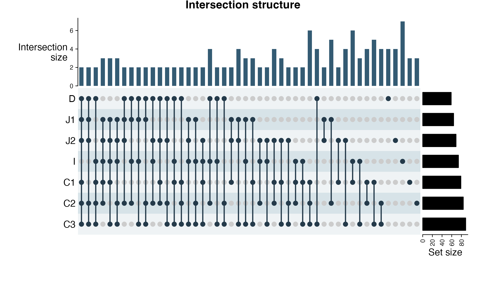
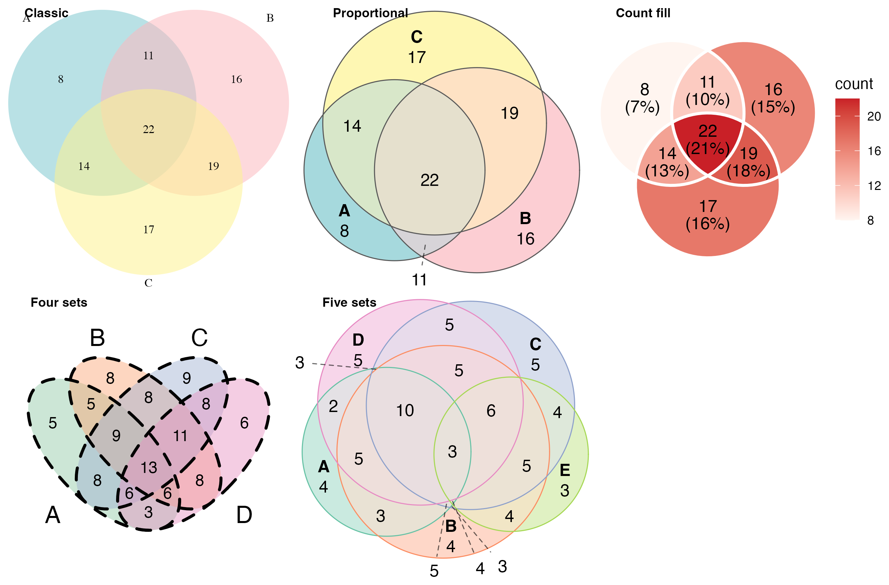

# 集合交叠与 UpSet / Set intersections

[全部分类 / Categories](../GALLERY.md) · [首页 / Home](../../README.md) · [逐图清单 / Inventory](catalog.csv)

本类 **2 张代表图**，每个细分图型保留一例。

按图形结构与科研用途浏览，每个细分图型选一张代表图；点击图片下方的来源与代码，继续探索绘图过程。 Explore one example per visual subtype, with source and code links for a closer look at the workflow.

## BF-0175 · 基因集合 UpSet

UpSet绘图示例。

[原尺寸](../../docs/assets/archive-gallery/topjournal-early/issue025_upset.png) · [脚本](../../biofigure/examples/archive-gallery/topjournal-early/scripts/issue025_chord_upset_reproduction.R) · [案例记录 / Details](catalog.csv)

## BF-0212 · 多种 Venn 图布局

Venn绘图示例。

[原尺寸](../../docs/assets/archive-gallery/full-reproduction/revision_v1_49_venn_gallery.png) · [脚本](../../biofigure/examples/archive-gallery/full-reproduction/scripts/batch41_50_reproduction.R) · [案例记录 / Details](catalog.csv)

[全部分类](../GALLERY.md) · [脚本存档说明](../../biofigure/examples/archive-gallery/README.md)
