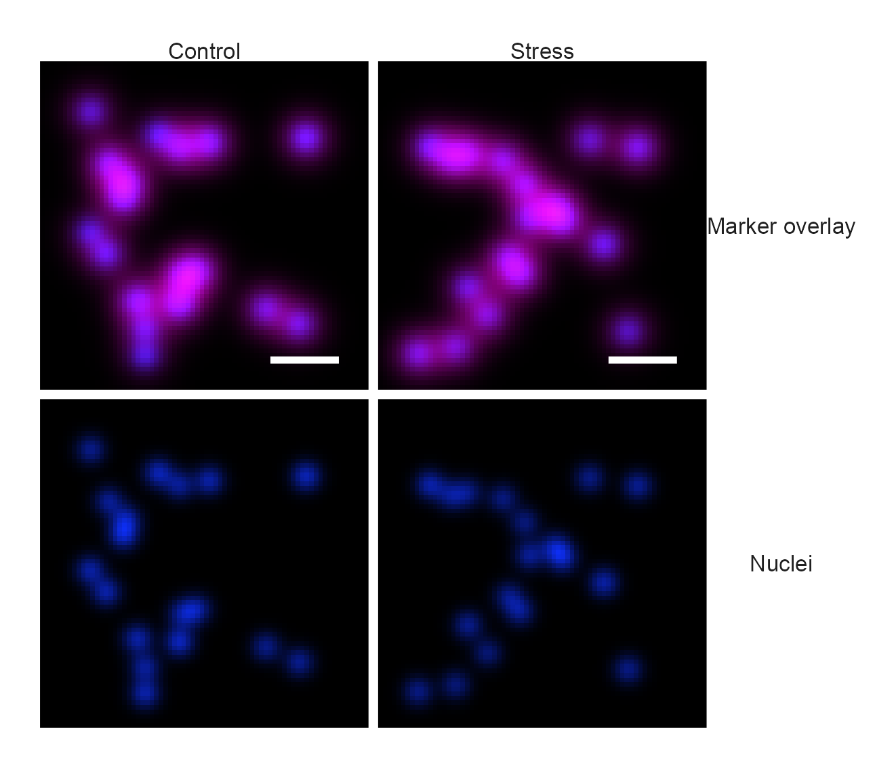
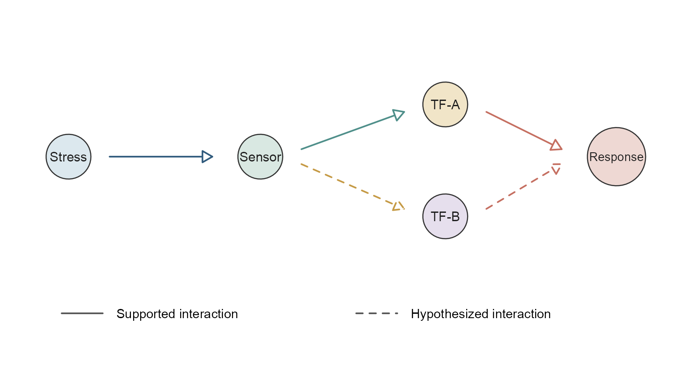
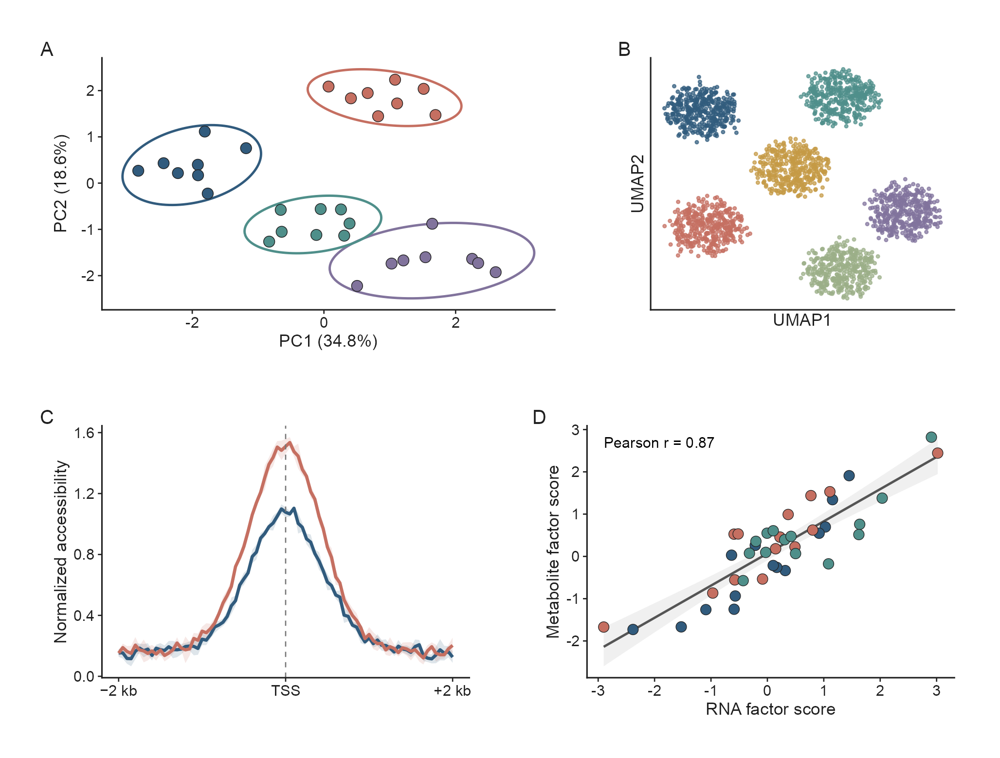

# 机制、图像与多面板 / Mechanisms and panels

[全部分类 / Categories](../GALLERY.md) · [首页 / Home](../../README.md) · [逐图清单 / Inventory](catalog.csv)

本类 **3 张代表图**，每个细分图型保留一例。

按图形结构与科研用途浏览，每个细分图型选一张代表图；点击图片下方的来源与代码，继续探索绘图过程。 Explore one example per visual subtype, with source and code links for a closer look at the workflow.

## BF-0003 · 图像实验板示意

图像实验板绘图示例。

[原尺寸](../../docs/assets/gallery/domain-imaging-assay.png) · [脚本](../../biofigure/examples/gallery/generate_domain_gallery.R) · [案例记录 / Details](catalog.csv)

## BF-0004 · 机制关系示意

机制关系绘图示例。

[原尺寸](../../docs/assets/gallery/domain-mechanism.png) · [脚本](../../biofigure/examples/gallery/generate_domain_gallery.R) · [案例记录 / Details](catalog.csv)

## BF-0008 · 多面板证据组合

综合证据面板绘图示例。

[原尺寸](../../docs/assets/gallery/domain-multipanel-evidence.png) · [脚本](../../biofigure/examples/gallery/generate_domain_gallery.R) · [案例记录 / Details](catalog.csv)

[全部分类](../GALLERY.md) · [脚本存档说明](../../biofigure/examples/archive-gallery/README.md)
