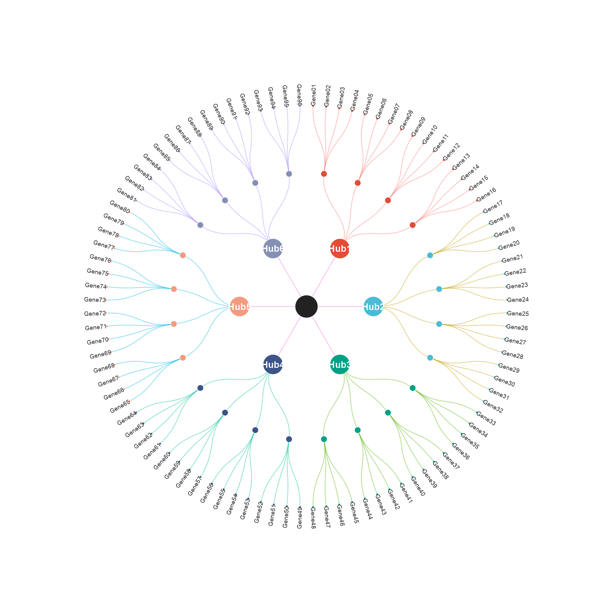
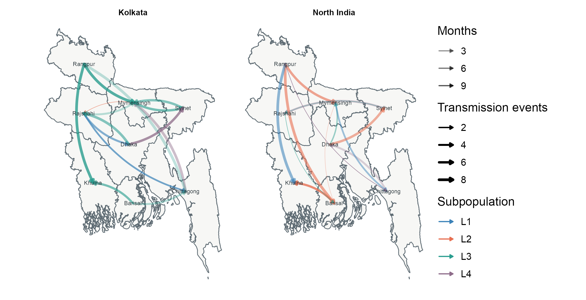
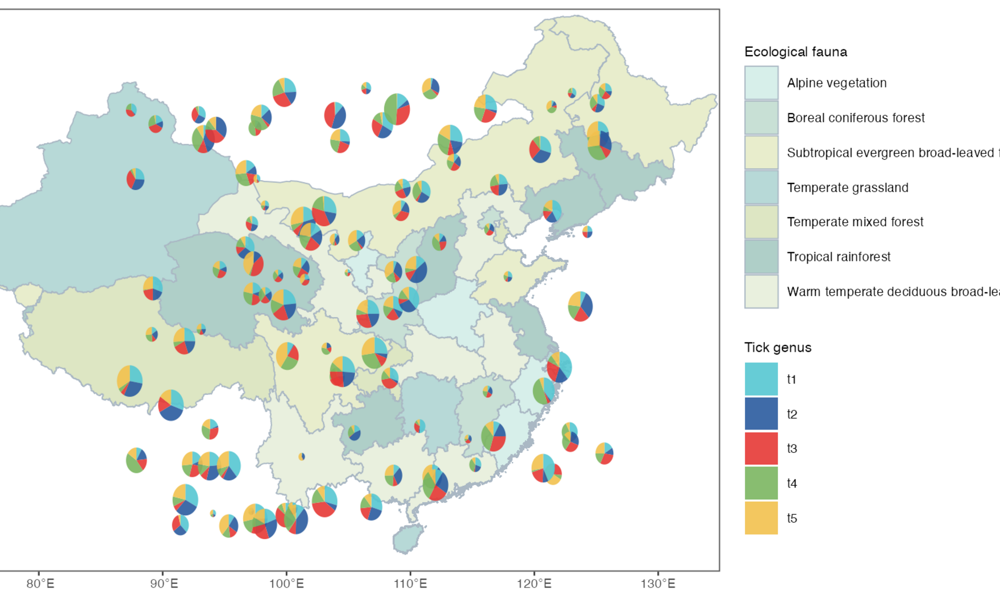
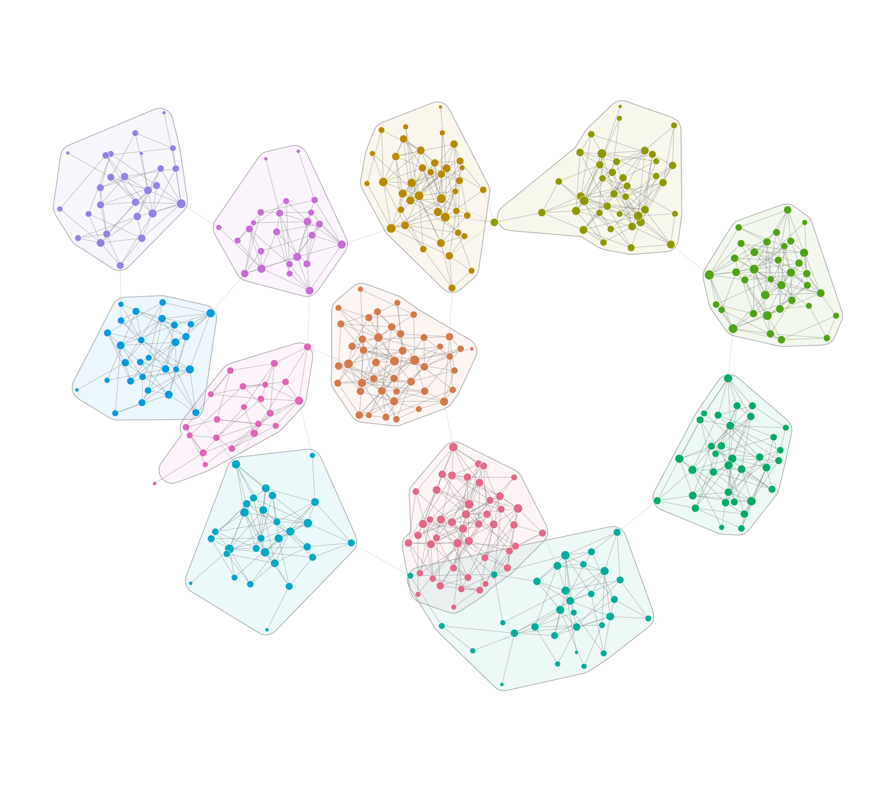

# 网络与地图 / Networks and maps

[全部分类 / Categories](../GALLERY.md) · [首页 / Home](../../README.md) · [逐图清单 / Inventory](catalog.csv)

本类 **5 张代表图**，每个细分图型保留一例。

按图形结构与科研用途浏览，每个细分图型选一张代表图；点击图片下方的来源与代码，继续探索绘图过程。 Explore one example per visual subtype, with source and code links for a closer look at the workflow.

## BF-0027 · 花瓣式层级网络

层级网络绘图示例。

[原尺寸](../../docs/assets/reproduction-gallery/figure_086_issue074_petal_network.png) · [脚本](../../biofigure/examples/reproduction-gallery/generate_064_080_gallery.R) · [案例记录 / Details](catalog.csv)

## BF-0029 · 地理流向地图

地理流向绘图示例。

[原尺寸](../../docs/assets/reproduction-gallery/figure_090_issue080_flow_map.png) · [脚本](../../biofigure/examples/reproduction-gallery/generate_064_080_gallery.R) · [案例记录 / Details](catalog.csv)

## BF-0055 · 相关网络与矩阵组合

相关矩阵与 Mantel 网络 · vegan 示例数据 / Correlation matrix and Mantel network · vegan example data。

[原尺寸](../../docs/assets/scidraw-gallery-batch2/18_linket_correlation_network.png) · [脚本](../../biofigure/examples/scidraw-gallery/scripts/generate_batch20.R) · [示例数据 / Example data](https://github.com/vegandevs/vegan/blob/master/man/varechem.Rd) · [案例记录 / Details](catalog.csv)

## BF-0132 · 中国地图与散点饼图

以 GADM 边界为底图，组合模拟采样点与组成饼图。

[原尺寸](../../docs/assets/archive-gallery/scidraw-001-065/59_china_scatterpie.png) · [脚本](../../biofigure/examples/archive-gallery/scidraw-001-065/scripts/render_cases_56_65.R) · [参考来源 / Reference](https://mp.weixin.qq.com/s/a8-pyP8L9KdE32l1gTnlpw) · [案例记录 / Details](catalog.csv)

## BF-0182 · 细胞簇网络

簇网络绘图示例。

[原尺寸](../../docs/assets/archive-gallery/full-reproduction/figure_055_cluster_network_code_driven.png) · [脚本](../../biofigure/examples/archive-gallery/full-reproduction/scripts/non_single_cell_055_069.R) · [案例记录 / Details](catalog.csv)

[全部分类](../GALLERY.md) · [脚本存档说明](../../biofigure/examples/archive-gallery/README.md)
