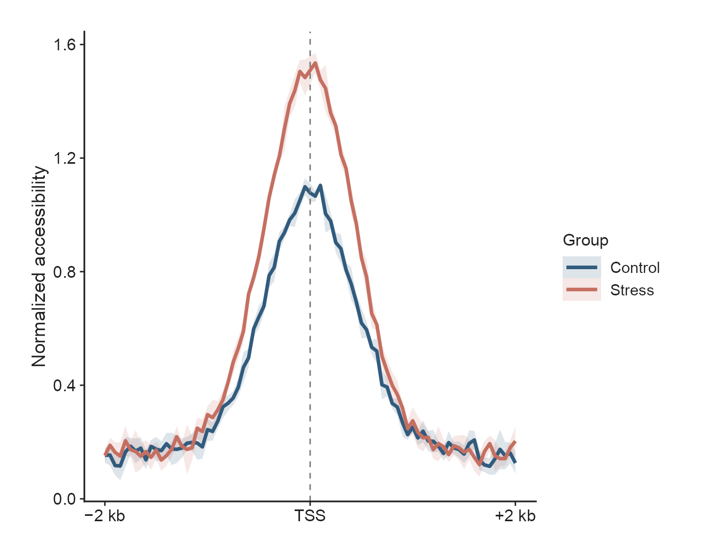
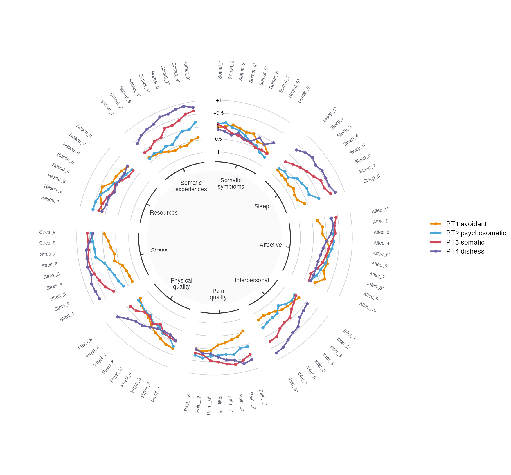
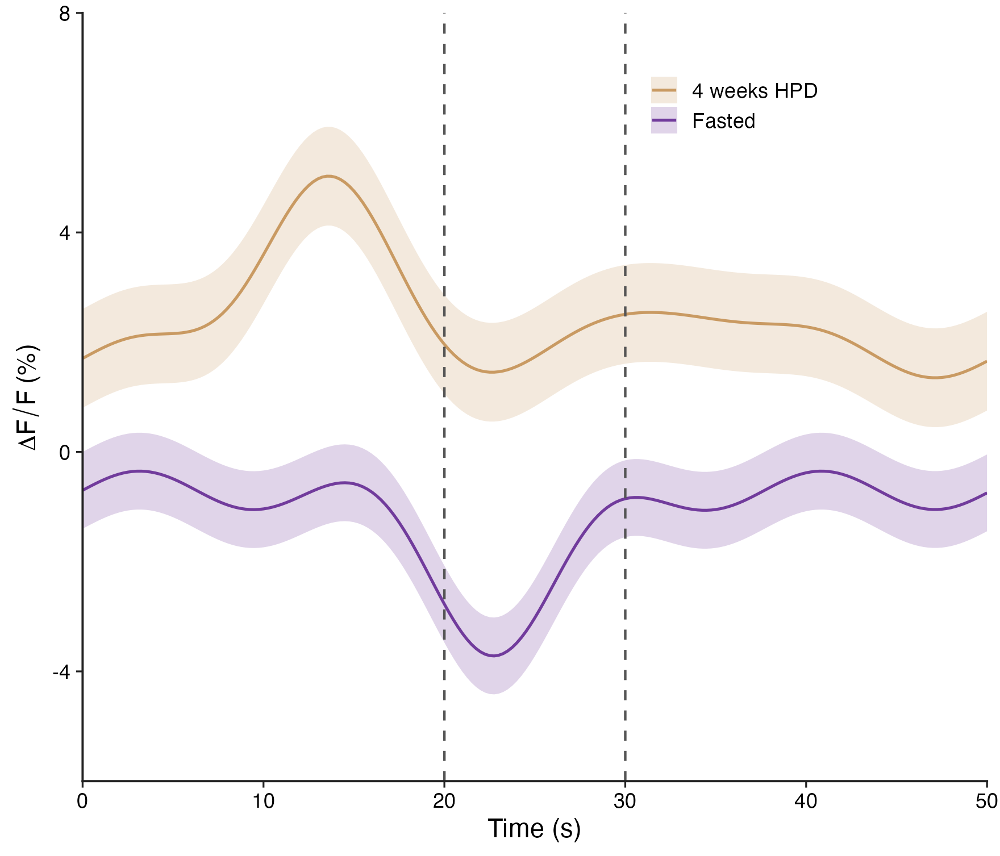
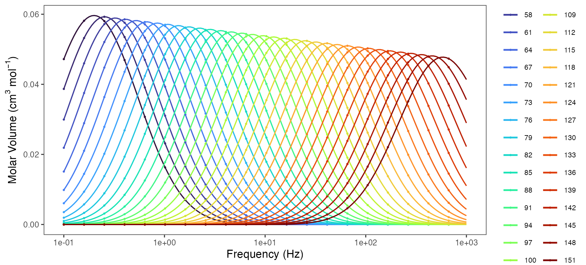
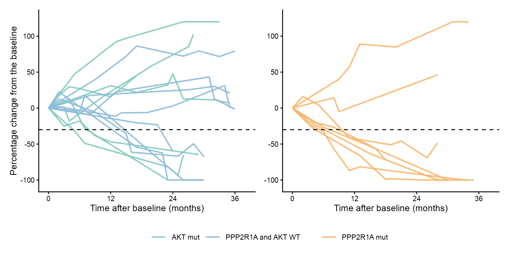

# 时序、曲线与信号 / Time courses and profiles

[全部分类 / Categories](../GALLERY.md) · [首页 / Home](../../README.md) · [逐图清单 / Inventory](catalog.csv)

本类 **5 张代表图**，每个细分图型保留一例。

按图形结构与科研用途浏览，每个细分图型选一张代表图；点击图片下方的来源与代码，继续探索绘图过程。 Explore one example per visual subtype, with source and code links for a closer look at the workflow.

## BF-0002 · 染色质信号曲线

染色质信号绘图示例。

[原尺寸](../../docs/assets/gallery/domain-chromatin-profile.png) · [脚本](../../biofigure/examples/gallery/generate_domain_gallery.R) · [案例记录 / Details](catalog.csv)

## BF-0086 · 环形分组曲线

环形曲线绘图示例。

[原尺寸](../../docs/assets/archive-gallery/scidraw-001-065/14_circular_grouped_profiles.png) · [脚本](../../biofigure/examples/archive-gallery/scidraw-001-065/scripts/render_cases_10_14.R) · [参考来源 / Reference](https://mp.weixin.qq.com/s/u8IgzYxdRHu8xwnnlvgawQ) · [案例记录 / Details](catalog.csv)

## BF-0129 · 分组时序与误差带

时序与误差带绘图示例。

[原尺寸](../../docs/assets/archive-gallery/scidraw-001-065/56_timeseries_ribbon.png) · [脚本](../../biofigure/examples/archive-gallery/scidraw-001-065/scripts/render_cases_56_65.R) · [参考来源 / Reference](https://mp.weixin.qq.com/s/mAOgsMJJJnHVHHMteS5O_A) · [案例记录 / Details](catalog.csv)

## BF-0138 · 多条件对数频率曲线

对数频率曲线绘图示例。

[原尺寸](../../docs/assets/archive-gallery/scidraw-001-065/65_log_frequency_curves.png) · [脚本](../../biofigure/examples/archive-gallery/scidraw-001-065/scripts/render_cases_56_65.R) · [参考来源 / Reference](https://mp.weixin.qq.com/s/vejTfuLTdhn-3qG8RSal5A) · [案例记录 / Details](catalog.csv)

## BF-0184 · 个体肿瘤变化蜘蛛图

个体蜘蛛轨迹绘图示例。

[原尺寸](../../docs/assets/archive-gallery/full-reproduction/figure_059_spider_code_driven.png) · [脚本](../../biofigure/examples/archive-gallery/full-reproduction/scripts/non_single_cell_055_069.R) · [案例记录 / Details](catalog.csv)

[全部分类](../GALLERY.md) · [脚本存档说明](../../biofigure/examples/archive-gallery/README.md)
