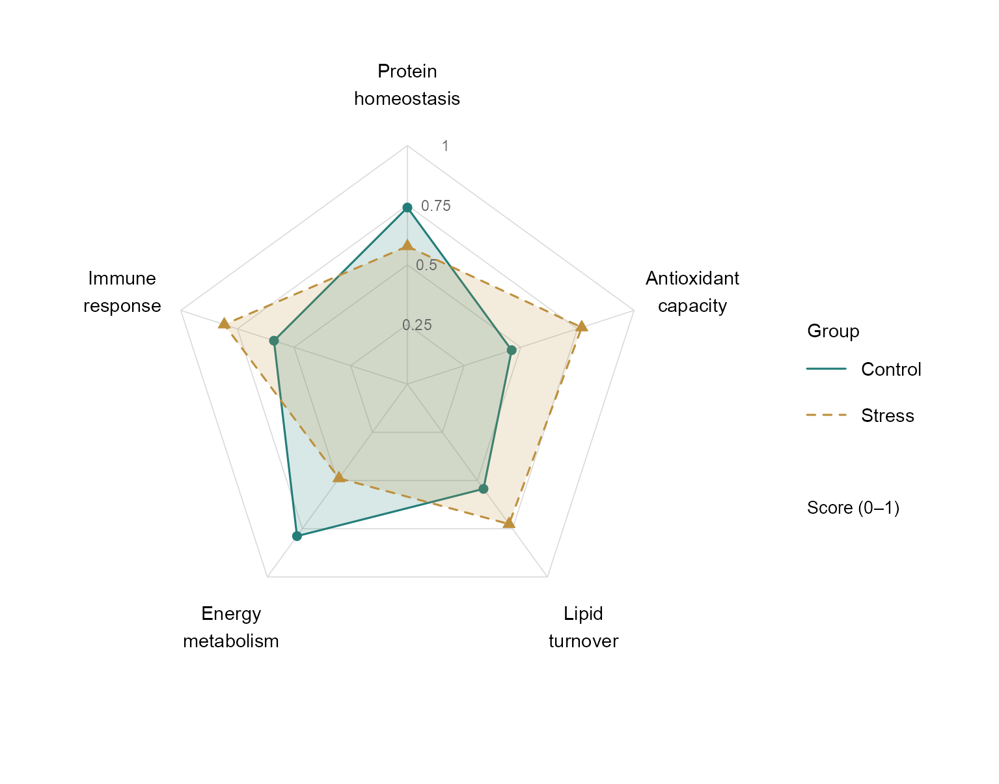
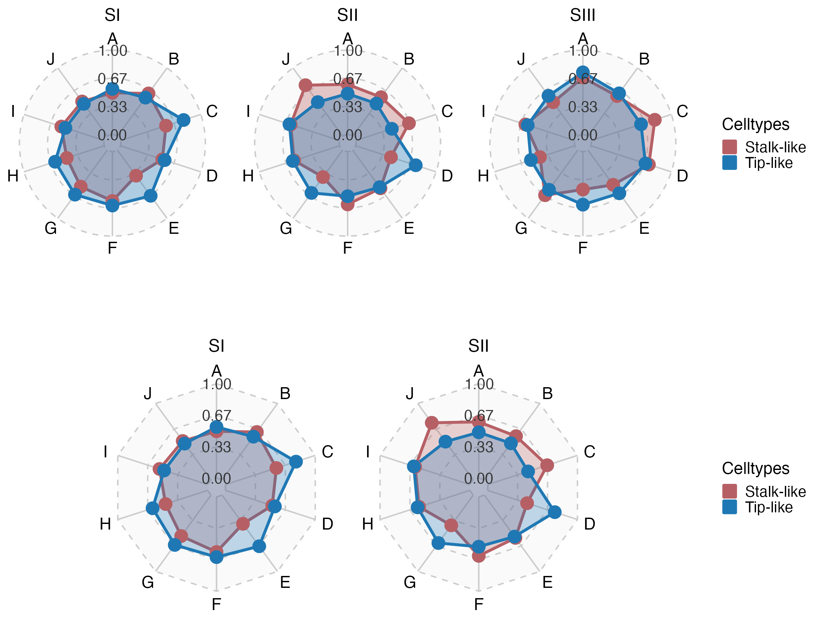

# 雷达与多指标比较 / Radar plots

[全部分类 / Categories](../GALLERY.md) · [首页 / Home](../../README.md) · [逐图清单 / Inventory](catalog.csv)

本类 **2 张代表图**，每个细分图型保留一例。

按图形结构与科研用途浏览，每个细分图型选一张代表图；点击图片下方的来源与代码，继续探索绘图过程。 Explore one example per visual subtype, with source and code links for a closer look at the workflow.

## BF-0015 · 多指标雷达图

单面板雷达绘图示例。

[原尺寸](../../docs/assets/gallery/template-radar.png) · [脚本](../../biofigure/examples/gallery/generate_advanced_gallery.R) · [案例记录 / Details](catalog.csv)

## BF-0213 · 分面雷达蜘蛛图

分面雷达绘图示例。

[原尺寸](../../docs/assets/archive-gallery/full-reproduction/revision_v1_50_radar_spider.png) · [脚本](../../biofigure/examples/archive-gallery/full-reproduction/scripts/batch41_50_reproduction.R) · [案例记录 / Details](catalog.csv)

[全部分类](../GALLERY.md) · [脚本存档说明](../../biofigure/examples/archive-gallery/README.md)
